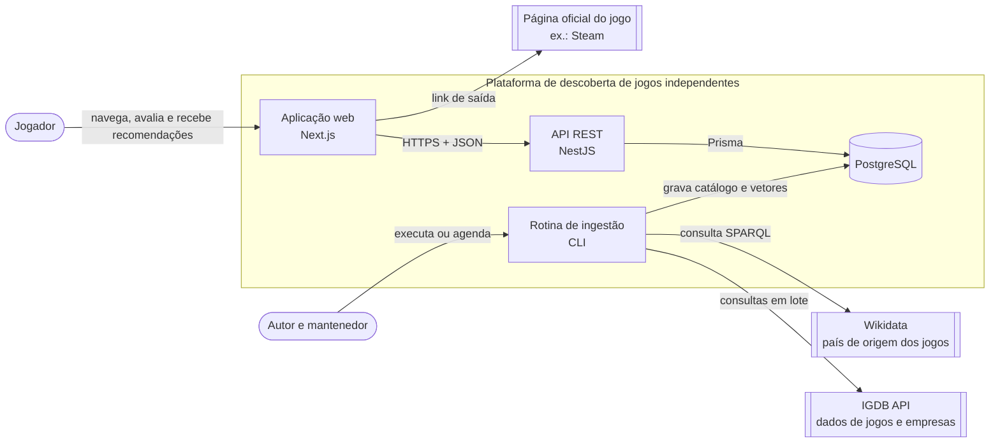
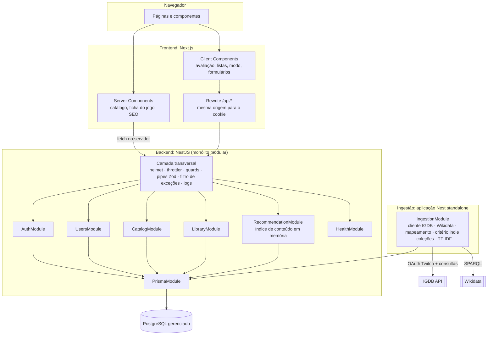
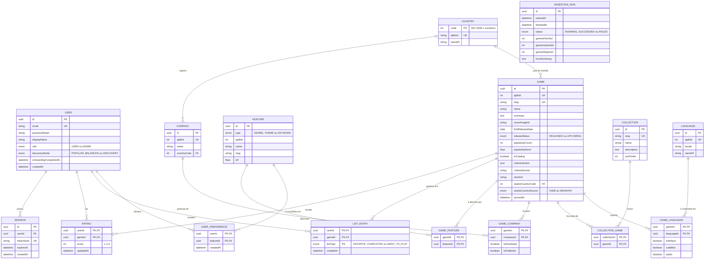
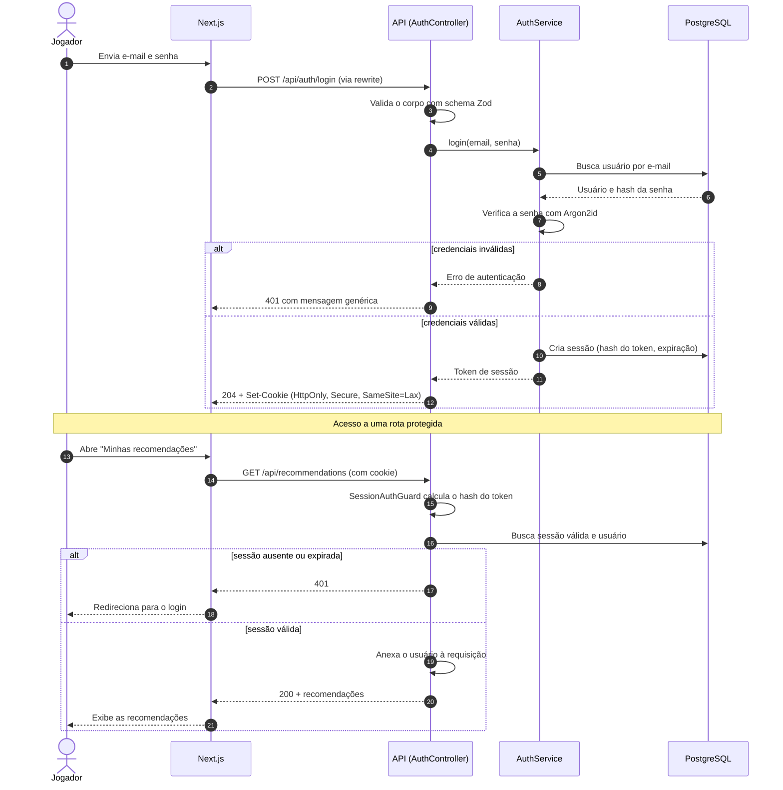
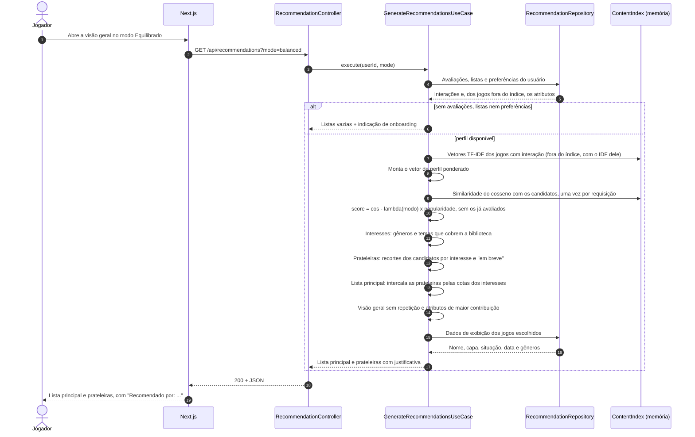
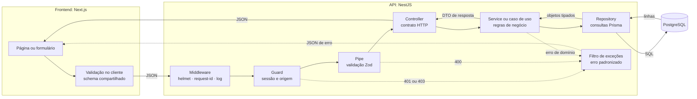

# Proposta técnica de desenvolvimento: plataforma de descoberta de jogos independentes

Oct 19, 2026 · @Victor Gopfert

## 1. Identificação e objetivo

| Campo | Valor |
| --- | --- |
| Projeto | Plataforma Web de Descoberta de Jogos Independentes |
| Nome da plataforma | **Penumbra**, decidido em 11/11/2026 (decisão do autor). É o nome do produto; o título do TCC continua o mesmo. O nome provisório "Indie Discovery" e o repositório `indie-discovery` mudam no B-83 |
| Natureza | Trabalho de Conclusão de Curso, modalidade projeto técnico |
| Curso | Tecnologia em Análise e Desenvolvimento de Sistemas, UERJ |
| Autor | Victor Gopfert Ferreira Figueiredo |
| Orientador | Leonardo da Silva Bóia |
| Documento de origem | *Plataforma Web de Descoberta de Jogos Independentes: proposta* (versão conceitual, outubro de 2026) |

**Objetivo deste documento:** transformar a proposta conceitual em um plano técnico e de execução que um único desenvolvedor consiga cumprir em menos de seis meses, entregando na defesa um MVP funcional, testado, documentado e demonstrável. Ele é a referência oficial durante a implementação: quando uma decisão aqui conflitar com uma ideia nova, a ideia nova entra no backlog pós-defesa, a menos que substitua algo de mesmo custo.

**Objetivo do sistema:** recomendar jogos independentes a jogadores pela afinidade entre as características de cada jogo e as preferências de cada pessoa, mostrando o motivo de cada indicação, deixando o usuário calibrar o peso da popularidade e incluindo jogos ainda não lançados.

Neste documento, três marcações distinguem a força de cada decisão:

- **Obrigatório:** faz parte do MVP ou da stack base e não muda sem revisão formal deste documento.
- **Recomendado:** escolha padrão, que pode ser trocada por alternativa equivalente sem afetar o restante.
- **Futuro:** fora da defesa, planejado para a Fase B.

## 2. Resumo executivo

**O sistema é um monólito modular em NestJS, com frontend Next.js e PostgreSQL via Prisma, organizado em monorrepositório e implantado em serviços sem custo, com um domínio próprio como única despesa.** O catálogo é montado por uma rotina de ingestão em lote a partir da API pública da IGDB; o usuário nunca consulta a IGDB diretamente, e a aplicação continua funcionando se ela estiver fora do ar.

As decisões centrais:

- **Recomendação por conteúdo, sem IA generativa no MVP.** Cada jogo vira um vetor TF-IDF de gêneros, temas e palavras-chave; o perfil do usuário é a média ponderada dos jogos que ele avaliou; a pontuação é a similaridade do cosseno menos um termo de popularidade cujo peso o usuário escolhe em três modos. A abordagem é determinística, explicável, testável e funciona com jogos sem nenhuma avaliação, o que inclui os não lançados.
- **Autenticação por sessão em cookie HttpOnly, com senha em Argon2id.** O frontend fala com a API pela mesma origem, por meio de um *rewrite* do Next.js, o que evita os problemas de cookies entre domínios.
- **Padrões com justificativa, não por padrão.** Controllers, services e repositories em todos os módulos; casos de uso dedicados só onde há orquestração real (recomendação e ingestão); regras de negócio críticas como funções puras, testáveis sem banco nem framework.
- **Contratos únicos em Zod**, compartilhados entre frontend e backend num pacote do monorrepositório e validados no NestJS pelo mecanismo nativo de *Standard Schema*.

O MVP tem 29 funcionalidades P0, que demonstram a proposta central de ponta a ponta: cadastro com redefinição de senha por e-mail, catálogo independente com filtros, coleções culturais curadas, página do estúdio, ficha do jogo com os jogos semelhantes, onde jogar, o preço e a demo na Steam, avaliações e listas com o convite para a lista de desejos da Steam, partida a frio, recomendações com motivo, com filtros e com o sorteio entre elas, seleção do grau de novidade e uma avaliação offline mensurável do recomendador.

O cronograma tem 24 semanas, com a premissa de 15 horas semanais dedicadas ao TCC. Prevê implantação já na semana 4, recomendação funcionando pela API na semana 16, congelamento de funcionalidades ao fim da semana 20 e duas semanas finais de margem antes da banca. Um ambiente local completo, com PostgreSQL embutido no projeto, serve de contingência para a demonstração.

## 3. Escopo e premissas

### Dentro do escopo da defesa

- Aplicação web pública para jogadores, com cadastro e área autenticada.
- Catálogo de jogos independentes, lançados e por lançar, montado por ingestão em lote da IGDB.
- Recomendação personalizada por conteúdo, com motivo visível e três modos de popularidade.
- Avaliação offline do recomendador e teste de usabilidade com jogadores.
- API documentada, testes automatizados dos fluxos críticos e ambiente implantado.

### Fora do escopo da defesa

- Qualquer funcionalidade operada por estúdios (cadastro de jogos, área do desenvolvedor). A página do estúdio (F-44, acrescentada em 11/11/2026) é montada com os dados da IGDB, sem ação do estúdio.
- Recursos sociais, comentários e notificações. O e-mail transacional fica restrito à conta: redefinição de senha e aviso de senha alterada (F-26). **Alterado em 11/11/2026 (decisão do autor):** o e-mail transacional inteiro estava fora do escopo.
- IA generativa, embeddings e filtragem colaborativa.
- Aplicativo móvel nativo e internacionalização: a interface é em português.
- Venda, intermediação ou qualquer modelo comercial.

### Premissas

| # | Premissa | Se for falsa |
| --- | --- | --- |
| PR-01 | Um único desenvolvedor, sem equipe, em nível de graduação | O plano já é dimensionado para isso |
| PR-02 | Cerca de 15 horas semanais dedicadas ao TCC: 12 de desenvolvimento e 3 de escrita e atividades acadêmicas | Com menos horas, aplicar o plano de corte da seção 16 já no marco M1 |
| PR-03 | 24 semanas até a banca, ancoradas no fim do período letivo em 24/04/2027 | Ao saber a data exata da defesa, recalcular os marcos a partir dela |
| PR-04 | A API da IGDB continua gratuita para uso não comercial, com atribuição visível | Confirmar os termos na tarefa B-07; se mudarem, o MVP roda com um recorte salvo do catálogo |
| PR-05 | Hospedagem e banco em camadas gratuitas, sem cartão de crédito. O domínio da Penumbra, com registro anual, é a única despesa (seção 6, acrescentado em 11/11/2026) | O ambiente local (PostgreSQL embutido, B-04) é a contingência oficial da demonstração |
| PR-06 | O catálogo recortado tem cerca de 20 mil jogos. **Revisada no M0 (19/10/2026):** a premissa original era "poucos milhares", mas a IGDB tem 130 mil jogos indie; o recorte aprovado (relatório do M0, `docs/m0-relatorio-igdb.md`, seção 8) mantém só jogos com ficha completa e algum sinal de interesse | Reduzir o recorte (por exemplo, por ano de lançamento) até caber no banco gratuito e na memória da API |
| PR-07 | As pesquisas de campo de outubro de 2026 já estão concluídas e entram no TCC como metodologia | Nenhuma nova pesquisa é necessária antes do teste de usabilidade |
| PR-08 | **Regra de prioridade (11/11/2026, decisão do autor):** a partir desta data, toda funcionalidade nova entra como P1 por padrão e só vai para P0 com aprovação explícita do autor. Motivo: os itens P0 acrescentados em 11/11/2026 (B-50, B-80 a B-92 e B-94) somam cerca de 90 h no ponto médio e aproximam o plano do limite da capacidade (seção 13) | Se a regra não for seguida, o recálculo da capacidade da seção 13 mostra o efeito, e o plano de corte da seção 16 é aplicado |

### Decisões herdadas da proposta conceitual

Estas decisões vieram das pesquisas com desenvolvedores e jogadores e não são reabertas aqui: popularidade calibrada pelo usuário, com o equilíbrio como padrão; jogos não lançados no catálogo; país do estúdio como filtro secundário, sem seção própria; idioma e temas como recortes de navegação; critério de indie público, que não exclui um jogo só por ele ter publisher; partida a frio que pede no máximo quatro avaliações; e neutralidade comercial.

**Revisão no M0 (19/10/2026), por decisão do autor:** país do estúdio e cultura retratada passam a ser tratados como diferenciais da plataforma. O país continua como filtro, agora com a IGDB complementada pelo Wikidata, e a cultura retratada ganha navegação própria por coleções curadas (F-24), que deixa de ser P2. As medições que sustentam a decisão estão no relatório do M0, `docs/m0-relatorio-igdb.md`, seção 8.8.

## 4. Requisitos e MVP

**O MVP é o conjunto P0: 29 funcionalidades que permitem a um jogador se cadastrar, informar o próprio gosto, receber recomendações explicadas e escolher o grau de novidade, sobre um catálogo real de jogos independentes.** P1 entra se sobrar capacidade depois do marco M2, sem nunca ser dependência de um P0. P2 é pós-defesa.

Complexidade: **B** baixa (até um dia de trabalho), **M** média (alguns dias), **A** alta (uma semana ou mais, com incerteza técnica).

### P0: essenciais para a defesa

| ID | Funcionalidade | Justificativa | Critérios de aceitação | Depende de | Compl. |
| --- | --- | --- | --- | --- | --- |
| F-01 | **Cadastro, login e logout** por e-mail e senha | Recomendação personalizada exige identidade persistente | E-mail único; senha com pelo menos 8 caracteres; senha armazenada só como hash Argon2id; login cria sessão em cookie HttpOnly; logout invalida a sessão no servidor; erros de login com mensagem genérica | — | M |
| F-02 | **Ingestão do catálogo** a partir da IGDB, por linha de comando | O catálogo precisa ser amplo e automático, sem cadastro manual | Importa jogos lançados e por lançar do recorte definido em M0; execução repetida não duplica registros; respeita o limite de requisições; cada execução fica registrada com contagens e erros | F-03, F-04 | A |
| F-03 | **Critério de jogo independente** configurável e documentado | O termo não tem definição única; o critério precisa ser público e testável | Regras em arquivo versionado; publicar um jogo não exclui, nem para grande publisher; jogo desenvolvido, na data de lançamento, por grande empresa ou por estúdio que ela controla (integral ou majoritariamente) é excluído; resultado verificado contra um conjunto de casos reais, com acertos e erros documentados | — | M |
| F-04 | **Vetorização de conteúdo** (TF-IDF) dos jogos | Base da recomendação e da explicação | Cada jogo tem pesos por gênero, tema e palavra-chave, com norma 1; atributos raros ou comuns demais são descartados por limites configuráveis; recálculo idempotente | — | M |
| F-05 | **Busca e navegação do catálogo** por título, gênero, tema e situação (lançado ou em breve) | Descoberta não personalizada e porta de entrada sem login | Filtros combináveis; paginação; estado dos filtros na URL; acessível sem login | F-02 | M |
| F-06 | **Filtros de idioma (português) e país do estúdio** | Idioma pesou cinco vezes mais que país na pesquisa; país fica como recorte secundário | Combináveis com os de F-05; jogos sem o dado não aparecem como "não tem", e sim como "não informado". **Regra de portão (revisada no M0):** idioma segue P0 com 95,5% de cobertura. O país do estúdio vem da IGDB e, na falta dela, do Wikidata (cerca de 50% de cobertura somada); no filtro, cada país só aparece como opção se tiver pelo menos 20 jogos no catálogo | F-05, M0 | M |
| F-07 | **Ficha do jogo** com capa, resumo, gêneros, temas, estúdio, país, situação e link para a página oficial | É onde a recomendação se converte em interesse pelo jogo | Selo "Em breve" para não lançados; link externo abre a página oficial; atribuição à IGDB visível; metadados de página gerados no servidor | F-02 | M |
| F-08 | **Avaliação de 1 a 5 e listas** (favorito, concluído, quero jogar) | Fonte do perfil de preferências | Criar, alterar e remover; só o próprio usuário altera seus dados; alteração reflete na próxima recomendação | F-01, F-07 | M |
| F-09 | **Página de perfil** com avaliações e listas | O usuário precisa ver e corrigir o que alimenta as recomendações | Lista avaliações e listas com acesso à ficha de cada jogo; estados vazios orientam o próximo passo; avatar com as iniciais do nome, sem foto enviada pelo usuário | F-08 | B |
| F-10 | **Partida a frio**: escolha de pelo menos 3 gêneros ou temas e avaliação opcional de até 4 jogos | Sem perfil não há recomendação; 16,7% dos jogadores não avaliariam nenhum jogo | Pode pular a etapa de avaliação; preferências geram recomendações mesmo sem avaliações; aparece no primeiro acesso e pode ser refeita | F-08, F-11 | M |
| F-11 | **Recomendações personalizadas com motivo** | Núcleo da proposta | Visão geral com a lista principal "Para você", que intercala os interesses do perfil (os gêneros e temas que, juntos, cobrem os jogos de que o jogador gostou) na proporção da cobertura de cada um, e prateleiras "Porque você curte `<atributo>`" para os maiores interesses e "Em breve no seu gosto"; na visão geral, cada jogo aparece uma vez; "ver mais" pagina cada lista até um teto; nenhum jogo já avaliado ou em lista; cada item traz de 1 a 3 atributos que mais contribuíram; mesmo estado gera as mesmas listas; usuário sem perfil é levado à partida a frio. **Corrigido em 03/11/2026 (B-71 e B-72, desvio registrado na seção 12):** era uma lista única com os N mais bem pontuados, em que o gosto dominante do perfil esconde os secundários. **Alterado em 03/11/2026 (B-71):** os interesses eram os de maior peso positivo, na proporção do peso; passaram a ser escolhidos pela cobertura da biblioteca (seção 12, item 4) | F-04, F-08 | A |
| F-12 | **Modo de descoberta**: Populares, Equilibrado e Descobertas | 75% dos jogadores querem equilíbrio ou escolha; nenhum dos lados quer penalização fixa | Padrão Equilibrado; escolha persistida no usuário; trocar o modo muda a lista de forma observável | F-11 | B |
| F-13 | **Página "Como funciona"**: critério de indie, lógica da recomendação e origem dos dados | Transparência é princípio da proposta | Explica o critério em linguagem simples, lista as grandes empresas, os estúdios controlados e as exceções manuais com o motivo e a fonte de cada uma, e descreve como as coleções culturais são curadas; acessível sem login | F-03 | B |
| F-14 | **Avaliação offline do recomendador** | Resultado mensurável do TCC | Script gera, para perfis simulados, cobertura de catálogo e popularidade média das recomendações em cada modo; resultado exportável em tabela e reproduzível | F-11, F-12 | M |
| F-15 | **Documentação da API e verificação de saúde** | Contrato verificável e monitoramento mínimo | Swagger lista todos os endpoints P0 com exemplos e erros; rota de saúde informa API e banco | — | B |
| F-17 | **Jogos semelhantes** na ficha do jogo | Reaproveita os vetores; é a recomendação de quem chega sem login; mostra a partida a frio do item, alcançando jogos "Em breve" sem histórico. Promovida de P1 a P0 em 11/11/2026 (decisão do autor) | Até 6 jogos, em ordem de cosseno com o jogo da ficha; a lista é a mesma para qualquer visitante, com ou sem login, sem termo de popularidade; nunca inclui o próprio jogo; inclui jogos "Em breve", com o selo; cada item mostra até 3 atributos em comum, pela contribuição de cada um ao cosseno, com os nomes do vocabulário; tamanho da lista e semelhança mínima em `config/recommendation.json`, com justificativa; abaixo do mínimo de itens, a seção não aparece; com o índice indisponível, a ficha abre normalmente, sem a seção; acessível sem login. **Alterado em 11/11/2026 (decisão do autor):** era "com o mesmo modo de popularidade". A lista passa a ser só pelo cosseno (λ = 0), porque é uma propriedade do jogo, cabe em cache, é a mesma que os buscadores indexam e é simples de explicar em "Como funciona". Os jogos da biblioteca de quem está logado não são excluídos: a exclusão é regra só das recomendações pessoais | F-04, F-07 | M |
| F-24 | **Coleções culturais curadas** ("Explore por cultura") | Cultura retratada pesou 33,3% na pesquisa; nenhuma fonte de dados registra a cultura de forma ampla (medido no M0), então a navegação é feita por curadoria transparente. Promovida de P2 a P0 no M0 | Coleções definidas em arquivo versionado, com nome, descrição e jogos aprovados; candidatos sugeridos automaticamente (palavras-chave, resumo e Wikidata) e revisados pelo autor; cada coleção com pelo menos 10 jogos, com destaque para a cultura brasileira; vitrine na página inicial e no catálogo, página da coleção e indicação na ficha do jogo; acessível sem login | F-02, F-07 | M |
| F-26 | **Redefinição de senha por e-mail** | Sem ela, quem esquece a senha perde a conta. Promovida de P2 a P0 em 11/11/2026 (decisão do autor): a plataforma fica pública, e o teste de usabilidade e a banca usam o ambiente de produção. Não toca no congelamento do modelo de recomendação | O pedido responde sempre a mesma mensagem, exista a conta ou não, sem saída rápida para conta inexistente (o envio acontece depois da resposta); limite de pedidos por IP e por e-mail; token aleatório de 32 bytes, com só o SHA-256 dele no banco, como nas sessões; validade de 60 minutos e uso único, e um pedido novo invalida o anterior; link montado a partir do `WEB_ORIGIN`, nunca do cabeçalho `Host`, com o token depois do `#`, para não chegar aos logs do servidor; a página de redefinição usa `Referrer-Policy: no-referrer`; a senha nova segue a regra do cadastro e é gravada com Argon2id; a redefinição encerra todas as sessões, não entra na conta automaticamente (leva ao login) e envia um e-mail avisando que a senha foi alterada; e-mails em português, sem rastreamento de abertura ou clique. Envio pela API HTTP do Resend, com domínio próprio (seção 6) | F-01 | M |
| F-34 | **"Onde jogar"** na ficha do jogo | O jogador sabe onde o jogo está disponível sem sair da plataforma, e o botão leva direto à página do jogo na loja (princípio 7 da proposta conceitual). Para jogos "Em breve", é o caminho até a lista de desejos. Acrescentada em 11/11/2026 (decisão do autor) | Plataformas com nome curto de exibição (PC, PS5, Switch…), a partir de um mapeamento versionado; um botão por loja com link direto para a página do jogo nela, com o nome da loja sempre visível e ícone só onde as regras de uso da marca permitirem; lojas em ordem fixa e alfabética; plataforma sem link de loja aparece sem link; jogo sem plataforma informada mostra "não informado"; acessível sem login. **Decidido em 11/11/2026 (decisão do autor):** os dados vêm só da IGDB e do id da Steam já gravado, sem API externa nova (a da Steam só conhece a própria loja e Windows, Mac e Linux). Plataforma é onde o jogo roda e loja é onde ele é vendido; o "Site oficial" continua separado. Pela neutralidade, os links são os da IGDB ou o da Steam montado pelo id, sem afiliado, e o link regional fica como a IGDB o registra | F-02, F-07 | M |
| F-35 | **Filtro por plataforma** no catálogo | No questionário, 83,3% jogam no PC, 41,7% no celular, 28,3% no PlayStation, 11,7% no Switch e 8,3% no Xbox: quem não joga no PC precisa filtrar. Acrescentada em 11/11/2026 (decisão do autor): o custo é baixo depois que o dado existe. Pelo mesmo raciocínio do B-75, é navegação e fica fora do núcleo da tese, por isso entra no plano de corte (seção 16) | Combinável com os filtros de F-05 e F-06; parâmetro repetível na URL; só lista plataformas com 20 jogos ou mais, como o filtro de país | F-34 | B |
| F-36 | **Preço na Steam** na ficha do jogo | O preço foi citado como barreira por 16,7% dos jogadores. A plataforma não muda o preço, mas tira um passo de quem já tem interesse e mostra promoções. Acrescentada em 11/11/2026 (decisão do autor) | Preço atual em reais, preço original e desconto da Steam Brasil, com "Preço na Steam Brasil em `<data da coleta>`"; "Gratuito" para jogos gratuitos; nada para jogos "Em breve" ou sem id da Steam; ao lado do botão da Steam no "Onde jogar" (F-34); só loja oficial, sem afiliado; nenhuma requisição de usuário consulta a Steam. **Decidido em 11/11/2026 (decisão do autor):** a fonte é a mesma rota da Steam das etiquetas, coletada em lote; nunca keyshops, que muitas vezes não pagam o estúdio; sem "média de preço"; o menor preço fica para a Fase B (F-37). Decisões e análise em `docs/precos.md` | F-34 | M |
| F-38 | **Filtro "Em promoção"** no catálogo | Mostra as promoções a quem navega. Acrescentada em 11/11/2026 (decisão do autor): é navegação, por isso entra no plano de corte com os outros filtros (seção 16) | Mostra os jogos com desconto maior que zero na última coleta; combinável com os outros filtros; estado na URL | F-36 | B |
| F-39 | **Convite para a lista de desejos da Steam** | O jogador não precisa manter duas listas à mão, e cada "quero jogar" de um jogo "Em breve" pode virar uma lista de desejos real para o estúdio, no momento de maior necessidade dele (proposta conceitual, seção 7). Acrescentada em 11/11/2026 (decisão do autor): é a ligação mais direta da plataforma com o benefício para os estúdios; nas entrevistas da BGS, 4 dos 6 jogos estavam em pré-lançamento, e 78,3% dos jogadores usam lista de desejos para jogos não lançados. Substitui a adição direta à lista da Steam, descartada (abaixo, junto do F-30 e do F-31) | Depois de marcar "quero jogar" num jogo com id da Steam, a ficha mostra "Adicionar também à lista de desejos na Steam", com link para a página do jogo na loja; funciona com ou sem conta Steam vinculada; não aparece para jogos sem id da Steam, nem quando o jogo já tem nota ou está em "concluídos"; o link é a página web da loja, não o protocolo `steam://`, que não faz nada sem o aplicativo da Steam instalado | F-08, F-34 | B |
| F-40 | **Demo na Steam** | Para estúdios em pré-lançamento, a demo é a principal ferramenta para juntar listas de desejos: o Steam Next Fest, citado pela E6 nas entrevistas da BGS, é feito de demos. Para o jogador, é experimentar sem pagar, o que também conversa com a barreira do preço (16,7% no questionário). Acrescentada em 11/11/2026 (decisão do autor) | Selo "Demo" na ficha e nos cartões do catálogo e do "ver mais", ao lado dos selos "Em breve" e "Pouco conhecido"; botão "Jogar a demo na Steam" no "Onde jogar" (F-34), com link para a página do jogo na loja; atualizado na rodada diária, e a demo removida na Steam some na rodada seguinte; nenhuma requisição de usuário consulta a Steam. **Decidido em 11/11/2026 (decisão do autor):** a fonte é só a Steam, porque a IGDB não registra demos; o link é a página da loja, e não o protocolo `steam://install/`, que exige o aplicativo e começaria o download sem a pessoa ver a página (`docs/precos.md`, seção 6) | F-34, F-36 | M |
| F-41 | **Filtro "Com demo"** no catálogo | Leva quem quer experimentar antes de comprar aos jogos com demo. Acrescentada em 11/11/2026 (decisão do autor): é navegação, por isso entra no plano de corte com os outros filtros (seção 16) | Combinável com os outros filtros; estado na URL | F-40 | B |
| F-42 | **Sortear jogo de uma lista de recomendações** | A barreira mais citada no questionário para experimentar jogos independentes foi "não fico sabendo deles ou não sei qual escolher" (45%); o sorteio ataca a segunda metade dela, escolher entre listas longas. 45% dos respondentes raramente procuram jogos novos ativamente. **Ressalva:** a ideia de um "Surpreenda-me" apareceu nas entrevistas da BGS, mas foi introduzida pelo entrevistador (E2) e reaparece na fala da E5; a análise das entrevistas a trata como indução, e ela não é citada como pedido espontâneo dos desenvolvedores. Acrescentada em 11/11/2026 (decisão do autor) | Botão "Sortear" no cabeçalho de cada prateleira da visão geral, ao lado do "Ver mais", e no topo da página do "ver mais"; sorteio entre os N primeiros da lista, sem repetir, e, ao acabar, embaralha de novo e avisa; um jogo por vez, como uma carta: capa, nome, motivo da recomendação, selos ("Em breve", "Pouco conhecido", "Demo") e preço da Steam quando houver; ações "Sortear outro" (também pela tecla de espaço), "Anterior", "Quero jogar", "Ver ficha" (ao voltar, continua de onde parou), contador ("12 de 50") e "Voltar à lista"; sequência reproduzível pela semente na URL; uma requisição por sessão de sorteio, nenhuma por jogo sorteado; acessível: cada jogo novo anunciado ao leitor de tela (`aria-live`), tudo pelo teclado e sem animação com "reduzir movimento". **Decidido em 11/11/2026 (decisão do autor):** N em `config/recommendation.json`, com valor inicial 50, porque sortear a lista inteira traria jogos de páginas em que a afinidade já caiu muito; o "Quero jogar" usa a rota de listas que já existe, e "Não tenho interesse" fica de fora, porque seria um sinal novo no perfil; o embaralhamento acontece no navegador, porque a visão geral já está no limite da instância gratuita (RNF-03) | F-11, F-08 | M |
| F-44 | **Página do estúdio** | É o recurso mais voltado aos estúdios: um lugar que mostra o conjunto do trabalho de cada um, com os jogos "Em breve" em destaque (pedido de E1 e E4 de comunicar do que o trabalho do estúdio trata). Também ajuda a chegada por buscadores. É o ponto de partida da "Área do estúdio" (F-23, P2). Acrescentada em 11/11/2026 (decisão do autor) | Página pública em `/estudios/<slug>` com nome, logotipo, país (com link para o filtro do catálogo), ano de fundação, site e descrição da IGDB, cada um só quando informado; jogos do catálogo com "Em breve" primeiro, depois os lançados do mais recente ao mais antigo, separados em "Desenvolvidos" e "Publicados" quando houver os dois; cartões com os mesmos selos e informações do catálogo; links na ficha; bloco "Estúdios" na busca do catálogo; acessível sem login, com metadados gerados no servidor. **Decidido em 11/11/2026 (decisão do autor):** os dados que faltam vêm da IGDB pela mesma consulta de jogos, sem requisição nova; publicadoras também ganham página; a descrição da IGDB aparece em inglês, com atribuição, como os resumos; o país é o da IGDB no `Company` e, na falta dele, o dos jogos que o estúdio desenvolveu quando todos concordam, senão "não informado", sempre com a fonte; só jogos do catálogo; a busca global no cabeçalho fica para a designer | F-02, F-05, F-07 | M |
| F-45 | **Filtros nas listas de recomendação** | Ajudam a escolher dentro de uma lista longa sem mudar a recomendação. Acrescentada em 11/11/2026, P0 com aprovação explícita do autor (regra de prioridade, PR-08) | Na página do "ver mais", os filtros de gênero, tema, etiqueta, situação, plataforma, em promoção, com demo, português, país do estúdio e período recortam os jogos da lista até o teto (100 na principal, 200 nas prateleiras), mantendo a ordem; opções e contagens só do que existe na lista, atualizadas na combinação, e grupo com menos de 2 opções escondido; "X de N jogos desta lista"; estado na URL; o sorteio respeita os filtros ativos. **Decidido em 11/11/2026 (decisão do autor):** só no "ver mais", e não na visão geral, que tem até 10 listas e já passa de 1 s em parte das medições em produção (RNF-03); os componentes são os do catálogo, e os dados fora do índice vêm de uma consulta ao banco por requisição, só para os ids da lista. Filtrar antes do teto fica para a Fase B (seção 15) | F-11, F-34, F-36, F-38, F-40, F-41, F-42, F-46 | M |
| F-46 | **Filtro por período de lançamento** | Encontrar lançamentos recentes ou de uma época. Acrescentada em 11/11/2026, P0 com aprovação explícita do autor (regra de prioridade, PR-08) | Faixa de anos (De / Até) e atalhos de recentes ("últimos 30 dias", "últimos 6 meses", "últimos 12 meses") no catálogo e nas listas de recomendação; combinável com os outros filtros; estado na URL; jogos sem data ficam de fora com o filtro ativo; atalhos só para jogos lançados com data exata. **Decidido em 11/11/2026 (decisão do autor):** data específica e mês/ano foram descartados, porque na IGDB a data de muitos jogos "Em breve" só tem precisão de ano ou trimestre e a ingestão grava um dia exato sem guardar a precisão; o ano é confiável mesmo nessas datas. As opções de ano vão do primeiro ao último ano do catálogo (nas listas, da lista) | F-05 | B |

### P1: importantes, mas negociáveis

| ID | Funcionalidade | Justificativa | Critérios de aceitação | Depende de | Compl. |
| --- | --- | --- | --- | --- | --- |
| F-16 | **Registro de cliques de saída** para a página oficial | Único indicador do benefício ao estúdio | Cada clique gera um evento com jogo e data; usuário opcional; relatório por jogo | F-07 | B |
| F-18 | **Sitemap e robots** para indexação | Ajuda a plataforma a ser encontrada, risco de adesão apontado na pesquisa | Sitemap lista as fichas públicas; atualizado após ingestão | F-07 | B |
| F-19 | **Exclusão da própria conta** e dos dados associados | Minimização de dados (LGPD) | Remove usuário, sessões, avaliações, listas e preferências após confirmação | F-01 | B |
| F-20 | **Edição de perfil**: nome de exibição e troca de senha | Manutenção básica da conta | Troca de senha exige a senha atual e encerra as outras sessões | F-01 | B |
| F-21 | **Ingestão agendada** | Mantém o catálogo atualizado sem ação manual | Execução periódica no CI com segredos protegidos; falha gera alerta no próprio CI | F-02 | B |
| F-31 | **Vínculo da conta Steam** à conta da plataforma | Abre a importação de dados da Steam sem criar outra conta | O usuário logado vincula pelo login da própria Steam (OpenID 2.0), sem que a plataforma veja a senha; só o Steam ID e a URL do avatar público são guardados; um Steam ID vincula a uma única conta; o vínculo pode ser desfeito, e desfazê-lo apaga os dois | F-01 | M |
| F-30 | **Importação da wishlist da Steam** para alimentar a recomendação | Reduz a partida a frio: o jogador chega com os interesses que já declarou na Steam | Com a conta vinculada (F-31), importa a wishlist para a lista "quero jogar"; mostra quantos jogos foram importados e quantos ficaram de fora por não serem indie ou não estarem no catálogo; quando a Steam devolve a lista vazia, avisa que a wishlist pode estar privada e explica como deixar os detalhes de jogos públicos, porque a Steam não distingue lista privada de lista vazia; repetir a importação não duplica; a importação só acrescenta jogos ao "quero jogar" e nunca remove, e tirar um jogo da lista da Steam não apaga nada na plataforma (decisão do autor, 11/11/2026: a lista daqui é do jogador, e uma remoção silenciosa o confundiria; para trazer o que entrou depois na Steam, ele reimporta) | F-31, F-08 | M |
| F-32 | **Login com Google** | Cadastro sem criar outra senha | Entrar e cadastrar pelo Google (OpenID Connect, com `state` e PKCE); e-mail verificado pelo Google igual ao de uma conta existente vincula as duas; conta criada pelo Google não tem senha, e os limites de tentativas de login não se aplicam a ela; a sessão depois do login é a mesma do login com senha; a URL da foto da conta Google é guardada como avatar | F-01 | M |
| F-43 | **Sortear no catálogo** com os filtros atuais | Funciona sem login e serve a quem chega pelo buscador e ainda não tem recomendações (risco de adesão da proposta conceitual, seção 13). Acrescentada em 11/11/2026 (decisão do autor) | A API sorteia um jogo entre os que passam nos filtros da URL; botão "Sortear" na página do catálogo, que abre a ficha do sorteado; acessível sem login | F-05 | B |

**Descartado, com motivo: adicionar à lista de desejos da Steam pela plataforma (11/11/2026, decisão do autor).**

- O vínculo da conta Steam (F-31, B-66) usa o OpenID 2.0 da Steam, que só entrega o SteamID. Ele prova a identidade, mas não dá à plataforma nenhuma permissão para agir na conta da Steam.
- O OAuth da Steam é documentado no Steamworks, para publicadoras, com permissões de outros recursos (Steam Cloud, Workshop). Não há permissão de lista de desejos para um site de terceiros.
- O único caminho técnico seria usar os cookies de sessão da Steam do usuário, o que exigiria que ele entregasse a sessão à plataforma. Está fora de questão por segurança (seção 8) e contraria a orientação da própria Steam de nunca entregar credenciais a sites de terceiros.
- A sincronização entre as listas fica num sentido só: da Steam para a plataforma, pela importação (F-30, B-67). No sentido contrário, o substituto é o convite para a lista de desejos da Steam (F-39, B-89).

### P2: pós-defesa

| ID | Funcionalidade | Justificativa |
| --- | --- | --- |
| F-22 | Sugestão de jogo ausente pela URL da loja, com moderação | Pedido de desenvolvedores; jogos pequenos e por lançar podem faltar nas bases |
| F-23 | Área do estúdio para descrever os próprios jogos | Pedido de desenvolvedores; exige verificação de identidade |
| F-25 | Recursos de comunidade: perfis públicos e listas compartilhadas | Pedido de desenvolvedores; só faz sentido com base de usuários |
| F-27 | Recomendação híbrida com embeddings semânticos | Evolução opcional, condicionada à avaliação da seção 12 |
| F-28 | Filtragem colaborativa | Exige volume de interações que o MVP não terá |
| F-29 | Avisos de lançamento de jogos acompanhados, inclusive "Seguir estúdio" (acrescentado em 11/11/2026) | Depende de e-mail ou notificação; o canal de e-mail passa a existir com o B-81 |
| F-33 | Foto de perfil enviada pelo usuário | Personalização; exige armazenamento de objetos e não contribui para a descoberta |
| F-37 | Preços em outras lojas e menor preço histórico completo, e as prateleiras "Em promoção no seu gosto" e "Com demo no seu gosto" | Completa o F-36 e o F-40; exige fonte externa cujos termos permitam um site público (`docs/precos.md`); as prateleiras são regras novas de prateleira, fora do congelamento do modelo. Acrescentada em 11/11/2026 (decisão do autor), com a prateleira de demos acrescentada no mesmo dia (B-90) |

### Requisitos não funcionais

| ID | Requisito | Como verificar |
| --- | --- | --- |
| RNF-01 | **Segurança**: senhas em Argon2id, cookies HttpOnly + Secure + SameSite=Lax, verificação de origem em requisições que alteram estado, limite de tentativas no login, cabeçalhos de segurança, validação de toda entrada | Testes e2e de autenticação e revisão da lista da seção 8 antes do congelamento |
| RNF-02 | **Independência da fonte externa**: nenhuma requisição de usuário depende da IGDB nem da Steam, inclusive para preços. **Ampliado em 11/11/2026 (B-86):** os preços são coletados em lote e gravados no banco, e a API só lê do banco | Demonstração com credenciais da IGDB removidas |
| RNF-03 | **Desempenho perceptível**: catálogo e recomendações respondem sem espera perceptível na demonstração | Medir e registrar o tempo de resposta com o catálogo real em M2; investigar se a resposta não for imediata. Sem meta numérica arbitrária. **Registrado em 10/11/2026 (B-79):** o critério de p95 fim a fim abaixo de 1 s, adotado desde o B-76, é atendido no "ver mais" e não na visão geral, que passa de 1 s em 3 de 6 linhas, com 6% a 8% das chamadas acima de 900 ms. Por decisão do autor, fica como limitação da instância gratuita (causa provável: a cota de 0,1 de CPU, hipótese sem o log do Render), com a visão geral pronta por usuário como trabalho futuro (Fase B) e, para a defesa, instância paga ou demonstração local (seção 12) |
| RNF-04 | **Manutenibilidade**: TypeScript estrito, lint e formatação automáticos, CI verde para integrar | Hook de pre-commit e pipeline bloqueiam violações |
| RNF-05 | **Acessibilidade básica**: HTML semântico, rótulos em formulários, contraste e navegação por teclado nos fluxos P0 | Checagem manual e com a auditoria de acessibilidade do navegador nos fluxos P0 |
| RNF-06 | **Dados e termos de uso**: atribuição à IGDB, uso não comercial, coleta apenas de e-mail e nome de exibição. **Acrescentado em 11/11/2026 (F-26):** o e-mail do usuário passa a ser processado também pelo provedor de envio, só para os e-mails da conta | Revisão antes da implantação pública |
| RNF-07 | **Observabilidade mínima**: logs estruturados com identificador de requisição; histórico de ingestões | Log de uma requisição rastreável ponta a ponta; tabela de execuções de ingestão |

## 5. Arquitetura

**Monólito modular: uma única API NestJS dividida em módulos por domínio, um frontend Next.js e um banco PostgreSQL, com a ingestão rodando como processo separado que reaproveita o mesmo código.** Os diagramas de contexto, arquitetura e fluxo de dados estão na seção 11.

### Por que monólito modular

Um único desenvolvedor, um único banco e um domínio pequeno não justificam microsserviços: eles multiplicariam implantação, observabilidade e contratos sem ganho real. O monólito modular dá as fronteiras que importam — cada módulo tem seus controllers, serviços e repositórios, e só expõe o que outros módulos precisam — e permite extrair um módulo no futuro, se um dia for necessário.

### Monorrepositório (obrigatório)

Um único repositório com *workspaces* do pnpm:

```
/
├─ apps/
│  ├─ api/          NestJS: API REST e aplicação de ingestão
│  └─ web/          Next.js: interface
├─ packages/
│  └─ contracts/    schemas Zod e tipos compartilhados
├─ scripts/db.mjs       PostgreSQL local (pnpm db:start / db:stop)
├─ tsconfig.base.json
└─ pnpm-workspace.yaml
```

| Critério | Monorrepositório | Repositórios separados |
| --- | --- | --- |
| Contratos entre frontend e backend | Um único pacote de schemas, importado pelos dois lados | Duplicação ou publicação de pacote |
| Lint, formatação e hooks | Uma configuração | Uma por repositório |
| CI | Um pipeline que testa tudo junto | Pipelines separados, mudanças cruzadas em dois PRs |
| Implantação | Cada app aponta para sua pasta | Natural |
| Custo | Configurar o pacote compartilhado para os dois builds | Nenhum custo de configuração |

Para um desenvolvedor só, o contrato único e o pipeline único pesam mais que o custo inicial de configuração, que fica isolado na tarefa B-01. Ferramentas de orquestração de monorrepositório, como Turborepo, são **opcionais**: os scripts do pnpm bastam no tamanho deste projeto.

### Módulos da API

| Módulo | Responsabilidade | Expõe para outros módulos |
| --- | --- | --- |
| `AuthModule` | Cadastro, login, logout, sessões, guard de autenticação | `SessionAuthGuard`, decorators `@Public()` e `@CurrentUser()` |
| `UsersModule` | Dados do usuário e modo de descoberta | `UsersService` |
| `CatalogModule` | Busca, filtros, ficha do jogo, listas de gêneros e temas, coleções culturais | `CatalogRepository` (leitura) |
| `LibraryModule` | Avaliações, listas e preferências de partida a frio | `LibraryRepository` (leitura) |
| `RecommendationModule` | Índice de conteúdo em memória, pontuação, explicação e `GET /recommendations`; usa o `CatalogModule` para o resumo dos jogos e os nomes em português | `ContentIndexService` (estado do índice, para a rota de saúde) |
| `IngestionModule` | Cliente IGDB, mapeamento, critério indie, TF-IDF, execução | — (só carregado pela aplicação de ingestão) |
| `HealthModule` | Saúde da API e do banco | — |
| `PrismaModule` | Cliente Prisma único e configurado | `PrismaService` |

### Duas entradas, o mesmo código

A API sobe com `NestFactory.create` e carrega todos os módulos, menos o de ingestão. A ingestão é uma **aplicação standalone** do Nest (contexto de aplicação sem servidor HTTP), executada por linha de comando, que carrega `IngestionModule` e `PrismaModule`. Assim, a rotina pesada de ingestão nunca disputa recursos com as requisições dos usuários, e a API não precisa conhecer credenciais da IGDB. Ao fim de uma ingestão, a API recarrega o índice de conteúdo na próxima inicialização ou por um endpoint interno protegido por segredo de ambiente.

### Frontend e mesma origem

O Next.js usa o App Router. Páginas públicas (catálogo, ficha, "Como funciona") são Server Components, que buscam dados no servidor e geram metadados para buscadores. Interações (avaliar, listas, modo, formulários) são Client Components. O navegador chama sempre `/api/*` no próprio domínio do frontend, e um *rewrite* do Next.js repassa a chamada para a API. Isso mantém o cookie de sessão como cookie primeiro (*first-party*), sem depender de cookies entre domínios, que navegadores restringem cada vez mais.

O estado da sessão vem de `GET /api/auth/me` e fica no cache do TanStack Query, compartilhado por todos os componentes que precisam dele (cabeçalho, páginas de conta). Não há um contexto de autenticação à parte: ele seria uma segunda cópia do mesmo estado. Entrar e cadastrar gravam o usuário devolvido pela API direto no cache; sair limpa o cache. Os formulários usam react-hook-form com os schemas de `packages/contracts`, e os erros da API voltam ao campo a que se referem. Depois de entrar, o visitante segue para o `?next=` da URL, aceito só se for um caminho deste site.

O catálogo (`/catalogo`, B-23) é um Server Component cuja URL é o único estado. Os parâmetros têm os mesmos nomes da API (`q`, `genre`, `theme`, `status`, `portuguese`, `country`, `sort`, `page`) e são validados com o `GameSearchQuerySchema` antes da chamada; uma URL inválida mostra o problema em vez de erro. No servidor, o cliente HTTP chama a API direto pelo `API_URL`, sem passar pelo *rewrite*, e as quatro leituras (jogos, gêneros, temas e países) saem em paralelo. Os filtros são um formulário GET com o `<Form>` do Next: sem JavaScript, é um formulário comum; com JavaScript, navega sem recarregar. Enviar o formulário volta para a página 1. As capas vêm da CDN da IGDB em `t_cover_small_2x`, com `next/image` em modo `unoptimized` (carregamento sob demanda, sem o otimizador da Vercel). O rodapé de todas as páginas traz a atribuição à IGDB (RNF-06).

A ficha do jogo (`/jogos/[slug]`, B-24) também é um Server Component. O título, a descrição (o resumo cortado em cerca de 160 caracteres) e as tags Open Graph com a capa grande saem no HTML inicial; a página e os metadados dividem a mesma chamada à API, envolvida em `cache()` do React. Gêneros, temas e país levam ao catálogo já filtrado, o português aparece em destaque com a distinção entre "sem português" e "idiomas não informados" (F-06), e a página oficial e a página do jogo na IGDB abrem em nova aba. Jogo inexistente ou fora do catálogo responde com o status HTTP 404 e `noindex`; por isso o segmento não tem `loading.tsx`, que faria a resposta começar em streaming e o 404 sair com status 200. O resumo vem da IGDB em inglês: traduzi-lo exigiria um serviço externo ou IA generativa, fora do MVP.

Na ficha, a nota e as listas (B-28) são um Client Component à parte, para a página continuar igual para buscadores e visitantes. Quem não entrou vê um convite com link para `/entrar?next=/jogos/<slug>` e volta para a ficha depois de entrar; a ação clicada não é guardada. Quem entrou vê a nota em cinco botões de alternar (`aria-pressed`), e não em botões de opção, que gravariam uma nota a cada seta do teclado, e as três listas também como botões de alternar. Cada alteração espera a resposta da API, sem atualização otimista: os controles ficam desabilitados com "Salvando…" anunciado por `aria-live`, e um erro aparece num alerta. "Concluídos" e "quero jogar" se excluem pelo que a API devolve. Depois de gravar, o cache da biblioteca é invalidado e o das recomendações é descartado, para a próxima lista já sair com a mudança (F-08). **Corrigido no B-35 (03/11/2026):** o cache das recomendações também era só invalidado, e a página mostrava a lista guardada, ainda com o jogo recém-avaliado, até a nova chegar, de 200 ms a 1 s em produção. Uma sessão vencida volta ao convite. Jogos "Em breve" têm os mesmos controles, porque a API aceita e há demos e testes abertos de jogos não lançados.

A página de recomendações (`/recomendacoes`, B-35) é um Client Component, porque depende da sessão. Quem não entrou vê um convite com link para `/entrar?next=/recomendacoes`, como na ficha, e não um redirecionamento automático, que faria a tela piscar e exigiria outro tratamento para a sessão que vence com a página aberta. O modo da lista é o salvo no usuário, e a página pede a lista sempre com o modo explícito (`?mode=`), com uma entrada de cache por modo: voltar a um modo já visto é instantâneo. Trocar o modo grava primeiro (`PATCH /api/me`) e só então pede a lista do modo novo, para que a lista na tela seja sempre a do modo gravado; custa cerca de 200 ms a mais que as duas chamadas em paralelo, e a lista anterior fica na tela, com "Atualizando…" anunciado, até a nova chegar. O modo não vai na URL, porque o salvo no usuário é a única referência. O seletor são três botões de alternar com uma descrição curta cada, pelo mesmo motivo da nota na ficha. O cartão é o do catálogo com o motivo em texto ("Recomendado por: Roguelike, Fantasia"): os gêneros e temas não viram links porque o motivo não diz qual é gênero e qual é tema, e o filtro do catálogo precisa saber. "Porque você gostou de <jogo>" tem link para a ficha só se o jogo continua no catálogo. No modo Descobertas, o selo "Pouco conhecido" marca os jogos que entraram pela popularidade baixa, e uma frase acima da lista explica a marca, que nas medições do B-32 aparece em 62% dos itens. Com a lista vazia (`empty`) ou de populares (`popular`), o seletor some, porque o modo não muda essas listas e trocá-lo pareceria quebrado; a vazia orienta a avaliar jogos, com link para o catálogo até existir a partida a frio (B-34), e a de populares explica que as notas ainda não mostram o gosto do jogador. A lista tem 20 itens, sem "ver mais", o mesmo corte das métricas do B-37; esse formato muda com o B-72 (parágrafo abaixo). **Alterado no B-71 (03/11/2026):** a página lê a lista principal da visão geral (`main`), já intercalada, e ignora as prateleiras até o B-72, para não quebrar entre os dois itens. Com o índice indisponível (503), a página mostra a mensagem da API e "Tentar de novo"; uma sessão vencida volta ao convite. O visual é provisório, como o do resto da interface. **Alterado em 05/11/2026 (B-72):** a página mostra a visão geral inteira, com as prateleiras (parágrafo abaixo); o convite, o 503 com "Tentar de novo", a sessão vencida, o seletor e as frases das bases `empty` e `popular` são os mesmos na visão geral e no "ver mais".

**Visão geral das recomendações (B-72; correção do F-11 registrada em 03/11/2026).** A página `/recomendacoes` passa a ser a visão geral: a lista principal "Para você" no topo e, abaixo dela, as prateleiras "Em breve no seu gosto" e uma "Porque você curte `<atributo>`" para cada interesse do perfil, na ordem do peso. Os títulos são montados na interface a partir do tipo da prateleira e do nome do atributo, que a API já manda em português. Na visão geral, um jogo aparece em um lugar só: cada prateleira mostra só os jogos dela que não apareceram acima, e a prateleira que fica com menos jogos que o mínimo da configuração não aparece. Cada lista tem "ver mais", que abre `/recomendacoes/<lista>` (`para-voce`, `em-breve`, `genero-<slug>` ou `tema-<slug>`) com a lista completa, de 20 em 20 jogos até o teto da configuração; ali a repetição é permitida, porque a lista é lida sozinha. O seletor de modo vale para todas as listas, e as listas de base `empty` e `popular` continuam como estão, sem prateleiras. A regra das listas está na seção 12, item 4. **Concluído em 05/11/2026 (B-72), com as decisões do autor:**
- **Layout:** os cartões ficam numa grade de duas colunas a partir das telas médias e numa coluna no celular. A visão geral chega a 70 cartões, e numa coluna só a página fica longa demais; a grade não pede componente novo, e o visual será refeito com a designer. **Alterado em 05/11/2026 (B-72, ajuste de design):** na visão geral, "Para você" e cada prateleira viraram uma fileira horizontal só com as capas de 5 jogos (`overviewMainSize` de 20 para 5 e `overviewShelfSize` de 10 para 5), para que várias listas caibam na primeira tela; de 640 px para cima são 5 colunas, e abaixo disso a fileira rola na horizontal, para a capa não encolher. O nome do jogo é o nome acessível do link e aparece no `title` ao passar o mouse; sem capa, o quadro mostra o nome. A página do "ver mais" continua com os cartões completos, o motivo e os selos, e a frase que explica o "Pouco conhecido" fica só nela, porque a visão geral não mostra mais o selo. A ordem das prateleiras continua a da API até o B-79. **Alterado em 09/11/2026 (B-79):** a API devolve as seções na ordem principal, "Porque você gostou de `<jogo>`" (endereço `/recomendacoes/jogo-<slug>`), "Porque você curte `<título>`", com o título do vocabulário, e "Em breve no seu gosto", e a página segue essa ordem. O motivo "Porque você gostou de" saiu do cartão, e o nome do jogo de origem fora do catálogo aparece sem link.
- **Títulos:** "Para você", "Em breve no seu gosto" e "Porque você curte `<nome>`", o mesmo formato para gênero, tema e estilo. Na visão geral, cada lista é uma seção com título de nível 2, e o nome do jogo no cartão desce para o nível 3; no "ver mais", o título da página é o da lista. **Alterado em 05/11/2026 (B-72, ajuste de design):** na visão geral não há mais cartões; nas fileiras de capas, o nome do jogo fica no link, sem título, e o nível 3 deixou de ser usado.
- **"Ver mais":** só aparece quando a lista completa tem mais jogos que os mostrados (`hasMore`); sem isso, ela já está toda na tela. A rota de estilo é `estilo-<slug>`.
- **Paginação:** "Anterior" e "Próxima", com `?page=N` na URL e "Página N" sem o total, porque a API manda só `hasMore`. Cada página tem endereço fixo, o voltar do navegador funciona e o determinismo de cada página (B-36) pode ser testado; é o mesmo formato do catálogo.
- **Modo no "ver mais":** o mesmo seletor e o mesmo fluxo da visão geral, que grava o modo e só então pede a lista. Gravado o modo, a lista volta à página 1, porque a página N de outro modo é outra lista.
- **Lista que deixou de existir:** a API responde 404 quando o interesse saiu do perfil, e a página volta à visão geral em silêncio, sem entrada no histórico (`replace`).
- **URLs inválidas:** um segmento fora do formato é link quebrado, e não mudança de perfil: responde a página 404 do site. Uma página inválida vira a primeira, e uma além do teto avisa que a lista não tem mais jogos, com link para a primeira página.
- **Base no "ver mais":** a resposta da rota passou a trazer `basis`, para a página tratar a lista de populares e a vazia como a visão geral (tabela da seção 5).

### Contratos da API

Prefixo global `/api`. Respostas em JSON; erros sempre no mesmo formato.

| Método e rota | Acesso | Propósito |
| --- | --- | --- |
| `POST /api/auth/register` | Público | Cadastro |
| `POST /api/auth/login` | Público | Login; define o cookie de sessão |
| `POST /api/auth/logout` | Autenticado | Encerra a sessão |
| `GET /api/auth/me` | Autenticado | Usuário atual |
| `GET /api/games?q=&genre=&theme=&status=&portuguese=&country=&sort=&page=&pageSize=` | Público | Busca com filtros e paginação: `q` é parte do nome (até 100 caracteres); `genre` e `theme` são slugs, repetíveis até 5 vezes, e o jogo precisa ter todos; `status` é `released` ou `upcoming`; `portuguese` é `yes` (tem pt-BR ou pt-PT), `no` (tem idiomas informados, nenhum português) ou `unknown` (nenhum idioma informado); `country` é a sigla do país do estúdio ou `unknown` (sem país), repetível até 5 vezes, e basta o jogo ter um deles (B-21); `sort` é `popular` (padrão), `newest` (sem data no fim) ou `name`, sempre com desempate por nome e id; `pageSize` vai de 1 a 48 (padrão 24) e `page` de 1 a 1000. Responde `{ items, page, pageSize, total, totalPages }`, com nome, capa, situação, data e gêneros de cada jogo |
| `GET /api/games/:slug` | Público | Ficha do jogo: os campos do resumo do catálogo mais resumo, temas, desenvolvedoras e publicadoras (só nomes; empresas com outro papel ficam de fora), país do estúdio com a origem do dado (`IGDB` ou `WIKIDATA`), idiomas com o tipo de suporte (interface, legendas, áudio) e `officialUrl`, lido de `Game.storeUrl`, que guarda o site oficial antes da loja. Só passa link `http` ou `https`, porque ele vira `href` na ficha. Palavras-chave ficam de fora. Slug inexistente ou jogo fora do catálogo respondem 404 com "Jogo não encontrado." (B-22) |
| `GET /api/collections` | Público | Coleções culturais publicadas com jogos no catálogo, na ordem do arquivo de curadoria: slug, nome, descrição, quantos jogos do catálogo cada uma tem e até 4 capas dos mais populares (B-57) |
| `GET /api/collections/:slug?page=&pageSize=` | Público | A coleção e os jogos dela no catálogo, na ordem `popular` e com a paginação de `GET /api/games`; slug inexistente ou coleção sem jogo no catálogo respondem 404 com "Coleção não encontrada." (B-57) |
| `GET /api/countries` | Público | Opções do filtro de país: sigla, nome em português e quantos jogos do catálogo são de estúdios do país, só para países com pelo menos 20 jogos, em ordem alfabética. **Acrescentado no B-21 (29/10/2026):** país não é atributo, então não cabe em `/api/features` |
| `GET /api/features?type=genre\|theme` | Público | Opções de filtro e de partida a frio: slug, nome em português e quantos jogos do catálogo têm o atributo, em ordem alfabética. **Alterado no B-20 (27/10/2026):** o tipo é em minúsculas, como os demais parâmetros de URL |
| `PUT /api/me/ratings/:slug` / `DELETE` | Autenticado | Cria ou altera a avaliação, com `{ score }` de 1 a 5, por *upsert*, ou a remove. O `PUT` exige o jogo no catálogo (404 com "Jogo não encontrado."); o `DELETE` vale também para o jogo que saiu dele e responde 204 mesmo sem avaliação. **Alterado no B-27 (02/11/2026):** o jogo vai pelo slug, não pelo UUID interno, que a API pública não expõe |
| `PUT /api/me/lists/:list/:slug` / `DELETE` | Autenticado | Põe ou tira o jogo da lista `favorite`, `completed` ou `want-to-play`; o `PUT` devolve as listas em que o jogo ficou. "Concluídos" e "quero jogar" se excluem na mesma transação, e "favoritos" combina com as duas. Mesmas regras de catálogo e de repetição das avaliações (B-27) |
| `GET /api/me/library` | Autenticado | Avaliações e as três listas do usuário, da mais recente para a mais antiga, com o resumo de cada jogo. O jogo que saiu do catálogo continua, com `inCatalog: false`, para não sumir sem explicação; a interface mostra o jogo sem link para a ficha (B-27) |
| `GET /api/me/library/:slug` | Autenticado | Nota e listas do usuário para um jogo só, `{ rating, lists }`, com `rating` nulo quando não há nota; vale também para o jogo fora do catálogo, e slug inexistente responde 404. **Acrescentado no B-28 (03/11/2026):** a ficha mostra o estado de um jogo sem pedir a biblioteca inteira, que cresce com o uso e com a importação da wishlist da Steam (B-67) |
| `PUT /api/me/preferences` | Autenticado | Troca as preferências da partida a frio pelo conjunto `{ genres, themes }` enviado, com pelo menos 3 itens e só as opções de `GET /api/features`; a primeira vez preenche `onboardingCompletedAt` (B-27) |
| `GET /api/me/preferences` | Autenticado | Gêneros e temas escolhidos, com o nome em português. **Acrescentado no B-27 (02/11/2026):** a partida a frio pode ser refeita (F-10) e precisa mostrar a escolha anterior |
| `PATCH /api/me` | Autenticado | Modo de descoberta (`{ discoveryMode }`); devolve o usuário como `GET /api/auth/me` |
| `GET /api/recommendations?mode=` | Autenticado | Visão geral das recomendações, com motivo. `mode` é `popular`, `balanced` ou `discovery`, em minúsculas como os demais parâmetros; sem ele, vale o modo salvo no usuário, e a consulta não grava a escolha (quem grava é o `PATCH /api/me`). Responde `{ mode, basis, main, shelves }`: `mode` com os valores do banco; `basis` `profile` (pelo perfil), `popular` (perfil sem nenhum atributo a favor: os mais populares) ou `empty` (sem avaliações, listas nem preferências gravadas: a interface leva à partida a frio). `main` é `{ items, hasMore }`, o começo da lista principal "Para você". `shelves` são as prateleiras, na ordem da página, cada uma `{ key, kind, feature, items, hasMore }`: `kind` `upcoming` (`key` `upcoming`, `feature` nulo) ou `interest` (`key` `genre:<slug>` ou `theme:<slug>`, `feature` `{ type, slug, name }` com o nome em português); `items` já sem os jogos que apareceram antes na visão geral, e `hasMore` diz se a lista completa da prateleira tem mais jogos que os mostrados. Prateleira abaixo do mínimo não vem; com `basis` `popular` ou `empty`, `shelves` é vazio. Cada item traz o resumo do jogo como no catálogo, o motivo (`features`, de 1 a 3 gêneros ou temas em português na ordem da contribuição, ou `liked-game`, o jogo da biblioteca que mais pesou, com `inCatalog`, porque pode ter saído do catálogo) e `lowKnown`, só verdadeiro no modo Descobertas. A pontuação não sai na resposta. Com o índice de conteúdo carregando ou com falha, responde 503 com mensagem clara, nunca lista vazia (B-33). **Alterado em 03/11/2026 (correção do F-11, B-71):** respondia `{ mode, basis, items }`, uma lista única, e aceitava `limit` de 1 a 50; os tamanhos agora vêm da configuração |
| `GET /api/recommendations/lists/:key?mode=&page=` | Autenticado | Lista completa de uma das listas da visão geral, para o "ver mais": `key` é `main`, `upcoming`, `genre:<slug>` ou `theme:<slug>`; `page` começa em 1. Páginas de 20 jogos, até o teto da configuração (valores iniciais: 100 na principal e 200 nas prateleiras, porque nas páginas fundas a afinidade cai muito). Responde `{ mode, key, feature, items, page, hasMore }`, com os itens no mesmo formato da visão geral; a repetição com as outras listas é permitida. Uma chave de interesse que não está entre os interesses atuais do perfil responde 404 com "Lista não encontrada." (o perfil pode ter mudado entre as chamadas); uma página além do teto responde com `items` vazio e `hasMore` falso. Com `basis` `popular` ou `empty`, só `main` existe. **Acrescentado em 03/11/2026 (correção do F-11, B-71)**. **Alterado em 05/11/2026 (B-72):** responde `{ mode, basis, key, feature, items, page, hasMore }`, com `basis` como na visão geral. Sem ela, a página do "ver mais" não distingue a lista de populares, que não deve mostrar o seletor, nem a vazia, que orienta a avaliar jogos. É a exceção ao "contrato sem mudança" do B-76, que deixava a mudança para o B-72 se houvesse motivo forte. A mudança é aditiva: as respostas de antes, sem o campo, continuam idênticas (`docs/recomendacao.md`) |
| `GET /api/health` | Público | Saúde da API, do banco e do índice de conteúdo (`ready` com quantos jogos e quando carregou, `loading` ou `failed`). Responde 200 mesmo em `degraded`: o health check do Render aceita qualquer 2xx ou 3xx, e um código de erro faria o Render tirar do ar, ou reiniciar em ciclo, uma API que ainda serve catálogo e contas (B-31) |
| `POST /api/internal/reload-index` | Segredo de ambiente | Recarrega o índice de conteúdo após uma ingestão, com `Authorization: Bearer <INTERNAL_RELOAD_SECRET>`, comparado em tempo constante; isenta do `OriginGuard`, porque é chamada de servidor para servidor e sem cookie. O índice novo só substitui o anterior depois de pronto; se a carga falha, o anterior continua e a rota responde 503. Chamada pelo workflow "Ingestão"; fora da documentação pública (B-31) |

Formato de erro padronizado, produzido pelo filtro global de exceções:

```json
{ "statusCode": 409, "error": "Conflict", "message": "E-mail já cadastrado", "requestId": "b1f3…" }
```

### Configuração por ambiente

Todas as variáveis (`DATABASE_URL`, `PORT`, `SESSION_TTL_DAYS`, `WEB_ORIGIN`, `IGDB_CLIENT_ID`, `IGDB_CLIENT_SECRET`, `INTERNAL_RELOAD_SECRET`, `NODE_ENV`; no frontend, `API_URL` para o *rewrite*, acrescentadas no B-02) são lidas pelo `@nestjs/config` e validadas por um schema Zod na inicialização: se faltar algo, a aplicação não sobe e diz o que falta. Um `.env.example` versionado documenta cada uma; nenhum `.env` real entra no repositório.

## 6. Stack e justificativas

**Obrigatória** = faz parte do MVP e está no escopo da defesa. **Recomendada** = escolha padrão, trocável por alternativa equivalente sem afetar o plano. **Opcional** = só se sobrar tempo ou se resolver um problema concreto.

### Base

| Tecnologia | Classe | Papel | Justificativa |
| --- | --- | --- | --- |
| Node.js 24 LTS (≥ 24.9) | Obrigatória | Runtime da API e do build do frontend | Versão com suporte longo, compatível com NestJS 12 e Prisma 7. **Alterado no B-02 (19/10/2026):** era Node 22, mas o Jest só carrega os pacotes ESM do NestJS 12 numa API CommonJS a partir do Node 24.9 (R-06); o Node 22 também sai de suporte em abril de 2027 |
| pnpm (workspaces) | Obrigatória | Gerenciador de pacotes e monorrepositório | Workspaces nativos, instalação rápida, um lockfile só |
| TypeScript (modo `strict`) | Obrigatória | Linguagem dos três pacotes | Tipos compartilhados entre frontend e backend; erros pegos na compilação |
| Zod | Obrigatória | Schemas de validação em `packages/contracts` | Uma definição gera validação em tempo de execução e tipo estático, usada nos dois lados |

### Backend

| Tecnologia | Classe | Papel | Justificativa |
| --- | --- | --- | --- |
| NestJS 12 | Obrigatória | Framework da API | Módulos, injeção de dependência, guards e pipes prontos; a versão 12 aceita schemas *Standard Schema* (como Zod) diretamente nos decorators `@Body`, `@Query` e `@Param` |
| Formato de módulo CommonJS | Recomendada | Formato do projeto da API | O NestJS 12 publica seus pacotes como ESM e a CLI pergunta o formato ao criar o projeto. CommonJS reduz atrito com Jest. Verificado no B-02: build, execução e cliente do Prisma 7 (`moduleFormat = "cjs"`) funcionam; o Jest exige Node 24.9+ com `--experimental-vm-modules`. Decisão: CommonJS com Node 24, registrada no README (risco R-06) |
| `@nestjs/config` | Obrigatória | Variáveis de ambiente | Leitura centralizada, validada por schema Zod |
| `@nestjs/swagger` | Obrigatória | Documentação OpenAPI em `/api/docs` | Geração a partir dos controllers. A geração automática a partir dos schemas Zod só será adotada se o suporte estiver estável no setup; caso contrário, decorators de documentação escritos à mão nos endpoints P0 |
| `@nestjs/throttler` | Obrigatória | Limite de taxa nas rotas de autenticação | Dificulta tentativa de senha em massa |
| helmet | Obrigatória | Cabeçalhos de segurança HTTP | Proteções básicas com uma linha de configuração |
| cookie-parser | Obrigatória | Leitura do cookie de sessão | Necessário para a autenticação por sessão |
| argon2 | Obrigatória | Hash de senha (Argon2id) | Algoritmo recomendado pela OWASP para armazenamento de senhas |
| Prisma 7 + `@prisma/adapter-pg` | Obrigatória | ORM, migrations e seed | Schema declarativo, migrations versionadas e cliente tipado. No Prisma 7 o gerador é `prisma-client` com `output` obrigatório, o cliente exige *driver adapter* e a URL do banco fica em `prisma.config.ts`; o seed roda explicitamente com `prisma db seed` |
| PostgreSQL 18 | Obrigatória | Banco relacional | Mesma versão principal no ambiente local e no provedor; o Neon oferece a 18 |
| Logger nativo do Nest em modo JSON | Recomendada | Logs estruturados (RNF-07) | O `ConsoleLogger` do Nest aceita saída em JSON; um middleware acrescenta o `requestId`. Sem dependência extra |
| pino (via `nestjs-pino`) | Opcional | Logs estruturados alternativos | Só se o logger nativo não atender na hospedagem |

### Frontend

| Tecnologia | Classe | Papel | Justificativa |
| --- | --- | --- | --- |
| Next.js (App Router) | Obrigatória | Interface web | Server Components para páginas públicas indexáveis e metadados por página; Client Components para interações; *rewrites* para a mesma origem |
| Tailwind CSS | Recomendada | Estilização | Produtividade sem criar biblioteca de componentes própria |
| shadcn/ui (Radix) | Recomendada | Componentes de interface (botão, campo, alerta, cartão) | Componentes acessíveis copiados para `src/components/ui`, sem dependência de biblioteca fechada; as cores e raios são variáveis CSS em `globals.css`, e a identidade visual entra trocando essas variáveis. **Acrescentado no B-64 (27/10/2026)** |
| react-hook-form + resolver Zod | Recomendada | Formulários | Reaproveita os schemas de `packages/contracts` no cliente |
| TanStack Query | Recomendada | Cache de dados no cliente | A sessão (`/me`) fica num só lugar do cache, compartilhada entre o cabeçalho e as páginas, e as mutações trazem os estados de envio e erro. Os Server Components continuam resolvendo as leituras públicas. **Alterado no B-64 (27/10/2026):** era Opcional, para entrar só nas avaliações; entrou com a sessão, que já é estado compartilhado do cliente |

### Qualidade, testes e entrega

| Tecnologia | Classe | Papel | Justificativa |
| --- | --- | --- | --- |
| ESLint + Prettier | Obrigatória | Padrões de código e formatação | Configuração única na raiz do monorrepositório |
| Husky + lint-staged | Obrigatória | Hook de pre-commit | Lint e formatação só nos arquivos alterados, rápido o bastante para não ser desligado |
| Jest + Supertest | Obrigatória | Testes unitários e e2e da API | Padrão do ecossistema Nest, com utilitários de teste prontos |
| Vitest + Testing Library | Recomendada | Testes do frontend | Componentes com lógica (formulários de conta, menu da sessão, avaliação, seletor de modo) e o cliente HTTP; rodam no `pnpm test` do CI. **Alterado no B-64 (27/10/2026):** era Opcional |
| Playwright | Opcional (P1) | Testes ponta a ponta no navegador | Útil para o fluxo da demonstração, mas não é condição para a defesa |
| GitHub Actions | Obrigatória | CI | Gratuito para repositório público; aceita PostgreSQL como serviço no job de testes |
| PostgreSQL embutido (`embedded-postgres`) | Obrigatória | Banco local | Binários oficiais do PostgreSQL 18 instalados pelo `pnpm install`, sem Docker nem permissão de administrador; banco local idêntico entre máquinas e base da contingência da demonstração. **Substitui o Docker Compose**, indisponível na máquina do autor (B-04, 19/10/2026). O pacote é marcado como beta no npm, por isso a versão fica fixada |

### Hospedagem sem custo

| Componente | Escolha | Limitações conhecidas | Consequência para o plano |
| --- | --- | --- | --- |
| Frontend | Vercel, plano gratuito | Uso pessoal e não comercial | Adequado a um TCC |
| API | Render, *web service* gratuito | 512 MB de memória; hiberna após 15 minutos sem tráfego e leva cerca de um minuto para acordar; sistema de arquivos efêmero; 750 horas de instância por mês na conta | Acordar a API antes de demonstrar; o índice em memória precisa caber em 512 MB (dimensionado no M0); um único serviço no ar o mês todo usa no máximo 744 horas |
| Banco | Neon, plano gratuito | 1 GB por projeto (eram 0,5 GB até 02/10/2026: https://neon.com/docs/changelog/2026-10-02); o computador do banco suspende após 5 minutos ociosos e volta na primeira consulta; 100 CU-horas de computação e 5 GB de tráfego de saída por projeto por mês, e ao estourar o banco fica suspenso até o mês seguinte, sem perder dados (conferido no B-38, 20/10/2026) | O catálogo recortado, de cerca de 20 mil jogos, cabe com folga; o banco não expira; a computação fica no tamanho mínimo, e o consumo é conferido no painel do Neon antes de cada marco e da demonstração |
| Banco (descartado) | Render Postgres gratuito | Expira 30 dias após a criação | Não serve para um projeto de 24 semanas |
| E-mail | Resend, plano gratuito, pela API HTTP | 3.000 e-mails por mês e 100 por dia; o domínio de teste só entrega para o e-mail da própria conta, então o envio exige domínio próprio verificado | Basta para os e-mails da conta (F-26). **Decidido em 11/11/2026 (decisão do autor):** o plano gratuito do Render bloqueia as portas SMTP 25, 465 e 587 desde setembro de 2025, por isso o envio é pela API HTTP; a Brevo sem domínio autenticado troca o remetente por `@brevosend.com` e põe a marca dela |
| Domínio | Domínio próprio da Penumbra, registro anual (B-83) | É a única despesa nova do projeto; a renovação é anual (R-13) | Serve ao site e ao envio de e-mail (B-81). **Acrescentado em 11/11/2026 (decisão do autor)** |

Os limites dos planos gratuitos mudam com frequência. Eles devem ser conferidos de novo na semana 3 (B-38) e na semana 21. Se qualquer serviço deixar de atender, a contingência é o ambiente local, com o PostgreSQL embutido e um dump do banco (B-41), ensaiado antes da defesa.

## 7. Organização do código e padrões

### Estrutura de pastas

```
apps/api/
├─ prisma/
│  ├─ schema.prisma
│  ├─ migrations/
│  └─ seed.ts                 países, idiomas e um conjunto pequeno de jogos de teste
├─ prisma.config.ts
├─ config/indie-criteria.json  critério indie versionado
├─ config/styles.json        estilos curados: palavras-chave e termos do resumo (B-74)
├─ src/
│  ├─ main.ts                  entrada da API
│  ├─ ingest.ts                entrada da ingestão (aplicação standalone)
│  ├─ snapshot-recommendations.ts  foto das respostas de recomendação, para conferir mudanças (B-76)
│  ├─ app.module.ts
│  ├─ config/                  schema Zod das variáveis de ambiente
│  ├─ common/
│  │  ├─ filters/              filtro global de exceções
│  │  ├─ guards/               SessionAuthGuard, OriginGuard
│  │  ├─ decorators/           @Public(), @CurrentUser()
│  │  ├─ middleware/           request-id
│  │  └─ errors/               erros de domínio
│  ├─ prisma/                  PrismaModule e PrismaService
│  └─ modules/
│     ├─ auth/                 controller, service, sessions.repository
│     ├─ users/
│     ├─ catalog/              controller, service, catalog.repository
│     ├─ library/
│     ├─ recommendation/
│     │  ├─ content-index.ts   índice em memória e vetor de um jogo fora dele
│     │  ├─ scoring/           funções puras: interações e perfil, pontuação, top-k, desempate, interesses, listas, motivo e lista de populares
│     │  ├─ tfidf.ts           funções puras, usadas pela ingestão e pelo índice
│     │  └─ generate-recommendations.use-case.ts
│     ├─ styles/               estilos curados: leitura do arquivo e atribuição a um jogo (funções puras)
│     ├─ ingestion/
│     │  ├─ run-ingestion.use-case.ts   orquestração
│     │  ├─ igdb/              cliente, limitador, token, schema, mapeador e fonte do catálogo
│     │  ├─ criteria/          critério indie: leitura do arquivo e avaliação (função pura)
│     │  ├─ popularity/        contagem reconstruída e normalização (funções puras)
│     │  ├─ review-flags/      alertas e diferença entre execuções (funções puras)
│     │  └─ persistence/       gravação do catálogo em lote
│     └─ health/
└─ test/                       e2e, fixtures da IGDB e builders de dados

apps/web/src/
├─ app/                        só roteamento: layout, providers e páginas
│  ├─ (public)/                catálogo, jogos/[slug], como-funciona
│  ├─ (auth)/                  entrar, cadastrar
│  └─ (account)/               recomendacoes, perfil, boas-vindas (onboarding)
├─ features/                   código de cada funcionalidade: chamadas à API, hooks do TanStack Query e componentes
│  ├─ auth/                    sessão, formulários de entrar e cadastrar, menu da conta
│  ├─ catalog/                 filtros na URL, paginação e estados da página de catálogo
│  ├─ games/                   ficha do jogo e peças comuns: card do jogo, capa, data de lançamento, selo "Em breve"
│  ├─ library/                 nota e listas na ficha do jogo
│  └─ recommendations/         página de recomendações: lista com motivo e seletor de modo
├─ components/
│  ├─ ui/                      componentes do shadcn/ui, gerados pela CLI
│  └─ form/                    campo de texto e alerta ligados ao react-hook-form
├─ lib/                        cliente HTTP, cliente do TanStack Query, destino seguro, erros de formulário, URLs da CDN da IGDB
└─ config/site.ts              nome e descrição da plataforma, num só lugar (o nome ainda é provisório)

packages/contracts/src/
├─ auth.ts  catalog.ts  library.ts  recommendation.ts  errors.ts
```

Cada módulo tem testes unitários ao lado do arquivo (`*.spec.ts`); os e2e ficam em `apps/api/test`.

### Padrões adotados

| Padrão | Onde | Por quê | Onde **não** usar |
| --- | --- | --- | --- |
| Controller | Todo módulo com rotas HTTP | Concentra o contrato HTTP: rota, status, validação de entrada e documentação Swagger. Não tem regra de negócio | — |
| Service | Auth, Users, Catalog, Library | Regras simples de negócio e orquestração de repositórios | Não criar service só para repassar chamada ao repositório sem lógica |
| Caso de uso (*use case*) | `GenerateRecommendationsUseCase` e `RunIngestionUseCase` | São os dois fluxos com várias etapas, várias fontes de dados e regras próprias; isolá-los facilita testar e explicar na banca | CRUD de avaliações, listas e usuários: um service basta |
| Repository | Um por agregado (sessões, catálogo, biblioteca, usuários) | Isola as consultas Prisma, permite substituí-las por *fakes* nos testes de service e deixa as consultas complexas de filtro em um só lugar | Sem repositório genérico base nem interface duplicando cada classe: em TypeScript, o *fake* de teste pode implementar o mesmo tipo |
| Funções puras | Pontuação, TF-IDF, critério indie, mapeamento IGDB | São o núcleo verificável do TCC: entrada conhecida, saída conhecida, sem banco | — |
| Schema de validação (Zod) | `packages/contracts`, aplicado com a opção `schema` dos decorators e pipe de validação | Uma definição valida no cliente e no servidor e gera o tipo | Não duplicar com DTOs baseados em class-validator |
| Middleware | `helmet`, `cookie-parser`, request-id | Preocupações transversais que valem para toda requisição, antes do roteamento | Não colocar autenticação em middleware: o guard tem acesso aos metadados da rota |
| Guard | `SessionAuthGuard` global com exceção por `@Public()`; `OriginGuard` em métodos que alteram dados | Protegido por padrão: uma rota nova esquecida fica fechada, não aberta | Sem `RolesGuard` no P0: não há rota de administração na interface (o papel `ADMIN` existe só no modelo, para o P2) |
| Filtro de exceções | Global | Formato único de erro, sem vazar *stack trace* ou detalhes do Prisma | — |
| Factory (provider com `useFactory`) | `PrismaClient` com o *adapter*, `IgdbClient` com credenciais | Objetos que dependem de configuração lida na inicialização | Não criar classes *factory* próprias: o mecanismo do Nest basta |
| *Test data builder* | `test/builders` | Cria usuários, jogos e avaliações de teste com valores padrão legíveis | — |

### O que foi descartado

| Abordagem | Motivo |
| --- | --- |
| Clean Architecture completa (entidades de domínio separadas do Prisma, portas e adaptadores para tudo) | Duplicaria cada modelo e cada consulta sem regra de domínio que justifique; o isolamento necessário já vem dos repositórios e das funções puras |
| CQRS, filas, Redis, eventos | Não há carga nem fluxos assíncronos que exijam; a ingestão já é um processo separado |
| Microsserviços | Ver seção 5 |
| GraphQL | REST com OpenAPI atende os contratos e é mais simples de documentar e testar |

### Convenções

- **Commits**: Conventional Commits (`feat:`, `fix:`, `test:`, `docs:`, `chore:`), o que facilita relatar a evolução no TCC.
- **Branches**: `main` sempre implantável; uma branch curta por item do backlog, com o ID no nome (ex.: `B-17-login`), integrada por *pull request* com CI verde.
- **Migrations**: `prisma migrate dev` só na máquina local; `prisma migrate deploy` no CI e na produção. Migrations aplicadas nunca são editadas.
- **Nomes**: código e banco em inglês; textos da interface em português.

## 8. Segurança e autenticação

### Decisão: sessão no banco com cookie, não JWT

| Critério | Sessão opaca no banco | JWT de acesso + *refresh token* |
| --- | --- | --- |
| Logout e revogação | Apagar a linha da sessão encerra o acesso na hora | Exige lista de revogação ou tokens curtos com renovação |
| Peças a implementar | Tabela de sessões, guard, cookie | Assinatura, rotação de refresh, armazenamento seguro no cliente, detecção de reuso |
| Custo por requisição | Uma consulta por índice único | Nenhuma consulta (vantagem que só pesa em escala) |
| Risco de erro de implementação | Baixo | Médio a alto |

Com um único frontend na mesma origem e sem clientes móveis, a vantagem do JWT (não consultar o banco) não compensa a complexidade. A sessão no banco é mais simples de explicar, testar e revogar.

### Como funciona

1. **Cadastro**: e-mail normalizado (minúsculas, sem espaços), senha com no mínimo 8 caracteres validada pelo schema; hash Argon2id com parâmetros no mínimo iguais à configuração recomendada pela OWASP (19 MiB de memória, 2 iterações, paralelismo 1).
2. **Login**: em caso de falha, mensagem genérica ("e-mail ou senha incorretos"), sem revelar qual campo errou. Em caso de sucesso, gera um token aleatório de 32 bytes, guarda no banco **apenas o hash SHA-256** do token e envia o token no cookie `sid` com `HttpOnly`, `Secure` (em produção), `SameSite=Lax`, `Path=/` e expiração de 7 dias.
3. **Rota protegida**: o `SessionAuthGuard` lê o cookie, calcula o hash, busca a sessão não expirada e anexa o usuário à requisição. Sem sessão válida, responde 401.
4. **Logout**: apaga a sessão no banco e limpa o cookie.
5. **Expiração**: prazo fixo de 7 dias, sem renovação deslizante no P0. Sessões expiradas são removidas ao final de cada execução de ingestão.
6. **Contas externas (P1)**: o login com Google (F-32) e o vínculo da Steam (F-31) terminam na mesma sessão no banco; muda só como a identidade é conferida. O Google usa OpenID Connect, com `state` e PKCE contra CSRF e interceptação do código. A Steam usa OpenID 2.0, que não entrega e-mail, por isso ela serve só para vincular a uma conta existente, e o retorno é confirmado com a própria Steam antes de gravar o Steam ID.
7. **Redefinição de senha (F-26, B-80; acrescentado em 11/11/2026)**: o pedido responde sempre a mesma mensagem, com limite por IP e por e-mail. O token tem 32 bytes aleatórios, e o banco guarda só o hash SHA-256 dele, como nas sessões. Vale 60 minutos, tem uso único, e um pedido novo invalida o anterior. Redefinir a senha encerra todas as sessões e leva ao login. O cadastro já responde 409 para e-mail existente: a resposta genérica da redefinição evita um segundo caminho para descobrir contas, mas não fecha o primeiro.

### Autorização

- Toda rota `/api/me/*` e `/api/recommendations` usa o `userId` **da sessão**, nunca de parâmetro ou corpo. Assim, um usuário não tem como alterar dados de outro: não existe rota que receba o ID de outro usuário. **Provado no B-30 (10/11/2026):** o e2e `apps/api/test/ownership.e2e-spec.ts` passa como uma pessoa por todas as rotas com sessão, sobre os mesmos jogos de outra, e confere que os dados da outra ficam iguais no banco (usuário, sessões, notas, listas e preferências) e na API; um `userId` no corpo ou na consulta, ou um e-mail e um papel no `PATCH /me`, são ignorados. O inventário lê as rotas registradas no servidor e confere que são as do Swagger mais as exceções declaradas no teste (hoje só `POST /api/internal/reload-index`, fora da documentação pública e protegida pelo segredo interno), que nenhuma tem parâmetro de caminho fora de `slug`, `list` e `key` e que as rotas com sessão são exatamente as da prova: uma rota nova com sessão faz o teste falhar até entrar nela. Para conferir que o teste pega a falha, o filtro de `userId` foi tirado, um ponto por vez, local e sem commit, da remoção da nota, da remoção da lista, da limpeza das listas exclusivas, da troca das preferências, da leitura das listas na biblioteca e da leitura das listas na recomendação: as seis mutações foram pegas, todas só pelo e2e de posse.
- O papel `ADMIN` existe no modelo, mas nenhuma rota P0 depende dele. A ingestão é executada por linha de comando e o recarregamento do índice é protegido por segredo de ambiente.

### Proteções da API

| Ameaça | Medida |
| --- | --- |
| CSRF | `SameSite=Lax` impede o envio do cookie em requisições POST, PUT, PATCH e DELETE vindas de outros sites; como defesa adicional, o `OriginGuard` rejeita métodos que alteram dados quando o cabeçalho `Origin` não é a origem do frontend. Nenhuma rota GET altera dados |
| Força bruta no login | `@nestjs/throttler` com dois limites no login: por IP (5 por minuto) e por conta (10 a cada 15 minutos). O IP repassado pela hospedagem pode ser forjado em parte das requisições, então o limite por conta é o que protege cada conta sem depender da infraestrutura. O cadastro tem limite por IP (5 por hora), e contorná-lo forjando o IP fica como risco aceito |
| XSS e roubo de sessão | Cookie `HttpOnly` (inacessível ao JavaScript); React escapa conteúdo por padrão; `dangerouslySetInnerHTML` proibido por regra de lint; resumos vindos da IGDB tratados como texto puro |
| Cabeçalhos inseguros | helmet |
| Entrada malformada | Schemas Zod em corpo, consulta e parâmetros, com limites (paginação máxima, tamanho de texto, valores de enum) |
| SQL injection | Consultas pelo Prisma, sem SQL montado por concatenação |
| Vazamento de detalhes internos | Filtro global de exceções devolve mensagem genérica para erro 500 e registra o detalhe só no log |
| CORS | Desnecessário no fluxo normal (mesma origem via *rewrite*); quando habilitado, restrito a `WEB_ORIGIN` |
| Links externos | Abertos com `rel="noopener noreferrer"` |

### Segredos e dados pessoais

- Segredos (`DATABASE_URL`, credenciais da IGDB, segredo de recarga e, a partir do B-81, a chave do provedor de e-mail) só em variáveis de ambiente do provedor e do CI; nunca no repositório, no frontend ou nos logs.
- Logs registram método, rota, status, duração e `requestId`; nunca senha, cookie, token ou corpo de login. O token de redefinição vai no link depois do `#`, que o navegador não envia ao servidor (F-26).
- O e-mail do usuário passa também pelo provedor de envio, só para os e-mails da conta (RNF-06, acrescentado em 11/11/2026).
- Coleta mínima, de acordo com o princípio da necessidade da LGPD: e-mail, nome de exibição, avaliações, listas e preferências; no P1, o Steam ID e a URL do avatar público de uma conta Steam ou Google vinculada. A página "Como funciona" informa que dados são guardados e para quê. A exclusão de conta pelo próprio usuário é P1 (F-19); até lá, exclusão mediante pedido por e-mail.
- Dependências: `pnpm audit` no CI como aviso, sem bloquear o build por vulnerabilidades sem correção disponível.

## 9. Testes e qualidade

**O critério é cobrir o que pode quebrar a demonstração ou a tese central, e não atingir um percentual de cobertura.** Nenhuma meta numérica de cobertura é definida; o relatório de cobertura é gerado apenas para orientar onde faltam testes.

### Níveis de teste

| Nível | Ferramenta | O que cobre | Classe |
| --- | --- | --- | --- |
| Unitário, funções puras | Jest | Pontuação (perfil ponderado, cosseno, penalidade por modo, desempate, exclusão de já avaliados, explicação), TF-IDF, critério indie, normalização de popularidade | Obrigatório |
| Unitário, mapeamento | Jest + fixtures JSON | Conversão de respostas reais da IGDB, salvas como fixtures no B-07, para o modelo interno, incluindo campos ausentes | Obrigatório |
| Unitário, services | Jest + *fakes* de repositório | Regras de cadastro (e-mail duplicado), avaliação fora de 1 a 5, modo inválido | Obrigatório |
| Integração e e2e da API | Jest + Supertest + PostgreSQL de teste | Cadastro, login, logout, rota protegida sem sessão; uma pessoa não altera dados de outra; avaliação e listas persistem; recomendações mudam conforme o modo; formato de erro | Obrigatório |
| Frontend | Vitest + Testing Library | Cliente HTTP (validação das respostas e formato dos erros), destino seguro do `?next=`, formulários de entrar e cadastrar (validação e erros da API no campo certo), menu da sessão; depois, componente de avaliação e seletor de modo | Recomendado |
| Ponta a ponta no navegador | Playwright | O roteiro da demonstração completo | P1 (B-55) |
| Avaliação offline da recomendação | Script de linha de comando | Métricas da seção 12 sobre perfis sintéticos | Obrigatório |
| Teste de usabilidade | Sessões moderadas com jogadores | Tarefas do fluxo principal e percepção das recomendações | Obrigatório (parte da avaliação do TCC) |

### Dados de teste

- Os e2e usam um banco próprio, com o nome do banco de desenvolvimento seguido de `_e2e`: antes da suíte, ele é criado se faltar e recebe as migrations com `prisma migrate deploy`; cada arquivo de teste limpa as tabelas que usa. A suíte se recusa a rodar num banco sem o sufixo ou fora de `localhost`, para nunca truncar o banco de desenvolvimento nem o de produção.
- Um catálogo sintético pequeno (dezenas de jogos com atributos escolhidos a dedo) permite afirmar resultados exatos: "um perfil que gosta de *roguelike* e *pixel art* recebe primeiro o jogo X".
- Nenhum teste automatizado chama a IGDB real. O cliente IGDB é testado contra fixtures.

### Teste de usabilidade

Realizado na semana 21 (B-44), com 8 a 12 jogadores recrutados entre os respondentes da pesquisa que aceitaram contato e outros voluntários. Tarefas: criar conta, escolher preferências, encontrar um jogo por gênero, avaliar três jogos, trocar o modo de descoberta e dizer se entende por que um jogo foi recomendado. Registro: conclusão de cada tarefa, dificuldades observadas, um questionário SUS e uma pergunta aberta sobre a relevância das recomendações. O resultado é descrito no TCC como evidência qualitativa de amostra pequena, sem generalização.

### Pipeline de qualidade

| Momento | Verificações | Bloqueia? |
| --- | --- | --- |
| Pre-commit (Husky + lint-staged) | ESLint com correção automática e Prettier nos arquivos alterados | Sim |
| Pull request e push na `main` (GitHub Actions) | Instalação → `prisma generate` → lint → checagem de tipos → testes unitários → migrations no PostgreSQL de serviço → e2e → build da API e do frontend | Sim |
| Auditoria de dependências | `pnpm audit` | Não (só aviso) |
| Antes de cada marco | Execução manual do roteiro de demonstração no ambiente implantado | Sim, para fechar o marco |

A checagem de tipos roda no CI e não no pre-commit, para que o commit continue rápido.

### Definição de pronto de um item

Um item do backlog está concluído quando: o critério de conclusão do item foi atingido; há teste para a regra principal (quando houver regra); o CI está verde; o endpoint novo está no Swagger; e a mudança está implantada no ambiente de demonstração.

## 10. Modelagem de dados

O diagrama entidade-relacionamento completo está na seção 11 (diagrama 3).

### Entidades principais

| Entidade | Responsabilidade | Origem dos dados | Requisitos |
| --- | --- | --- | --- |
| `User` | Conta, papel e modo de descoberta escolhido | Cadastro | F-01, F-12 |
| `Session` | Sessão ativa (hash do token e expiração) | Login | F-01 |
| `Game` | Jogo do catálogo: nome, resumo, capa, lançamento, status, popularidade bruta e normalizada, se é indie, link oficial, país do estúdio e a origem desse dado | Ingestão (IGDB e Wikidata) | F-02, F-05, F-06, F-07 |
| `Company` | Desenvolvedora ou publicadora, com país | Ingestão | F-03, F-06 |
| `GameCompany` | Papel de cada empresa em cada jogo (desenvolvedora, publicadora) | Ingestão | F-03 |
| `Country` | Tabela de países (código ISO 3166-1 numérico, sigla, nome em português) | Seed | F-06 |
| `Feature` | Atributo de conteúdo: gênero, tema ou palavra-chave, com seu peso IDF | Ingestão | F-04, F-05, F-10 |
| `GameFeature` | Associação jogo-atributo; o peso TF-IDF não é gravado, a API o refaz a partir do IDF de `Feature` (B-31) | Ingestão | F-04, F-11 |
| `Language` e `GameLanguage` | Idiomas e tipo de suporte (interface, legendas, áudio) | Seed + ingestão | F-06 |
| `Rating` | Nota de 1 a 5 de um usuário para um jogo | Usuário | F-08 |
| `ListEntry` | Jogo em uma lista do usuário (favoritos, concluídos, quero jogar) | Usuário | F-08 |
| `UserPreference` | Gêneros e temas escolhidos na partida a frio | Usuário | F-10 |
| `IngestionRun` | Registro de cada execução da ingestão: início, fim, status, contagens, versão do critério, escala da popularidade e resumo de erros | Ingestão | F-02 |
| `IngestionReviewFlag` | Alerta de revisão gerado por uma execução (estúdio sem efeito atual, empresa-mãe não revisada, data nova, mudança de lado, saída do conjunto candidato, jogo de coleção fora do catálogo) | Ingestão | F-02 |
| `Collection` e `CollectionGame` | Coleção cultural curada (nome, descrição, ordem) e os jogos aprovados nela | Arquivo de curadoria versionado, sincronizado pela ingestão | F-24 |

### Decisões de modelagem

| Decisão | Justificativa |
| --- | --- |
| Chaves compostas em `Rating` (usuário, jogo), `ListEntry` (usuário, jogo, lista), `UserPreference` e tabelas associativas | O banco garante que não há duas avaliações do mesmo jogo pela mesma pessoa; o `PUT` vira um *upsert* simples |
| Nota de 1 a 5 numa restrição `CHECK` da migration, além do contrato (`RatingScoreSchema`); `Restrict` nas chaves estrangeiras de `Rating` e `ListEntry` para `Game` e de `UserPreference` para `Feature`, e cascata nas de `User` | O Prisma não declara `CHECK` no schema, então ela fica na migration e vale até para gravação por fora da API. A ingestão nunca apaga jogo nem atributo, e o `Restrict` impede que uma exclusão manual leve avaliações, listas e preferências sem aviso; apagar o usuário leva os dados dele junto (B-26) |
| `igdbId` único em `Game`, `Company`, `Language`; único composto `(type, igdbId)` em `Feature` | Ingestão idempotente: rodar duas vezes atualiza em vez de duplicar. Gêneros, temas e palavras-chave têm numerações independentes na IGDB |
| `slug` único em `Game` | URLs legíveis e estáveis para a ficha do jogo e para buscadores |
| Jogo rejeitado na primeira avaliação não é gravado; jogo gravado que passa a ser rejeitado fica com `inCatalog = false`, com o veredito (`criteriaVerdict`) e a versão do critério (`criteriaVersion`, hash do arquivo) | Avaliações e listas apontam para o jogo, então ele não é apagado. O campo se chama `inCatalog`, não `isIndie`, porque o jogo sai também por motivos que não dizem nada sobre ser indie (cancelado, ficha incompleta, sem sinal de interesse); as consultas da interface sempre filtram `inCatalog = true` (renomeado no B-13), exceto a biblioteca do usuário, que mostra o jogo marcado com `inCatalog: false`, porque a maioria dos recém-lançados sem sinal de interesse sai do catálogo no fim da carência (B-27) |
| Índices em `Game(inCatalog, releaseStatus)`, `Game(studioCountryCode)`, `GameFeature(featureId)`, `Company(countryCode)` e `Session(expiresAt)` | Correspondem aos filtros do catálogo, à busca por atributo e à limpeza de sessões |
| Busca textual por nome com `ILIKE` no P0 | Suficiente para cerca de 20 mil jogos; busca *full-text* do PostgreSQL fica como P2. O Prisma repassa o texto sem escapar, então `%`, `_` e `\` digitados são escapados pela API (B-20). A busca diferencia acentos ("pokemon" não acha "Pokémon"); resolver isso exige a extensão `unaccent` ou a busca *full-text* |
| Nomes de gênero e tema traduzidos na leitura, por um arquivo versionado (`config/feature-labels.json`) indexado pelo slug | A IGDB entrega os nomes em inglês e a interface é em português. O banco continua igual à IGDB; um slug sem tradução aparece com o nome original, e a mesma tradução serve à explicação das recomendações. O gênero Indie, presente em todos os jogos do catálogo, fica fora das opções de filtro e dos cards, porque não distingue um jogo de outro (B-20) |
| Recomendações não são persistidas | São calculadas na hora a partir do índice em memória; persistir criaria problema de invalidação sem benefício no MVP |
| Pesos TF-IDF refeitos na API, a partir do IDF gravado em `Feature`; `GameFeature` guarda só o vínculo | Qualquer mudança no catálogo muda o N, todos os IDF e quase todos os pesos: gravados, eles eram regravados em cerca de 72% das linhas de `GameFeature` a cada execução. Refeitos com a mesma função da ingestão, saem iguais aos gravados (comparação de 02/11/2026: 166.282 pesos, diferença máxima de 1,1 × 10⁻¹⁶), e mudar as fatias ou a normalização em `config/recommendation.json` passa a valer com a recarga do índice, sem nova ingestão (B-31; `docs/vetorizacao-tfidf.md`) |
| Imagens de capa não são armazenadas | Guarda-se só o identificador da imagem; a URL é montada para a CDN de imagens da IGDB, com atribuição visível. Cada tela pede o tamanho que a própria CDN já serve (`t_cover_small`, `t_cover_big`…), carregado sob demanda, sem passar pelo otimizador de imagens da Vercel: a cota mensal do plano gratuito pode não comportar um catálogo de cerca de 20 mil jogos. Jogo sem capa mostra uma imagem substituta. Se a CDN da IGDB cair, somem só as capas |
| Fotos de perfil não são enviadas pelo usuário | O avatar é feito com as iniciais do nome, no frontend. No P1, uma conta com Steam (F-31) ou Google (F-32) vinculado usa o avatar de lá, guardando só a URL em `User.avatarUrl`, com a origem em `User.avatarSource`. Upload próprio é P2 (F-33): o disco do Render é apagado a cada deploy e o banco não é lugar de arquivo, então ele exige um serviço de armazenamento de objetos, além de validação, redimensionamento e exclusão junto com a conta |
| Critério indie em arquivo JSON versionado (`config/indie-criteria.json`) | Fica rastreável no Git, revisável na banca e alterável sem migration |
| `popularityCount` (a contagem reconstruída, inteira) e `popularityNorm` gravados no jogo; a unidade da IGDB, o máximo e a mediana gravados em `IngestionRun` | A unidade muda todo dia com a base de usuários da IGDB, mas a contagem de um jogo não: guardar a contagem evita regravar todo o catálogo a cada execução, e a fração da IGDB se recupera multiplicando a contagem pela unidade da execução (B-13) |
| País do estúdio resolvido na ingestão e gravado em `Game.studioCountryCode`, com `studioCountrySource` (IGDB ou WIKIDATA) | A IGDB tem o país em 39% do catálogo e o Wikidata completa até cerca de 50% (M0); resolver uma vez na ingestão mantém a consulta do filtro simples e deixa a origem do dado rastreável |
| Filtro de português aceita pt-BR e pt-PT, com qualquer tipo de suporte, e separa "não tem" (idiomas informados, nenhum português) de "não informado" (nenhum idioma) | Quem lê pt-BR entende pt-PT, que acrescenta 788 jogos aos 6.468 com pt-BR; só 25 jogos têm português apenas no áudio, e a ficha mostra a variante e o tipo de suporte. A separação segue o F-06 (B-21). Um índice em `GameLanguage(languageId)` foi medido e ganhou de 10 a 15 ms, então ficou de fora |
| Coleções em arquivo versionado (`config/collections.json`), sincronizadas pela ingestão | A curadoria fica revisável no Git e na banca, como o critério indie; o banco guarda só o resultado para as consultas. Cada coleção guarda também os recusados com o motivo e as regras do script de sugestão, e começa como rascunho (`published: false`), fora do banco e do mínimo de 10 jogos. O vínculo do jogo que sai do catálogo continua gravado e as consultas filtram o catálogo (B-57; `docs/colecoes.md`) |
| Datas em UTC; IDs internos UUID | Padrão sem ambiguidade; os IDs internos não expõem a contagem de usuários |

### Volume esperado

O tamanho do catálogo foi definido no M0 (B-07): cerca de 20 mil jogos, depois do recorte aprovado (relatório do M0, `docs/m0-relatorio-igdb.md`, seção 8). Nessa ordem de grandeza, tanto o banco gratuito de 1 GB quanto o índice em memória dentro dos 512 MB da API têm folga (índice estimado em poucos MB); os valores reais são medidos na carga inicial (B-14) e no B-31, e não presumidos. Se o catálogo ficar grande demais, o corte é feito por data de lançamento ou por um mínimo de popularidade, registrado no critério de ingestão.

## 11. Diagramas

Todos os diagramas estão em Mermaid e foram validados com o renderizador oficial (`@mermaid-js/mermaid-cli`). Ao exportar este documento para Markdown, eles renderizam diretamente no GitHub e podem ser versionados em `docs/` no repositório.

### 11.1 Diagrama de contexto

Quem usa o sistema e com quais sistemas externos ele conversa. A IGDB só é acessada pela rotina de ingestão.



### 11.2 Arquitetura do sistema

Monólito modular com camada transversal comum; a ingestão é uma segunda entrada que reutiliza o `PrismaModule`.



### 11.3 Entidade-relacionamento

Atributos essenciais, chaves e cardinalidades. Tabelas associativas usam chave primária composta.



`INGESTION_RUN` não tem relacionamentos: é um registro de auditoria das execuções.

### 11.4 Sequência de autenticação e acesso a rota protegida



### 11.5 Sequência de recomendação



O "ver mais" (`GET /api/recommendations/lists/:key`) segue os mesmos passos até as listas e devolve uma página de uma lista só, sem tirar as repetições. **Alterado em 03/11/2026 (correção do F-11, B-71):** antes, a sequência terminava numa lista única, ordenada e cortada.

### 11.6 Fluxo de dados entre as camadas

Caminho de uma requisição que altera dados, com os pontos de saída por erro (linhas tracejadas).



## 12. Recomendação e análise de IA

**Decisão: recomendação por conteúdo com TF-IDF, similaridade do cosseno e um termo de popularidade ajustável pelo usuário (alternativa 2). Nenhuma IA generativa nem serviço externo no MVP.** Uma evolução com embeddings semânticos fica como P2 (F-27), condicionada a critérios de avaliação definidos abaixo.

### Comparação das alternativas

| Critério | (1) Regras e filtros | (2) Pontuação e ranqueamento por conteúdo | (3) IA: embeddings, modelos ou serviços externos |
| --- | --- | --- | --- |
| Como funciona | Mostra jogos que têm os gêneros ou temas escolhidos, ordenados por popularidade | Vetor de atributos por jogo, perfil ponderado pelas avaliações, ranqueamento por similaridade com ajuste de popularidade | Vetores semânticos dos resumos, gerados por modelo; ou ranqueamento e explicação por modelo de linguagem via API |
| Personalização | Baixa: duas pessoas com os mesmos filtros recebem a mesma lista | Real: cada avaliação muda o perfil, inclusive avaliações negativas | Potencialmente maior, ao capturar semelhanças que os atributos não descrevem |
| Dados necessários | Atributos dos jogos | Atributos dos jogos e as avaliações do próprio usuário; nenhum dado de outros usuários | Resumos de boa qualidade em todos os jogos; os da IGDB são curtos ou ausentes em parte dos jogos pequenos (a medir no B-07) |
| Complexidade | Baixa | Média: álgebra de vetores esparsos, sem bibliotecas especiais | Alta: pipeline de modelo, armazenamento de vetores densos, calibração do híbrido |
| Custo | Nenhum | Nenhum | Modelo local: tempo de processamento na ingestão e memória. Serviço externo: custo por chamada, chave de API e dependência em tempo de requisição |
| Testabilidade | Alta | Alta: determinística, com resultado exato verificável em catálogo sintético | Baixa a média: resultados difíceis de prever; com modelo de linguagem, não determinísticos |
| Explicação ao usuário | Trivial ("você escolheu Roguelike") | Exata: os atributos que mais contribuíram para a pontuação | Embeddings não explicam por si só; explicação gerada por modelo de linguagem pode afirmar algo falso sobre o jogo |
| Jogos sem avaliações e não lançados | Funciona | Funciona: depende só dos atributos do jogo | Funciona com embeddings, se o resumo existir |
| Controle de popularidade | Por ordenação | Termo explícito na fórmula, com peso por modo | Precisa ser combinado com um termo explícito do mesmo jeito |
| Impacto no cronograma | Mínimo, mas não sustenta a proposta central nem o resultado do TCC | Cerca de três semanas (B-31 a B-33, B-36, B-37), já previstas | Mais algumas semanas e um risco técnico novo, sem ganho comprovado sobre a alternativa 2 |

A alternativa 1 não é recomendação personalizada: é o catálogo filtrado, que já existe em F-05 e será usado como *baseline* na avaliação. A alternativa 3 não é justificável no MVP: a proposta central (descoberta explicada, com controle de popularidade e jogos não lançados) é inteiramente atendida pela alternativa 2, e a IA adicionaria custo, incerteza e perda de explicabilidade sem uma melhora que possa ser demonstrada antes da defesa.

### Como a alternativa 2 funciona

**1. Vetores dos jogos (na ingestão, B-12).** Cada jogo é descrito por seus gêneros, temas e palavras-chave. O peso de cada atributo é o IDF (atributos raros pesam mais), multiplicado por um peso por tipo (palavras-chave valem menos que gêneros e temas, por serem mais ruidosas). Atributos presentes em pouquíssimos jogos ou em quase todos são descartados por limites configuráveis. Cada vetor é normalizado para norma 1.

**2. Perfil do usuário (na requisição).**

```
peso do jogo i:      w_i = (nota_i − 3) + b_i
  b_i = bônus de lista: favorito 2 · concluído 1 · quero jogar 0,5 (0 se não estiver em lista)
  jogo só em lista, sem nota: w_i = b_i

perfil:              u = Σ w_i · v_i  +  β · Σ e_f
  v_i = vetor do jogo i
  e_f = vetor unitário de cada gênero ou tema escolhido na partida a frio
  β   = peso das preferências declaradas (inicial 1)
```

Notas 1 e 2 entram com peso negativo e afastam o perfil daqueles atributos; nota 3 é neutra. **Decidido no B-32:** um jogo em duas listas (favorito com concluído ou com quero jogar) soma os dois bônus.

**3. Pontuação de cada candidato j.**

```
score(j) = cos(u, v_j) − λ_modo · pop_j

pop_j = log(1 + p_j/u) / log(1 + p_max/u)      popularidade normalizada entre 0 e 1
λ_modo (valores iniciais):  Populares −0,2 · Equilibrado 0 · Descobertas +0,3
```

`p_j` é a fração da base de usuários da IGDB que marcou o jogo como "quero jogar" (primitivo "Want to Play" do PopScore), o mesmo indicador para jogos lançados e não lançados; zero quando não houver valor. **Revisto no B-13:** o valor não é uma contagem. Todos os 16.730 valores do catálogo aceito são múltiplos inteiros de 1/881.744, então o sistema reconstrói a contagem dividindo pela unidade `u`, a menor fração positiva da execução; se algum valor sair da grade, a execução falha em vez de normalizar errado. `p_max` é o máximo do **catálogo aceito** (763 pessoas em 23/10/2026), não o da IGDB inteira (1.708). Com o valor bruto na fórmula, `log(1 + p) ≈ p` e a normalização vira linear: a mediana de `pop_j` sairia 0,0066; com a contagem, sai 0,27, e o p90, 0,57. Limitação: a IGDB recalcula o valor todo dia, mas o sistema só o atualiza a cada ingestão. **Decidido no M0** (relatório do M0, `docs/m0-relatorio-igdb.md`, seção 8): substitui a proposta original (contagem de avaliações e, para não lançados, `hypes`), porque existe para 91% dos jogos lançados e 43% dos não lançados, enquanto as avaliações existem em 47% do catálogo (praticamente só lançados) e os `hypes` em 27% dos não lançados. A escala logarítmica evita que poucos sucessos dominem a normalização.

**4. Seleção.** Candidatos são todos os jogos indie que o usuário não avaliou e que não estão em nenhuma de suas listas, com cosseno acima de zero, para que todo jogo recomendado tenha ao menos um atributo a favor; jogo com vetor vazio fica de fora. Ordenação por pontuação. **Desempate, decidido no B-32:** sorteio fixo por usuário (hash de `userId + gameId`, com o id do jogo como último critério), para que o mesmo estado produza sempre a mesma lista e usuários com gosto parecido vejam empatados diferentes. A popularidade não entra no desempate (decisão do B-12): ela já está no termo λ do modo e, no desempate, contaria duas vezes, uma delas invisível. Os empates são frequentes: no modo Equilibrado, o sorteio decide boa parte do top-20 (medições em `docs/recomendacao.md`). A rota não recebe filtros (decidido no B-33): nenhuma tela do P0 os usa. **Alterado em 11/11/2026 (B-96, decisão do autor):** o "ver mais" passa a aceitar filtros, que recortam a lista já montada até o teto, sem mudar a pontuação nem a ordem; a visão geral continua sem filtros.

**Desvio registrado em 03/11/2026: listas por interesse (correção do F-11, B-71).** A proposta previa uma lista única com os N mais bem pontuados. Em produção, um perfil com vários jogos de RPG e aventura bem avaliados e alguns de terror recebeu só RPG e aventura no top-20: com um vetor de perfil único, o cosseno favorece o gosto dominante, e o secundário fica diluído. Os jogos que atendem o gosto secundário, justamente os menos expostos, quase nunca aparecem, o que contraria a proposta da plataforma; o corte fixo de 20 itens também prendia o jogador. A seleção passa a montar várias listas a partir do mesmo conjunto de candidatos, com o cosseno de cada candidato calculado uma vez por requisição:

- **Interesses do perfil:** escolhidos pela cobertura da biblioteca. Os itens a cobrir são os jogos da biblioteca com peso `w > 0` e as preferências da partida a frio, cada preferência como um item de peso β que só tem o próprio atributo. Concorrem os gêneros e temas com componente positiva em `u`, menos os escondidos dos filtros (como Indie); a condição `u_k > 0` fica para que notas negativas possam anular um atributo. A escolha é gulosa: a cada passo entra o atributo cuja soma dos pesos dos itens ainda não cobertos que o contêm é a maior (no empate, o de maior `u_k` e depois o de menor posição), até o máximo da configuração (entre 3 e 5) ou até nenhum atributo cobrir peso novo. **Desvio registrado em 03/11/2026 (B-71, por decisão do autor no plano):** o registro original escolhia os de maior `u_k`. O gosto dominante aparece como um grupo de atributos que andam juntos nos mesmos jogos (RPG, Aventura, Fantasia e Ação), e por `u_k` esse grupo pode ocupar todas as vagas, deixando o gosto secundário (o terror do caso de produção) sem prateleira; as cotas por `u_k` também dividiam o gosto dominante entre vários atributos e encolhiam o secundário. Isso manteria o problema que a correção existe para resolver. **Parte do mesmo desvio, decidida pelo autor na implementação:** também não concorre o gênero ou tema presente em mais de 40% do catálogo (`interestMaxDocumentRatio`). Na conferência no navegador, Aventura (54% do catálogo) estava nos jogos dos dois gostos, cobriu a biblioteca inteira no primeiro passo e deixou o perfil com um interesse só, sem prateleira de terror. Um atributo assim impede a escolha dos outros interesses, e uma prateleira com ele não ajuda a descobrir nada. Hoje o limite tira só Aventura e o tema Ação (53%), e 30% daria o mesmo resultado; os dois continuam na pontuação, no perfil e no motivo. Nos 200 perfis de teste, os perfis com um interesse só caíram de 55 para 22 (`docs/recomendacao.md`).
- **Estilos entre os interesses (B-74, acrescentado em 03/11/2026):**
  - Os estilos curados (`config/styles.json`, `docs/estilos.md`) concorrem ao lado dos gêneros e temas, com o mesmo limite de 40% do catálogo.
  - Um estilo é atribuído a um jogo por uma das palavras-chave dele ou por um termo exato do resumo. A atribuição é feita na carga do índice, sem consulta nova por requisição e sem nova ingestão.
  - Cada jogo da biblioteca contém, além dos atributos do vetor, os estilos dele.
  - O estilo só concorre se a soma dos pesos dos jogos da biblioteca que o têm, inclusive os de nota baixa, for positiva: é o equivalente ao `u_k > 0` dos gêneros e temas, já que o estilo não tem componente própria em `u`.
  - A prateleira do estilo é "Porque você curte `<estilo>`", com a chave `style:<slug>`.
- **Desempate da cobertura (B-74, alterado em 03/11/2026):**
  - **Regra nova**, para gêneros, temas e estilos: pelo peso na biblioteca, isto é, a soma dos pesos dos itens de peso positivo que têm o atributo, inclusive os já cobertos; depois, pelo atributo menos frequente no catálogo.
  - **Antes:** pelo maior `u_k`. Favorecia os gêneros, pela fatia de 40% do vetor contra 30% dos temas. No caso Amnesia, Quebra-cabeça (17,8% do catálogo) venceu Terror (13,5%), que estava em três dos oito jogos.
  - **Por que não só o menos frequente:** ele escolheria Furtividade (2,0%), um detalhe do único jogo descoberto.
  - **Peso da decisão:** de 55% a 67% das escolhas empatam na cobertura, então o desempate decide a maior parte dos interesses (`docs/estilos.md`, seção 5).
- **Prateleira de um interesse** ("Porque você curte `<atributo>`"): os candidatos que têm aquele atributo, ordenados pela pontuação do perfil inteiro, `cos(u, v_j) − λ_modo · pop_j`, com o mesmo desempate. Assim sobem primeiro os que também batem com os outros gostos. As prateleiras são recortes do mesmo conjunto, não novas varreduras do catálogo.
- **Prateleira "Em breve no seu gosto":** os candidatos não lançados (`UPCOMING`), na mesma ordem. Existe porque 78,3% dos jogadores usam a lista de desejos para jogos não lançados e os desenvolvedores apontaram o pré-lançamento como o momento crítico (proposta conceitual).
- **Lista principal "Para você":** intercala as prateleiras de interesse na proporção da cobertura de cada interesse, `p_k = c(k) / Σ c(i)`, sendo `c(k)` o peso que o interesse cobriu ao entrar (no registro original, `p_k = u_k / Σ u_i`, trocado pelo mesmo desvio do item anterior). Posição a posição, entra o próximo jogo ainda não usado da prateleira com o maior déficit em relação à cota, `p_k · n − c_k` (`n` é a posição e `c_k` quantos jogos já entraram por aquela prateleira); o empate fica com o interesse de maior peso, e o jogo com dois interesses conta para a prateleira que o pôs. Quando as prateleiras se esgotam, a lista segue com os candidatos restantes, na ordem da pontuação. É determinística, com o desempate por hash de `userId:gameId` dentro de cada prateleira. Com menos de 2 interesses, a lista principal é a ordenação de antes.
- **Visão geral sem repetição:** um jogo aparece em um lugar só. Primeiro a lista principal; depois, na ordem da página, cada prateleira mostra os jogos dela que ainda não apareceram. No "ver mais", a lista completa de uma prateleira permite a repetição.
- **Paginação:** "ver mais" pagina cada lista, em vez do corte fixo de 20, até um teto por tipo de lista: menor na principal (valor inicial 100 itens) e maior nas prateleiras (200), porque nas páginas fundas a afinidade cai muito.
- **O que não muda:** a pontuação, o modo de popularidade, o motivo de cada item e o selo "Pouco conhecido" valem em todas as listas. As listas de base `popular` e `empty` continuam como estão, sem prateleiras.

A lista principal é uma aproximação heurística das recomendações calibradas (Steck, 2018), em que a lista deve refletir as proporções dos interesses do usuário. Lá, a calibração é uma otimização que troca relevância pela divergência entre as duas distribuições; aqui, as proporções viram cotas fixas, preenchidas na ordem da pontuação, o que mantém a lista determinística e explicável e não acrescenta parâmetro além dos tamanhos. As cotas vêm da cobertura, isto é, de quanto do peso dos jogos de que o jogador gostou cada interesse representa, o que fica mais perto da distribuição de gêneros do histórico usada por Steck do que as componentes de `u` (B-71). A quantidade máxima de interesses, o mínimo de jogos para uma prateleira aparecer, os tamanhos da visão geral e os tetos da paginação ficam em `config/recommendation.json`, com justificativa, como os demais valores.

**5. Explicação.** A contribuição de cada atributo k para a similaridade é `u_k · v_jk / (‖u‖ · ‖v_j‖)`. Os 1 a 3 gêneros ou temas com maior contribuição positiva viram o texto "Recomendado por: Roguelike, Fantasia". **Decidido no B-32:** palavras-chave nunca viram motivo, porque não têm tradução e, raras, produzem motivos como "anxiety" (B-12). Sem gênero ou tema a favor, o motivo é "Porque você gostou de `<jogo>`": o jogo da biblioteca de maior `w_i · cos(v_i, v_j)`. A mesma reserva cobre os blocos do B-62 e do B-63, que não viram motivo. No modo Descobertas, o cartão acrescenta "pouco conhecido" quando o termo de popularidade foi decisivo: o jogo ficaria fora da lista se a ordem fosse só pelo cosseno.

**Alterado em 07/11/2026 (B-78), por decisão do autor:** com as etiquetas da comunidade Steam no vetor, o motivo segue esta ordem de grupos, e entra o primeiro grupo com alguma contribuição positiva, com os 1 a 3 atributos de maior contribuição dele:
1. as etiquetas que podem virar prateleira;
2. as demais etiquetas (visuais e vagas);
3. os gêneros e temas da IGDB;
4. "Porque você gostou de `<jogo>`".

O motivo continua mostrando só o que contribuiu para a pontuação (regra do B-74), e a ordem evita repetir a mesma ideia pelas duas fontes ("Aventura, Aventura"). Como todo atributo do vetor passou a estar num dos três primeiros grupos, o "Porque você gostou de" fica só como reserva: ele aparecia nos jogos que só dividiam palavras-chave com a biblioteca, e as palavras-chave saíram do vetor.

**Alterado em 09/11/2026 (B-79), por decisão do autor:** a reserva "Porque você gostou de `<jogo>`" saiu do motivo, do contrato e da interface. Todo candidato tem cosseno positivo, e todo atributo do vetor está num dos três grupos, então o caminho não era alcançado; a frase passou a ser o título das prateleiras por jogo. Um jogo sem atributo que vire motivo fica sem motivo.

**Nas listas por interesse (B-71):** o motivo de cada item continua o mesmo em todas as listas: o título da prateleira já diz o interesse, e o motivo mostra os atributos que mais contribuíram para o perfil inteiro. "Pouco conhecido" passa a valer para qualquer lista: no modo Descobertas, o jogo está entre os N primeiros da lista, sendo N a posição do último jogo mostrado dela, e não estaria se a mesma lista fosse montada com λ = 0. Na lista principal, a versão com λ = 0 é intercalada com as mesmas cotas, que só dependem do perfil. Na visão geral, a posição é a da lista completa, com repetição, porque a remoção dos repetidos depende das outras listas.

**Estilos no motivo (B-74, acrescentado em 03/11/2026), para manter a explicação exata.** **Substituído em 07/11/2026 pelo B-78:** os estilos saíram do código, e as etiquetas entram no motivo pela contribuição delas, como atributos do vetor.
- Um estilo só aparece no motivo se as palavras-chave dele contribuíram positivamente para a pontuação do jogo.
- A contribuição do estilo é a soma das contribuições `u_k · v_jk / (‖u‖ · ‖v_j‖)` das palavras-chave dele presentes no vetor do jogo, e ela concorre com a dos gêneros e temas pelos 1 a 3 lugares do motivo.
- O estilo atribuído só pelo resumo serve para interesses e prateleiras, mas não entra no motivo, porque não contribuiu para a pontuação. O mesmo vale para a palavra-chave descartada pelo TF-IDF, que não está no vetor.
- As palavras-chave continuam fora do motivo uma a uma (B-32); só entram agrupadas e traduzidas pelo estilo.

**6. Execução.** O `ContentIndex` carrega os vetores de todos os jogos indie na memória da API ao iniciar (B-31). Cada recomendação é uma varredura sobre vetores esparsos de cerca de 20 mil jogos, sem consulta pesada ao banco. O tempo de resposta e a memória ocupada são medidos com o catálogo real no M2 (RNF-03).

Todos os pesos (bônus de lista, β, peso por tipo de atributo, limites de descarte e λ por modo) e os tamanhos das listas (interesses, mínimo por prateleira, visão geral e tetos da paginação, B-71) ficam em um arquivo de configuração versionado e são ajustados no B-37 com o protocolo abaixo, não por intuição.

**Vetorização (B-12, 22–23/10/2026).** Configuração em `apps/api/config/recommendation.json` e medições em `docs/vetorizacao-tfidf.md`. Atributo mantido se aparece em pelo menos 3 jogos e em no máximo 80% deles, e 245 palavras-chave de metadados (loja, plataforma, eventos, prêmios, financiamento, opções técnicas) ficam de fora. A normalização padrão é **por bloco**: gênero, tema e palavra-chave normalizados separadamente, com fatias de 40/30/30, e a fatia de um bloco ausente redistribuída entre os presentes. Foi adotada pelo argumento estrutural (com a normalização global, palavras-chave raras, com IDF até 14 vezes o de um gênero comum, dominam o vetor e o motivo exibido) e porque a plataforma é de descoberta; a medição preliminar com 14 pares não a confirmou no ranqueamento, e o modo global segue configurável para o B-37. A cobertura de etiquetas (21,1% do catálogo com vetor idêntico ao de 10 ou mais jogos) foi escalada como decisão do M0. **Alterado em 07/11/2026 (B-78):** o bloco de palavras-chave saiu do vetor, e as etiquetas da comunidade Steam ocupam a fatia dele: gênero, tema e etiqueta, com 40/30/30, termo binário e IDF no catálogo. Com as palavras-chave, saiu também a lista das 245 de metadados, que só valia para o vetor; elas continuam gravadas, como evidência da reserva das etiquetas.

### Etiquetas da comunidade Steam (B-77; desvio registrado em 07/11/2026)

**Desvio.** Os gêneros, temas e palavras-chave da IGDB descrevem mal o tipo de jogo: 29,5% do catálogo não tem palavra-chave, e as prateleiras saíam largas ("Porque você curte RPG"). Por decisão do autor, as etiquetas da comunidade Steam passam a ser o vocabulário da ficha, do filtro, das prateleiras e do motivo. A IGDB continua sendo a fonte do catálogo e do critério de indie. A medição completa, com o método, está em `docs/etiquetas.md`.

**Resultado das regras fixadas no plano:**
- **R1, cobertura:** 94,1% do catálogo tem etiqueta aceita, e 87,3% no quartil menos popular.
- **R2, peso mínimo relativo:** 0,3.
- **R3, precisão:** 91,6% na amostra julgada pelo autor. Simulação e Simulador de Caminhada saíram do vocabulário.
- **R4, vetor:** as etiquetas entram no lugar das palavras-chave. O empate em bloco no topo dos vizinhos caiu de 9 para 2 das 15 referências, e os jogos-curinga de 109 para 8. A memória foi aceita por estimativa, com a condição de o B-78 medir o RSS em produção e rever a decisão acima de 450 MB.
- **R5, regra de interesses do plano:** reprovada.

**Vocabulário** (`apps/api/config/tags.json`, que se chamava `tags.draft.json` até o B-78): 356 etiquetas aceitas, das quais 271 podem virar prateleira e 90 têm título próprio para "Porque você curte `<título>`". Os grupos, as prateleiras e os títulos foram revisados pelo autor. Os 49 estilos do B-74 viram evidência de reserva da IGDB para os jogos sem etiqueta da Steam, sem a evidência que a Steam confirma em menos de 50% dos jogos com as duas fontes.

**Regra de prateleiras adotada: duas fases, até 6 prateleiras.**
- **Fase 1:** escolhe os gostos pelas etiquetas de gênero e subgênero (em até 10% do catálogo, que podem virar prateleira, com suporte de 2 jogos), pela cobertura do peso da biblioteca ainda sem prateleira. O atributo largo da IGDB entra só para jogos que nenhuma delas cobre.
- **Preferências da partida a frio:** entram em seguida, isentas.
- **Fase 2:** completa as vagas com etiquetas de qualquer grupo, na ordem do peso da biblioteca que sustentam. Uma etiqueta não entra se o Jaccard dos jogos do catálogo com ela e com uma prateleira já escolhida passar de 0,5.
- **Regras em comum:** nenhuma ideia se repete (gênero "Visual Novel" e etiqueta "Romance Visual" contam como a mesma), e o gosto de um jogo só fica com a prateleira "Porque você gostou de `<jogo>`".
- **Implementada em 09/11/2026 (B-79)**, com os valores em `config/recommendation.json` e a equivalência entre a IGDB e a Steam no campo `sameIdeaAs` do vocabulário (tabela preparada com apoio de IA e aprovada pelo autor, com o par Music ↔ Ritmo acrescentado por ele). Por decisão do autor, a condição `u_k > 0` do B-71 continua, as preferências entram pela frequência no catálogo e depois pela posição, e a cota de cada prateleira na lista principal é o peso dos jogos que a sustentam. A implementação deu os mesmos interesses que o protótipo em 606 de 606 perfis, e C2 a C5 passam (`docs/etiquetas.md`, seção 11). O cálculo da visão geral, com as prateleiras por jogo, ficou em 1,58 a 1,60 vez o da `main` no local, acima do critério de 1,5 mesmo com a otimização sem mudança na saída; por decisão do autor, a exceção fica registrada, e o p95 fim a fim em produção decide, com o cálculo dos vizinhos na carga do índice como alternativa se ele falhar (`docs/recomendacao.md`, seção "Recomendações específicas").
- **Tempo em produção (B-79), registrado em 10/11/2026.** Duas medições pela metodologia do B-33, com 100 amostras por linha, direto no Render e pela Vercel, e as regras 1 a 3 do B-76. A primeira, logo depois do PR #78, reprovou pela regra 3. Por decisão do autor, os vizinhos na carga do índice não foram aplicados, pelo custo estimado de cada carga, e o PR #79 reduziu o custo sem mudar a saída: o "ver mais" passou a montar só a lista pedida, e a semelhança das prateleiras por jogo ficou guardada entre requisições. A segunda medição veio depois dele. Mediana (p95):

  | Requisição | 09/11, direto | 09/11, Vercel | 10/11, direto | 10/11, Vercel |
  | --- | --- | --- | --- | --- |
  | Visão geral, Populares | 325 ms (991) | 374 ms (1.057) | 363 ms (1.087) | 371 ms (993) |
  | Visão geral, Equilibrado | 301 ms (897) | 330 ms (1.087) | 361 ms (981) | 311 ms (801) |
  | Visão geral, Descobertas | 310 ms (1.083) | 396 ms (998) | 398 ms (1.090) | 391 ms (1.204) |
  | "Ver mais", principal p. 1, Populares | 297 ms (908) | 374 ms (991) | 297 ms (581) | 291 ms (594) |
  | "Ver mais", principal p. 1, Equilibrado | 301 ms (985) | 313 ms (899) | 299 ms (711) | 287 ms (614) |
  | "Ver mais", principal p. 1, Descobertas | 313 ms (1.003) | 396 ms (1.000) | 300 ms (910) | 297 ms (811) |
  | "Ver mais", `tag:roguelike` p. 1, Populares | 298 ms (993) | 313 ms (1.024) | 290 ms (431) | 215 ms (699) |
  | "Ver mais", `tag:roguelike` p. 1, Equilibrado | 299 ms (699) | 314 ms (1.091) | 291 ms (593) | 206 ms (493) |
  | "Ver mais", `tag:roguelike` p. 1, Descobertas | 306 ms (1.010) | 392 ms (998) | 296 ms (501) | 210 ms (411) |
  | "Ver mais", `game:risk-of-rain-2` p. 1, Populares | 299 ms (994) | 309 ms (989) | 233 ms (630) | 203 ms (600) |
  | "Ver mais", `game:risk-of-rain-2` p. 1, Equilibrado | 298 ms (990) | 324 ms (988) | 236 ms (718) | 203 ms (493) |
  | "Ver mais", `game:risk-of-rain-2` p. 1, Descobertas | 308 ms (994) | 401 ms (1.101) | 236 ms (385) | 204 ms (350) |
  | Todas as de recomendação juntas | 304 ms (987) | 379 ms (1.000) | 294 ms (723) | 265 ms (718) |
  | `GET /api/health` | 137 ms (251) | 175 ms (396) | 212 ms (297) | 176 ms (380) |

  - **O que passou:** as 9 linhas de "ver mais" ficaram com p95 abaixo de 1 s, nos dois caminhos, e
    o p95 de todas as linhas de recomendação juntas caiu de 987 para 723 ms direto (de 1.000 para
    718 ms pela Vercel).
  - **O que não passou:** a visão geral, em 3 de 6 linhas (Populares e Descobertas direto, Descobertas
    pela Vercel), com 6% a 8% das chamadas acima de 900 ms (23 de 300 direto e 18 de 300 pela
    Vercel). A rota de saúde não teve cauda parecida: no máximo 696 ms, p95 de 297 e 380 ms.
  - **Decisão do autor (10/11/2026): a visão geral fica registrada como limitação da instância
    gratuita, sem nova otimização** (opção ii da parada fixada antes de medir).
  - **Por que não uma prateleira por jogo em vez de duas (opção i):** a medição repete a mesma conta,
    com o cache de vizinhos já aquecido, e a visão geral falhou também nos modos sem a segunda
    montagem das listas (Populares, com 1.087 ms direto; a segunda montagem, pela semelhança, só
    existe no modo Descobertas). O custo que sobra é montar a visão geral inteira, não as prateleiras
    por jogo.
  - **Causa provável (hipótese, não confirmada):** a cota de 0,1 de CPU da instância gratuita do
    Render. Ela é coerente com as medições do B-76 em diante (produção cerca de 10 vezes mais lenta
    que o local em trabalho de CPU, tempo em janelas de cerca de 100 ms), mas não foi confirmada
    pelo `durationMs` do log do Render, que o autor tirou da medição.
  - **Trabalho futuro (Fase B):** guardar a visão geral pronta por usuário e modo, invalidada quando
    a biblioteca ou as preferências do usuário mudam e a cada recarga do índice.
  - **Mitigação para a defesa:** instância paga do Render no período da defesa ou demonstração local,
    a decidir perto da data.
- **Prateleiras "Porque você gostou de `<jogo>`" (B-79):** até 2, de jogos com nota 4 ou mais ou em favoritos, com peso positivo no perfil (um favorito com nota 1 ou 2 fica de fora, por decisão do autor). Primeiro os jogos que nenhuma prateleira de interesse cobre; depois o de maior peso e, no empate, o de data mais recente entre a nota e a entrada em favoritos; por fim, o id. Os jogos da prateleira são os candidatos do perfil com algum atributo do jogo de origem, por `cos(v_origem, v_j) − λ_modo · pop_j`, com o mesmo desempate e o mesmo "pouco conhecido". Elas não entram nas cotas da lista principal.
- **Ordem da página (B-79):** principal, por jogo, por interesse e "Em breve no seu gosto", até 10 seções. A remoção dos repetidos segue essa ordem.
- **Nomes das etiquetas (B-79, decisão do autor):** 44 nomes da Steam foram trocados pelo termo que a comunidade usa (Puzzle, Deckbuilding, Bullet Hell), em português quando é natural (Difícil, Simulador de Fazenda). O nome antigo fica como `aliases`, que a busca do filtro também encontra (`docs/etiquetas.md`, seção 12).

| Critério (gravado antes de medir) | A (4) | B (4) | Duas fases (4) | Duas fases (5) | Duas fases (6) |
| --- | --- | --- | --- | --- | --- |
| C1 revisado, RPG com terror | passa | não passa | não passa | não passa | não passa |
| C2, Amnesia | passa | passa | passa | passa | passa |
| C3, perfis realistas | não passa | não passa | passa | passa | passa |
| C4, preferências | 200 de 200 | 200 de 200 | 200 de 200 | 200 de 200 | 200 de 200 |
| C5 (a), (b), (c), perfis coerentes | 96,5%; 70,0%; 0% | 98,5%; 77,5%; 0% | 99,0%; 70,5%; 0% | 100%; 76,5%; 0% | 100%; 85,5%; 0% |
| C6, tempo (razão) | 1,11 | 1,09 | 1,11 | 1,10 | 1,10 |

**Exceção à regra de parada (decisão do autor, 07/11/2026).** A regra de parada, fixada antes de medir, adotava a variante B se a regra de duas fases não passasse. A regra de duas fases com 6 prateleiras foi adotada assim mesmo, como exceção explícita:
- a variante B tinha sido fixada como reserva por ser a melhor regra medida até então;
- a regra de duas fases com 6 vagas é melhor que B em todos os critérios em que diferem (C3, C5 a e C5 b) e empata nos demais, e as duas reprovam no C1 revisado;
- nenhum critério foi alterado e nenhuma regra nova foi testada: a escolha foi entre opções já medidas.

Com o vocabulário revisado, a regra adotada continua passando em C2 a C6, com C5 (b) de 87,0%.

**Limitações dos dados:**
- **RPG com terror:** os dois jogos de terror do caso de teste só dividem a etiqueta "Terror", que está em 16,3% do catálogo, acima do limite de 10%. O B-37 calibra esse limite.
- **Perfil aconchegante:** "Aconchegante" não está entre as etiquetas da Steam de três dos quatro jogos, e "Relaxante" passa de 10% do catálogo. Simulador Rural é a prateleira aceita para esse perfil.

### Casos-limite e contingências

| Situação | Comportamento |
| --- | --- |
| Usuário sem avaliações, listas nem preferências | A API devolve lista vazia com `basis: empty`; a interface leva à partida a frio. A decisão é pelo que está gravado: quem tem preferências que saíram do índice recebe os populares, e não volta para a partida a frio (B-33) |
| Jogo da biblioteca que saiu do catálogo | Continua no perfil: o vetor é montado com os atributos dele no banco e o IDF do índice. Pode ser citado no motivo "Porque você gostou de", marcado como fora do catálogo (B-33). **Alterado em 09/11/2026 (B-79):** o motivo saiu; o jogo pode gerar a prateleira "Porque você gostou de `<jogo>`", com o nome sem link para a ficha |
| Biblioteca sem jogo com nota 4 ou mais nem favorito | Nenhuma prateleira por jogo; as outras seções continuam (B-79) |
| "Ver mais" de uma prateleira por jogo que deixou de existir (o jogo saiu da biblioteca ou perdeu a nota) | 404 com "Lista não encontrada.", como nas de interesse (B-79) |
| Perfil só com notas negativas ou neutras (vetor sem componente positiva) | Recomenda os jogos mais populares dos gêneros preferidos, se houver, ou do catálogo; o cartão informa que a lista vai melhorar com mais avaliações |
| Poucos candidatos depois dos filtros | Devolve os que houver, sem completar com jogos fora do filtro |
| Perfil com menos de 2 interesses positivos | A lista principal é a ordenação por pontuação, sem intercalar; as prateleiras que alcançam o mínimo continuam aparecendo (B-71) |
| Prateleira com menos jogos que o mínimo na visão geral, já sem os repetidos | Não aparece; o interesse continua contando nas cotas da lista principal (B-71) |
| "Ver mais" de um interesse que deixou de ser interesse (o perfil mudou entre as chamadas) | 404 com "Lista não encontrada."; a interface volta para a visão geral (B-71) |
| Página além do teto da paginação | Lista vazia, sem mais páginas (B-71) |
| IGDB indisponível | Nenhum efeito sobre o usuário: a recomendação usa apenas dados já ingeridos (RNF-02) |
| Índice carregando na inicialização ou com falha | Rota de recomendações responde 503 com mensagem clara; a rota de saúde informa o estado |

### Avaliação da qualidade (F-14, B-37)

Não haverá usuários reais suficientes para métricas de uso. A avaliação combina um protocolo offline reproduzível com o teste de usabilidade.

**Perfis sintéticos.** Para cada gênero e tema relevante do catálogo, o script sorteia, com semente fixa, um perfil que avalia bem alguns jogos que têm aquele atributo e mal alguns que não têm.

| Métrica | Definição | O que se espera |
| --- | --- | --- |
| Acerto por omissão (*leave-one-out hit rate*@20) | Esconde um dos jogos bem avaliados do perfil e verifica se ele volta entre os 20 primeiros | Superar os dois *baselines*: aleatório e "mais populares dos gêneros preferidos" (alternativa 1) |
| Cobertura de catálogo@20 | Fração do catálogo que aparece em algum top-20 entre todos os perfis | Maior em Descobertas do que em Populares |
| Popularidade média das recomendações (ARP@20) | Média de `pop_j` dos 20 primeiros | Ordem Populares > Equilibrado > Descobertas, com diferença observável |
| Fração de jogos não lançados@20 | Proporção de "em breve" no top-20 | Presente nos três modos, sem dominar nenhum deles; se dominar, revisar o `p_j` dos não lançados |
| Cobertura dos interesses do perfil@20 | Fração dos gêneros e temas com componente positiva no perfil presentes em algum jogo do top-20 | Maior na lista principal intercalada do que na lista única (B-71) |
| Determinismo | Mesmo estado, mesmas listas: a principal, cada prateleira e cada página | Verificado por teste automatizado |

Os critérios são comparativos (contra *baselines* e entre modos), não metas numéricas arbitrárias. **Acrescentado em 03/11/2026 (B-71):** o B-37 compara também a lista única de antes com a lista principal intercalada, em todas as métricas, para mostrar quanto a cobertura dos interesses sobe e quanto o acerto por omissão muda. Os resultados, com a semente e a configuração usadas, entram no TCC como tabela. No teste de usabilidade, os jogadores dizem se entendem o motivo das recomendações e se reconhecem os jogos sugeridos como compatíveis com o próprio gosto, o que complementa o protocolo offline com percepção humana, sem pretensão estatística.

### Evolução opcional com IA (P2, F-27)

**O que seria:** um modelo de embeddings de texto de código aberto, executado localmente durante a ingestão, gera um vetor semântico para o resumo de cada jogo. A pontuação passa a ser híbrida: `α · cos_TF-IDF + (1 − α) · cos_semântico − λ_modo · pop`. Os vetores são calculados uma vez e guardados; nenhuma requisição de usuário chama modelo ou serviço externo.

**Quando adotar:** só se, no mesmo protocolo offline, o híbrido tiver acerto por omissão maior que o TF-IDF sem reduzir a cobertura nem aumentar a popularidade média no modo Descobertas, e se um pequeno conjunto de julgamentos humanos (pares "este jogo é parecido com aquele?") concordar mais com o híbrido. Sem isso, a evolução não é adotada.

**Pré-requisitos a medir antes:** fração dos jogos com resumo útil (medida no B-07) e memória adicional na API (vetores densos de poucas centenas de dimensões para alguns milhares de jogos ocupam alguns megabytes, mas o valor real deve ser medido).

**Contingência:** jogo sem resumo ou sem vetor semântico usa só a parte TF-IDF (`α = 1`). A explicação continua vindo dos atributos TF-IDF.

### Descartado, com motivo

| Abordagem | Motivo |
| --- | --- |
| API externa de embeddings ou de modelo de linguagem no MVP | Custo, chave de API, dependência em tempo de requisição e nenhum ganho demonstrável antes da defesa |
| Explicações geradas por modelo de linguagem | Podem afirmar algo falso sobre o jogo; não são determinísticas nem testáveis; a explicação por atributos já é exata |
| Filtragem colaborativa | Exige volume de interações entre muitos usuários, que o MVP não terá; favorece itens populares, o oposto da proposta. Fica como P2 (F-28) |

## 13. Backlog

**Esforço relativo:** **P** = 2 a 4 horas · **M** = 5 a 10 horas · **G** = 12 a 20 horas de trabalho efetivo, já incluindo o tempo de aprender a biblioteca envolvida e escrever os testes do item. Nenhum item passa de G; se um item crescer além disso durante a execução, ele é dividido.

O critério de conclusão de cada item soma-se à definição de pronto da seção 9 (teste da regra principal, CI verde, Swagger atualizado, implantado).

### E0. Ambiente e fundação

| ID | Item | Prior. | Depende de | Critério de conclusão | Esf. |
| --- | --- | --- | --- | --- | --- |
| B-01 | Monorrepositório pnpm com `apps/api`, `apps/web`, `packages/contracts` e `tsconfig.base` estrito | P0 | — | Os três pacotes compilam; `contracts` é importado pela API e pelo frontend | M |
| B-02 | Projetos NestJS 12 e Next.js criados; Swagger em `/api/docs`; prefixo `/api`; *rewrite* `/api/*`; verificação de compatibilidade CommonJS × Prisma 7 | P0 | B-01 | Página do Next.js chama uma rota da API pela mesma origem; decisão CJS ou ESM registrada no README | P |
| B-03 | ESLint, Prettier, Husky e lint-staged na raiz | P0 | B-01 | Commit com erro de lint é bloqueado | P |
| B-04 | PostgreSQL local embutido no projeto (`pnpm db:start` / `db:stop`), em vez de Docker Compose, que ficou indisponível na máquina do autor (decisão de 19/10/2026) | P0 | B-01 | `pnpm db:start` sobe o banco com a mesma versão principal do provedor | P |
| B-05 | Pipeline de CI: instalação, lint, tipos, testes, build; PostgreSQL de serviço para e2e | P0 | B-03 | PR com teste falhando fica vermelho; e2e de exemplo roda contra o banco de serviço | P |
| B-06 | Schema Zod das variáveis de ambiente e `.env.example` | P0 | B-02 | API não sobe sem variável obrigatória e informa qual falta | P |

### E1. Catálogo e ingestão

| ID | Item | Prior. | Depende de | Critério de conclusão | Esf. |
| --- | --- | --- | --- | --- | --- |
| B-07 | **Spike da IGDB (marco M0):** credenciais, termos de uso, campos disponíveis, cobertura de país, idioma, resumo e indicador pré-lançamento; recorte e tamanho do catálogo; fixtures salvas | P0 | — | Relatório curto com cobertura medida de cada campo, tamanho estimado do catálogo, decisão de portão do F-06 e fixtures reais versionadas | M |
| B-08 | Schema Prisma do catálogo (Game, Company, Country, GameCompany, Feature, GameFeature, Language, GameLanguage, IngestionRun), primeira migration e seed de países e idiomas | P0 | B-02, B-04, B-07 | `migrate dev` e `db seed` rodam do zero; `migrate deploy` roda no CI | M |
| B-09 | Cliente IGDB: token OAuth da Twitch, paginação, limite de requisições por segundo, novas tentativas com espera | P0 | B-06, B-07 | Teste com servidor simulado comprova o limite de taxa e a renovação do token | M |
| B-10 | Mapeador IGDB → modelo interno | P0 | B-07 | Testes com as fixtures, incluindo campos ausentes, passam | M |
| B-11 | Critério indie configurável em JSON (F-03), incluindo o recorte do catálogo aprovado no M0 e a exclusão do tema Erotic (relatório do M0, `docs/m0-relatorio-igdb.md`, seção 8) | P0 | B-10 | Conjunto de casos reais documentado com acertos e erros; jogo com publisher pequena não é excluído | M |
| B-12 | Cálculo de IDF e vetores TF-IDF normalizados (F-04) | P0 | B-08, B-10 | Testes com catálogo sintético verificam pesos, norma 1 e descarte por limites | M |
| B-13 | `RunIngestionUseCase` em aplicação standalone: busca, mapeia, filtra, grava em lote, busca a popularidade "Want to Play" do PopScore, calcula vetores, registra `IngestionRun` (F-02) | P0 | B-09, B-11, B-12 | Duas execuções seguidas não duplicam registros; falha parcial fica registrada com resumo de erros; é sinalizado para verificação o jogo novo de estúdio da tabela "sem efeito atual" de `docs/criterio-indie-casos.md`, ou cuja desenvolvedora tem empresa-mãe na IGDB fora da lista de grandes, ou na lista mas fora dos estúdios controlados; o critério dos jogos já no catálogo é reavaliado a cada execução, e o jogo sem data que ganha data de lançamento é sinalizado para verificação. **Concluído em 24/10/2026:** carga real no banco local com 20.050 jogos em cerca de 7 min e até 559 MB de pico, com gravação de 16 s numa transação; a segunda execução seguida não regravou nenhuma linha. A popularidade passou a usar a contagem reconstruída (seção 12), o sinal de interesse ganhou a carência pós-lançamento de 180 dias para jogo que já estava no catálogo e `isIndie` virou `inCatalog` (`docs/ingestao.md`) | G |
| B-14 | Carga inicial do catálogo real no banco de produção | P0 | B-13, B-38, B-60 | Catálogo carregado; tamanho do banco e contagens registrados. **Concluído em 24/10/2026:** 20.051 jogos (14.057 lançados, 3.152 por lançar com data e 2.842 sem data) carregados pelo workflow manual "Ingestão" do GitHub Actions; banco de 69 MB pelo `pg_database_size` (32,44 MB no painel de uso do Neon), dentro do limite de 1 GB; 2,94 CU-h de computação no mês; 0 alertas; a segunda execução do mesmo dia regravou só 3 linhas (`docs/ingestao.md`) | P |
| B-60 | Medição da regra de controle do critério indie: duas amostras de cerca de 10 jogos, uma dos excluídos pela regra e outra dos aceitos, classificadas à mão | P0 | B-59 | Amostras classificadas e registradas em `docs/criterio-indie-casos.md`, com a taxa de erro em cada sentido; a amostra dos aceitos mede o erro mais provável da regra nova (aceitar jogo de estúdio controlado fora da lista). **Concluído em 23/10/2026:** 10 de 10 exclusões corretas e 6 de 10 aceitos corretos, com os outros 4 sem desenvolvedora creditada. Achados: lacuna na lista de grandes, corrigida por um teste de entrada escrito e aplicado às 134 empresas no topo das cadeias de empresa-mãe (5 acrescentadas, 106 avaliadas e recusadas); e aceitos sem desenvolvedora (1,54% das avaliações; 23,15% dos jogos), escalado ao M0 sem regra de reserva | P |
| B-59 | Medição dos falsos negativos do critério indie: sortear de 8 a 10 jogos excluídos pela regra e classificá-los à mão | P0 | B-11 | Amostra classificada e registrada em `docs/criterio-indie-casos.md`, com a taxa de indies legítimos excluídos; se a taxa for alta, a regra de publisher é revista antes do B-14. **Concluído em 22/10/2026:** taxa de 8 em 10; regra trocada pela de controle do estúdio na data de lançamento, com 56 estúdios verificados em fonte. Estimado como P, concluído como M: a revisão exigiu verificar a aquisição de cerca de 60 estúdios | M |
| B-61 | Decisão sobre o "Want to Play" como sinal de interesse do critério indie | P0 | B-13 | Decisão registrada em `docs/criterio-indie-casos.md` com duas medições lado a lado: quantos jogos a carência pós-lançamento corrigida mantém e quantos saem ao fim dela, e quantos o "Want to Play" admitiria por contagem mínima (hoje, entre os 89.793 rejeitados por falta de sinal: 20.386 com valor positivo, 9.211 com contagem de pelo menos 2 e 2.564 com pelo menos 5). **Concluído em 30/10/2026:** "Want to Play" com contagem de 5 pessoas ou mais como sinal a mais, com a carência mantida; N = 5 é o menor limite em que os jogos que entram (2.582, +12,8%) são mais bem descritos que o catálogo atual (15,4% contra 17,6% com vetor de até 2 etiquetas); trocar a carência pelo "Want to Play" foi descartado, porque ele mantém 0 dos 329 jogos em carência | P |
| B-69 | "Want to Play" com contagem de 5 pessoas ou mais como sinal de interesse do critério indie (decisão do B-61) | P0 | B-61 | A ingestão busca o "Want to Play" dos jogos sem outro sinal antes do veredito; o mínimo fica em `config/indie-criteria.json`; testes do critério cobrem o limite; carga em produção registrada; medido entre duas ingestões quantos jogos ficaram abaixo do limite depois de estarem acima. Precede o B-37 e as medições do B-62, porque o catálogo maior muda IDF, vetores, popularidade máxima e cobertura de etiquetas. **Concluído em 01/11/2026:** carga em produção com 22.805 jogos; na carga local do mesmo dia, 2.358 foram decididos pelo "Want to Play" e 17,3% dos vetores tinham até 2 etiquetas; entre as cargas locais de 30/10 e 01/11, nenhum jogo saiu por ficar abaixo do mínimo depois de estar acima | M |
| B-56 | Enriquecimento do país do estúdio pelo Wikidata na ingestão (F-06) | P0 | B-13 | Jogos sem país na IGDB recebem o do Wikidata quando existir, cruzando pelo identificador da IGDB; origem do dado gravada; cobertura final medida e registrada. **Concluído em 24/10/2026:** 47,8% do catálogo com país (39,2% pela IGDB e 8,6% pelo Wikidata), contra cerca de 50% estimados no M0; 250 jogos brasileiros (45 pelo Wikidata); 48 países com 20 jogos ou mais. A IGDB tem precedência, porque o Wikidata diverge dela em 4,6% dos jogos que as duas informam e os erros aparecem dos dois lados; se o Wikidata falhar, a ingestão segue e mantém os países que vieram dele (`docs/ingestao.md`) | P |

### E2. Contas e autenticação

| ID | Item | Prior. | Depende de | Critério de conclusão | Esf. |
| --- | --- | --- | --- | --- | --- |
| B-15 | Modelos User e Session com migration | P0 | B-08 | Migration aplicada local e no CI | P |
| B-16 | Cadastro com Argon2id e e-mail único (F-01) | P0 | B-15 | E-mail duplicado devolve 409; senha nunca aparece em resposta nem em log | P |
| B-17 | Login, logout, `GET /auth/me`, `SessionAuthGuard` global e `@Public()` (F-01) | P0 | B-16 | Rota sem `@Public()` responde 401 sem cookie; logout invalida a sessão no servidor | M |
| B-18 | Proteções: throttler no login, helmet, `OriginGuard`, filtro global de exceções, request-id e logs em JSON | P0 | B-17 | Excesso de tentativas devolve 429; requisição com `Origin` estranho é rejeitada; erro 500 não expõe detalhes | M |
| B-19 | Suíte e2e de autenticação | P0 | B-18, B-05 | Cobre cadastro, login, credencial errada, rota protegida, logout e sessão expirada, no CI | M |
| B-64 | Páginas de entrar e cadastrar e estado de sessão no cabeçalho (F-01) | P0 | B-17, B-40 | Cadastro, login e logout pela interface no ambiente implantado; foco funcional, sem trabalho de design: o visual vem depois, com apoio de design gráfico e um documento de telas | P |
| B-82 | Botão de mostrar e ocultar a senha (F-01, F-26) | P0 | B-64 | Componente `PasswordField` com o botão dentro do campo, o rótulo e o `aria-pressed` alternando, acessível pelo teclado e com o `autocomplete` mantido; usado no login, no cadastro e na redefinição; teste do componente. **Acrescentado em 11/11/2026 (decisão do autor)** | P |
| B-80 | Redefinição de senha na API e na interface, com envio por console e falso (F-26) | P0 | B-17, B-82 | `PasswordResetToken` com migration; rotas de pedido e confirmação seguindo os critérios do F-26, no Swagger; `Mailer` com envio por console, falso e Resend; páginas `/esqueci-senha` e `/redefinir-senha`; e2e com a mesma resposta para e-mail inexistente, token expirado e reutilizado, pedido novo invalidando o anterior, sessões encerradas e limites. **Acrescentado em 11/11/2026 (decisão do autor)** | G |

### E3. Descoberta e interface pública

| ID | Item | Prior. | Depende de | Critério de conclusão | Esf. |
| --- | --- | --- | --- | --- | --- |
| B-20 | `GET /games` com busca por nome, filtros de gênero, tema e situação, paginação e ordenação; `GET /features` (F-05) | P0 | B-08, B-14 | Filtros combinados retornam o esperado em testes com dados conhecidos; limite máximo de página respeitado | M |
| B-21 | Filtros de idioma português e país do estúdio, com "não informado" (F-06) | P0 | B-20, B-56 | Filtros funcionam combinados; o filtro de país só lista países com pelo menos 20 jogos | P |
| B-22 | `GET /games/:slug` com empresas, país, atributos e link oficial | P0 | B-08 | 404 padronizado para slug inexistente | P |
| B-23 | Página de catálogo com filtros na URL (F-05, F-06) | P0 | B-20, B-40 | Link copiado reabre a mesma busca; funciona sem login; estados vazio e de erro tratados; capas no tamanho pequeno da CDN da IGDB, carregadas sob demanda | M |
| B-24 | Página do jogo com selo "Em breve", atribuição à IGDB e metadados gerados no servidor (F-07) | P0 | B-22, B-40 | Título e descrição aparecem no HTML inicial; link externo abre a página oficial; capa da CDN da IGDB sem o otimizador da Vercel, com imagem substituta quando não há capa | M |
| B-25 | Página "Como funciona" (F-13) | P0 | B-11, B-40 | Explica critério, recomendação, modos, curadoria das coleções e origem dos dados; lista as grandes empresas, os estúdios controlados e as exceções manuais, com motivo e fonte, a partir do arquivo de critério. **Acrescentado em 03/11/2026 (B-75):** se o B-75 (P1) entrar, lista também os estilos e as palavras-chave de cada um. **Acrescentado em 11/11/2026 (B-50):** explica como os jogos semelhantes da ficha são escolhidos (cosseno, sem popularidade, motivo em comum). **Acrescentado em 11/11/2026 (B-84):** explica de onde vêm as plataformas e os links de loja (IGDB e id da Steam) e a ordem alfabética das lojas. **Acrescentado em 11/11/2026 (B-86, B-90):** explica que o preço e a demo vêm da Steam, atualizados uma vez por dia. **Acrescentado em 11/11/2026 (B-92):** explica que o sorteio escolhe entre os N primeiros de cada lista, sem repetir. **Acrescentado em 11/11/2026 (B-94):** explica de onde vêm os dados do estúdio e como o país dele é definido | P |
| B-57 | Coleções culturais: modelo e migration, arquivo `config/collections.json`, script que sugere candidatos (palavras-chave, resumo e Wikidata), sincronização na ingestão, `GET /collections` e `GET /collections/:slug` (F-24) | P0 | B-13, B-20 | De 8 a 10 coleções iniciais revisadas pelo autor, com destaque para a cultura brasileira e pelo menos 10 jogos cada; endpoints no Swagger. **Concluído em 01/11/2026:** 10 coleções publicadas, de 22 a 131 jogos (Brasil com 29), e Povos indígenas em rascunho; regra de ambientação decidida pelo autor na revisão (lugar real conta sozinho; versão futurista, distópica ou inventada só com a cultura no centro), em `docs/colecoes.md` | M |
| B-75 | Filtro de estilo no catálogo (F-05, F-06) | P1 | B-74, B-23 | Parâmetro `style` em `GET /api/games`, repetível como gênero e tema; opções numa rota de estilos com a contagem de jogos; filtro na página de catálogo, na URL como os outros; a página "Como funciona" (B-25) lista os estilos e as palavras-chave de cada um. **P1 por decisão do autor (03/11/2026):** é filtro de navegação, fora do núcleo da tese. **Substituído em 05/11/2026 pelo B-78:** o filtro passa a ser por etiqueta da comunidade Steam, que absorve os estilos | M |
| B-58 | Interface das coleções: vitrine "Explore por cultura", página da coleção e indicação na ficha do jogo (F-24) | P0 | B-57, B-24 | Vitrine e página funcionam sem login; a ficha mostra as coleções do jogo. **Concluído em 10/11/2026:** vitrine em `/colecoes` e na página inicial, links no catálogo, página da coleção com paginação e o item "Coleções" na ficha, que a API passou a trazer; o link "Coleções" no cabeçalho, que deixou de transbordar a 390 px (os links principais descem para uma segunda linha nas telas estreitas); o destaque para a cultura brasileira é, por ora, a ordem do arquivo, e a navegação nas telas estreitas fica para o redesign (decisões do autor; `docs/colecoes.md`) | M |
| B-84 | "Onde jogar" na ficha (F-34): plataformas e links de loja na ingestão, no modelo, na ficha e na API | P0 | B-24, B-78 | Medição antes de implementar, com as regras escritas no plano antes de medir, como no B-77: a loja com menos de 9 de 10 links corretos na amostra não ganha botão (valor inicial); `platforms` na mesma consulta de jogos da IGDB, `websites` de loja gravados e classificados por função pura; `Platform`, `GamePlatform` e `GameStoreLink` com migration; ficha com plataformas e um botão por loja, em ordem alfabética; cobertura final registrada em `docs/ingestao.md` depois da ingestão em produção. **Acrescentado em 11/11/2026 (decisão do autor):** compatível com o congelamento do modelo, porque a plataforma não entra no vetor, na pontuação nem nas prateleiras | M |
| B-85 | Filtro por plataforma no catálogo (F-35) | P0 | B-84, B-23 | Parâmetro `platform` repetível em `GET /api/games`, combinável com os outros filtros; opções com a contagem, só plataformas com 20 jogos ou mais; filtro na página do catálogo, com o estado na URL. **Acrescentado em 11/11/2026 (decisão do autor):** como o B-75, é navegação, fora do núcleo da tese, e entra no plano de corte | P |
| B-86 | Preço da Steam na ficha (F-36) | P0 | B-84, B-78 | Sonda só de leitura antes de implementar, com a regra escrita no plano antes de medir: preço divergente da página da loja em mais de 1 de 20 jogos reprova a fonte (valor inicial); preço pedido no mesmo lote das etiquetas; `GamePrice` com migration; `price` na ficha da API e ao lado do botão da Steam no "Onde jogar"; loja fora do ar mantém o último preço gravado, com a data da coleta. **Acrescentado em 11/11/2026 (decisão do autor):** só a Steam, sem fonte nem chave nova; compatível com o congelamento do modelo, porque o preço não entra no vetor, na pontuação nem nas prateleiras (`docs/precos.md`) | M |
| B-88 | Filtro "Em promoção" no catálogo (F-38) | P0 | B-86, B-23 | Parâmetro `onSale` em `GET /api/games`, combinável com os outros filtros; filtro na página do catálogo, com o estado na URL. **Acrescentado em 11/11/2026 (decisão do autor):** é navegação e entra no plano de corte com os outros filtros | P |
| B-90 | Demo da Steam (F-40) | P0 | B-84, B-86, B-87 | Sonda só de leitura antes de implementar, com a regra escrita no plano antes de medir: mais de 1 erro em 20 jogos conferidos à mão reprova a rota A (`GetItems`, no mesmo lote dos preços); reprovada, a rota B (`appdetails`) é medida nos jogos "Em breve" e nos lançados nos últimos 12 meses antes de decidir; `steamDemoAppId` no `Game` com migration; `hasDemo` na ficha e nos cartões; selo "Demo" e botão "Jogar a demo na Steam" no "Onde jogar"; demo removida entre duas rodadas some. **Acrescentado em 11/11/2026 (decisão do autor):** só a Steam, porque a IGDB não registra demos; compatível com o congelamento do modelo, porque a demo não entra no vetor, na pontuação nem nas prateleiras (`docs/precos.md`, seção 6) | M |
| B-91 | Filtro "Com demo" no catálogo (F-41) | P0 | B-90, B-23 | Parâmetro `hasDemo` em `GET /api/games`, combinável com os outros filtros; filtro na página do catálogo, com o estado na URL. **Acrescentado em 11/11/2026 (decisão do autor):** é navegação e entra no plano de corte com os outros filtros | P |
| B-94 | Página do estúdio (F-44) | P0 | B-13, B-24, B-23 | Medição antes de implementar: cobertura de slug, logotipo, descrição, site e ano de fundação na IGDB entre os estúdios com jogos no catálogo, em `docs/ingestao.md`; campos na mesma consulta de jogos da ingestão, sem requisição nova; colunas no `Company` com migration; país pela IGDB ou pelos jogos que concordam, com a fonte; `GET /api/studios/:slug` (404 para estúdio inexistente ou sem jogos no catálogo) e `GET /api/studios?q=` (até 5); página `/estudios/<slug>`, links na ficha e bloco "Estúdios" na busca do catálogo. **Acrescentado em 11/11/2026 (decisão do autor):** compatível com o congelamento do modelo, porque nada muda na pontuação; uma prateleira "Do estúdio de `<jogo que você curtiu>`" fica para a Fase B (seção 15) | M |
| B-95 | Filtro por período (F-46) | P0 | B-20, B-23 | Parâmetros `yearFrom`, `yearTo` e `released` (`30d`, `6m`, `12m`) em `GET /api/games`, com contrato e Swagger; opções de ano do primeiro ao último ano do catálogo; filtro no catálogo, com o estado na URL; atalhos só com datas exatas; testes da faixa, de cada atalho, de jogo sem data e de jogo "Em breve" com data imprecisa. **Acrescentado em 11/11/2026, P0 com aprovação explícita do autor (regra de prioridade, PR-08).** Pelo código, a ingestão só pede à IGDB o `first_release_date` (um timestamp) e grava o dia em `Game.firstReleaseDate` (`@db.Date`); ela não pede os `release_dates` com o `date_format`, onde a IGDB diz se a data é exata, de mês, de trimestre ou de ano. A precisão não está no dado gravado, e o código não mostra que dia a IGDB põe no timestamp de uma data imprecisa: isso é conferido no item, e a decisão para os atalhos fica registrada nele | P |

### E4. Biblioteca do jogador

| ID | Item | Prior. | Depende de | Critério de conclusão | Esf. |
| --- | --- | --- | --- | --- | --- |
| B-26 | Modelos Rating, ListEntry e UserPreference com migration | P0 | B-15 | Restrições de unicidade e nota entre 1 e 5 garantidas pelo banco e pelo schema. **Concluído em 02/11/2026:** chaves compostas, `CHECK` da nota na migration e `Restrict` para jogo e atributo, cobertos por testes e2e contra o PostgreSQL | P |
| B-27 | Endpoints de avaliação, listas, biblioteca, preferências e modo (`/me/*`) (F-08, F-12) | P0 | B-26, B-17 | `userId` vem só da sessão; `PUT` repetido não duplica. **Concluído em 02/11/2026:** oito rotas com o jogo pelo slug, "concluídos" e "quero jogar" exclusivos e o jogo fora do catálogo mantido na biblioteca, marcado; e2e com sessão real | M |
| B-28 | Componentes de avaliação e listas na página do jogo (F-08) | P0 | B-27, B-24 | Usuário deslogado é levado ao login; logado vê o próprio estado e altera com retorno visual. **Concluído em 03/11/2026:** controles na ficha com a rota nova `GET /api/me/library/:slug`; quem não entrou vai ao login e volta para a ficha; os mesmos controles para jogos "Em breve" | M |
| B-29 | Página de perfil com avaliações e listas (F-09) | P0 | B-28 | Estados vazios orientam o próximo passo; remover avaliação pela página funciona; avatar com as iniciais do nome no perfil e no cabeçalho | P |
| B-30 | E2e de biblioteca e posse dos dados | P0 | B-27, B-05 | Prova que uma pessoa não altera nem lê a biblioteca de outra. **Concluído em 10/11/2026:** 10 testes e2e; comparação pelo banco e pela API, identidade fora do corpo e da consulta, gravações simultâneas e inventário das rotas pela tabela do servidor, com o Swagger e as exceções declaradas (decisões do autor; seção 8) | P |
| B-89 | Convite para a lista de desejos da Steam (F-39) | P0 | B-84, B-28 | Convite na ficha depois de marcar "quero jogar" num jogo com id da Steam, com link para a página web do jogo na loja, com ou sem conta Steam vinculada; sem o convite para jogo sem id da Steam, com nota ou em "concluídos"; teste do componente nos três casos. **Acrescentado em 11/11/2026 (decisão do autor):** substitui a adição direta à lista da Steam, descartada (seção 4); não afeta o congelamento do modelo, porque só usa o `steamAppId` que já existe | P |

### E5. Recomendação

| ID | Item | Prior. | Depende de | Critério de conclusão | Esf. |
| --- | --- | --- | --- | --- | --- |
| B-31 | `ContentIndex`: carga dos vetores na inicialização e recarga protegida por segredo | P0 | B-12, B-14 | Memória ocupada medida com o catálogo real e registrada; recarga sem reiniciar a API; decidido se `GameFeature.tfidfWeight` continua persistido ou se os pesos são reconstruídos na inicialização a partir do IDF de `Feature` (qualquer mudança no catálogo regrava os pesos: a execução de 25/10/2026, com 5 jogos a mais, regravou 135 mil das 189 mil linhas de `GameFeature`; `docs/ingestao.md`). **Concluído em 02/11/2026:** pesos refeitos na API a partir do IDF e coluna removida, depois de conferidos contra os 166.282 pesos gravados (diferença máxima de 1,1 × 10⁻¹⁶); índice de 22.825 jogos em cerca de 1 s, com cerca de 19 MB de heap e RSS da API entre 274 e 338 MB no build local; recarga pelo workflow "Ingestão" (`docs/vetorizacao-tfidf.md`) | M |
| B-62 | Modo de jogo e perspectiva como quarto bloco do vetor de conteúdo (decisão do M0, seção 8.9) | P0 | B-12, B-13, B-69 | Ingestão grava os dois campos; bloco com fatia própria em `config/recommendation.json`, fora da explicação ao jogador (F-11); a fatia só fica acima de zero se melhorar o acerto@10 no protocolo do B-37 (a queda de vetores idênticos de 21% para 13,4% mede distinção, não qualidade) | M |
| B-63 | Palavras do resumo como bloco do vetor de conteúdo, em TF-IDF e sem embeddings (decisão do M0, seção 8.9) | P0 | B-31, B-62 | Pesos das palavras calculados em memória pela API a partir do resumo, com a lista de palavras irrelevantes e os limites de frequência em `config/recommendation.json`; fora da explicação ao jogador por enquanto (entrar ou não decide-se no B-37, com exemplos reais); a fatia só fica acima de zero se melhorar o acerto@10 no B-37. Pontos a observar no B-37, sem tratar antes: resumos só em inglês, sem radicalização, nomes próprios e linguagem de divulgação. Primeiro item do plano de corte depois dos P1. **Movido em 11/11/2026 (decisão do autor):** da S7 para a S10, antes do B-37 (seção 14, "Por que esta ordem") | M |
| B-32 | Núcleo de pontuação em funções puras: perfil ponderado, cosseno, termo de popularidade, seleção, desempate e explicação (F-11) | P0 | B-31 | Testes unitários com catálogo sintético comprovam ordem esperada, exclusão de já avaliados, efeito de nota negativa e atributos da explicação. **Concluído em 02/11/2026:** bônus de listas somados, motivos só por gênero e tema com a reserva "Porque você gostou de", desempate por sorteio fixo por usuário; de 4 a 15 ms por recomendação no catálogo local (`docs/recomendacao.md`) | G |
| B-33 | `GenerateRecommendationsUseCase` e `GET /recommendations` com os três modos e casos-limite (F-11, F-12) | P0 | B-32, B-27, B-17 | Resposta inclui motivo; sem perfil indica onboarding; com o índice de conteúdo indisponível (`loading` ou `failed`), responde 503 com mensagem clara, nunca lista vazia (decidido no B-31); tempo de resposta medido com o catálogo real (**marco M2**). **Concluído em 03/11/2026:** modo opcional na consulta, com o salvo como padrão; motivo com os nomes em português; o jogo da biblioteca fora do catálogo continua no perfil, com o vetor montado a partir do banco; 15 ms de mediana no servidor com o catálogo local e de 33 a 62 ms em produção, com cerca de 200 ms fim a fim (`docs/recomendacao.md`) | M |
| B-34 | Fluxo de partida a frio: escolha de gêneros e temas e avaliação opcional de até 4 jogos (F-10) | P0 | B-33, B-28 | Novo usuário sai do onboarding com recomendações, mesmo pulando as avaliações. **Acrescentado em 04/11/2026 (B-74):** avaliar oferecer estilos além de gêneros e temas na escolha; os estilos descrevem o gosto de forma mais específica e, já no índice, custam pouco; a decisão é deste item | M |
| B-35 | Página de recomendações com cartões, motivo e seletor de modo (F-11, F-12) | P0 | B-33, B-40 | Trocar o modo atualiza a lista e persiste a escolha. **Concluído em 03/11/2026:** `/recomendacoes` com o motivo e o selo "Pouco conhecido"; o modo é gravado antes de a lista do modo novo ser pedida; sem lista pelo perfil, o seletor some | M |
| B-71 | Prateleiras por interesse, lista principal intercalada e paginação na API (correção do F-11, desvio registrado na seção 12) | P0 | B-33 | Interesses pelas maiores componentes positivas de gênero e tema, sem os escondidos; prateleiras como recortes do mesmo conjunto, ordenadas pela pontuação do perfil inteiro; "Em breve no seu gosto"; lista principal intercalada pela proporção dos pesos, com a ordenação de antes para menos de 2 interesses; visão geral sem repetição; rota paginada com tetos; "pouco conhecido" em todas as listas; quantidades, mínimo, tamanhos e tetos em `config/recommendation.json` com justificativa; testes unitários de cada regra; tempo de resposta medido de novo com o catálogo real. **Concluído em 03/11/2026:** interesses escolhidos pela cobertura da biblioteca, e não pelos maiores `u_k`, sem os atributos presentes em mais de 40% do catálogo (desvio registrado na seção 12), com as cotas pela cobertura; 4 interesses, mínimo de 4 jogos por prateleira, visão geral com 20 na principal e 10 por prateleira; a soma do perfil passou a seguir a ordem do id do jogo (subitem do B-36 trazido para cá); a página do B-35 lê a lista principal até o B-72; 26 ms de mediana no servidor com o catálogo local, contra 15 ms da lista única nos mesmos perfis (`docs/recomendacao.md`) | M |
| B-72 | Interface da visão geral de recomendações e "ver mais" (F-11, F-12) | P0 | B-71, B-35, B-76 | Lista principal no topo e prateleiras abaixo, sem repetição; "ver mais" abre a lista completa, paginada; o seletor de modo vale para todas as listas; as listas de base `empty` e `popular` como antes. **Concluído em 05/11/2026:** visão geral em seções, com grade de duas colunas; "ver mais" em `/recomendacoes/<lista>`, com "Anterior" e "Próxima" pela URL; a lista que saiu do perfil volta à visão geral; `basis` na resposta do "ver mais" (exceção ao B-76, registrada na seção 5) | M |
| B-74 | Estilos como camada de exibição (caminho a do B-73; F-11) | P0 | B-71, B-73 | Atribuição de estilos na carga do índice, a partir de `config/styles.json` (palavras-chave e termos do resumo), sem consulta nova por requisição e sem nova ingestão; estilos como candidatos a interesse ao lado de gêneros e temas, com o limite de 40%, e prateleiras "Porque você curte `<estilo>`"; desempate da cobertura pelo peso na biblioteca e depois pelo atributo menos frequente, para todos os atributos; estilo no motivo só pela contribuição das palavras-chave dele (seção 12, item 5); o caso de produção (RPG com terror) e o caso Amnesia como testes de regressão; interesses e cobertura medidos de novo nos 200 perfis da semente 71; tempo local medido. **Concluído em 04/11/2026:** os 49 estilos de `config/styles.json` atribuídos na carga do índice; nos 200 perfis, 143 dos 433 interesses são estilos, como o cenário F do B-73, e 105 perfis veem ao menos uma prateleira de estilo; visão geral em 33 ms de mediana no servidor, contra 27 ms do B-71; carga do índice cerca de 0,8 s mais longa, com 4,4 MB a mais retidos (`docs/recomendacao.md`) | M |
| B-76 | Revisão do módulo de recomendação: limpeza do código e tempo da visão geral em produção (RNF-03) | P0 | B-71, B-74 | Antes do B-72. Mapa do módulo e diagnóstico do código e do tempo por etapa, medido; limpeza das duplicações e dos caminhos que sobraram do B-71, do limite de 40% e do B-74, sem camadas novas além das da seção 7; otimizações que mantêm a resposta idêntica, conferida por um script versionado que compara o JSON da visão geral e do "ver mais", nos três modos, nos 400 perfis da semente 71, antes e depois; contrato da API e `config/recommendation.json` sem mudança, salvo motivo forte registrado antes do B-72; medido de novo em produção com a metodologia do B-33; p95 fim a fim abaixo de 1 s, registrado. **Ampliado em 05/11/2026:** era só o tempo em produção (P), antes do B-44. **Concluído em 05/11/2026:** respostas idênticas à `main` nos 400 perfis em todos os commits; visão geral local de 29 para 19 ms de mediana no servidor; em produção, mediana de cerca de 200 ms (eram cerca de 400) e p95 fim a fim abaixo de 1 s em todas as linhas, com 100 amostras; carga do índice com 7,1 s de transação, dentro dos 60 s do tempo-limite (`docs/recomendacao.md`) | G |
| B-77 | Medição das etiquetas da comunidade Steam (só medição; F-05, F-06, F-11) | P0 | B-72 | Regras de decisão escritas no plano antes de medir. Cobertura no catálogo inteiro, por quartil de popularidade, pelo `external_games` da IGDB e pela rota da loja da Steam; peso mínimo relativo à etiqueta mais votada do próprio jogo; rascunho do vocabulário de etiquetas aceitas, com nome em português e por grupo, para revisão do autor; os 49 estilos mapeados para as etiquetas, e as palavras-chave e os termos do resumo da IGDB como evidência de reserva para os jogos sem Steam, com os falsos positivos corrigidos; amostra de precisão; protótipo do vetor com as etiquetas e da regra nova de interesses, comparados com os atuais nos perfis de teste e nos quatro perfis realistas; decisão sobre as etiquetas no vetor pelas regras do plano; riscos e desvio registrados: a Steam como terceira fonte externa, a rota sem documentação pública, os termos de uso e a atribuição sem sugerir endosso da Valve. **Acrescentado em 05/11/2026 (decisão do autor):** gêneros, temas e palavras-chave da IGDB são largos ou irregulares (29,5% do catálogo sem palavras-chave); numa amostra de 500 jogos, 91,8% têm etiquetas na Steam. **Concluído em 07/11/2026:** R1 a R4 aprovadas (cobertura de 94,1% e de 87,3% no quartil menos popular; peso mínimo 0,3; precisão de 91,6% na amostra julgada pelo autor; etiquetas no vetor); R5 reprovada e a regra de prateleiras de duas fases adotada como exceção à regra de parada; vocabulário revisado pelo autor; Simulação e Simulador de Caminhada fora do vocabulário (`docs/etiquetas.md`, seção 12) | P |
| B-78 | Etiquetas da comunidade na plataforma: ingestão, ficha e filtro do catálogo (F-05, F-06, F-11) | P0 | B-77 | A ingestão grava o id da Steam e as etiquetas aceitas com o peso, sem chamar a Steam por requisição; se a rota da Steam falhar, a execução não falha e mantém as etiquetas gravadas; vocabulário único: as etiquetas aceitas, em português, são o vocabulário da ficha, do filtro, das prateleiras e do motivo, e os estilos deixam de ser lista paralela; ficha com as principais etiquetas e a atribuição à comunidade Steam; filtro repetível por etiqueta em `GET /api/games` e na página do catálogo; as etiquetas entram no vetor só se o B-77 aprovar. **Acrescentado em 05/11/2026:** absorve o B-65 e substitui o B-75. **Decidido no B-77 (07/11/2026):** as etiquetas entram no vetor, no lugar das palavras-chave, com peso mínimo relativo 0,3 e o vocabulário revisado; o RSS da API é medido depois da carga e de três recargas em produção, e a decisão do vetor é revista se passar de 450 MB. **Implementado em 07/11/2026, com as decisões do autor:** etiquetas como atributos `TAG`, com a posição da Steam e a origem do jogo; a ingestão falha sem gravar nada se a Steam falhar antes da primeira coleta bem-sucedida, e depois dela mantém as gravadas; sonda só de leitura no workflow antes do merge; motivo pela ordem etiquetas de prateleira, outras etiquetas, gêneros e temas, jogo curtido; filtro com busca por nome; os estilos saíram do código. Na carga local: 94,1% do catálogo com etiquetas da Steam e 2,1% pela reserva, ingestão de 17 min 36 s, banco de 110 para 133 MB; a conferência com o protótipo repetiu (a) 2 de 15 e (b) 8 curingas; visão geral em 1,02 vez o tempo anterior; RSS local abaixo do da `main`. **Concluído em 08/11/2026 (PR #76):** antes do merge, a sonda só de leitura confirmou que a Steam responde ao GitHub Actions. A primeira ingestão em produção levou 12 min 26 s e deixou 94,1% do catálogo com etiquetas da Steam e 2,1% com a reserva. O RSS da API chegou a no máximo 216,7 MB, contra 253,0 MB da `main` antes do merge, pelo mesmo método: a condição do B-77 foi atendida, e as etiquetas ficam no vetor (`docs/etiquetas.md`, seção 10) | G |
| B-79 | Recomendações específicas: interesses e prateleiras por jogo (F-11) | P0 | B-78 | Só atributos específicos viram interesse (até 10% do catálogo, valor final pelo B-77), cada um com suporte mínimo na biblioteca (pelo B-77), até 4 prateleiras sem sobreposição, com a medida de sobreposição definida no plano; testes de regressão do caso RPG com terror (o gosto secundário continua ganhando prateleira) e do caso Amnesia (atributo raro de um jogo só não vira prateleira); duas prateleiras "Porque você gostou de `<jogo>`", pelo peso e, no empate, pela avaliação mais recente, só se as etiquetas entrarem no vetor (se não entrarem, ficam de fora e isso é registrado); ordem na página: principal, por jogo, por interesse, em breve; o motivo só cita etiquetas se elas entrarem no vetor (regra do B-74); vizinhos por requisição, com os vetores tipados do B-76, e p95 fim a fim abaixo de 1 s em produção. **Acrescentado em 05/11/2026 (decisão do autor):** as prateleiras saíam largas ("Porque você curte RPG", 24% do catálogo) porque a escolha pela cobertura para no primeiro atributo que cobre a biblioteca. Depois dele, o modelo de recomendação fica congelado (seção 14). **Alterado em 07/11/2026 (B-77):** a regra de interesses passa a ser a de duas fases com até 6 prateleiras (seção 12), com os títulos do vocabulário; as prateleiras "Porque você gostou de `<jogo>`" saem só de jogos com nota 4 ou mais ou em favoritos, e um jogo só em "quero jogar" ou só em "concluídos" nunca gera essa prateleira; a visão geral passa a ter até 10 seções e, com as prateleiras por jogo, é medida de novo em produção pela metodologia do B-33, com p95 fim a fim abaixo de 1 s **Concluído em 10/11/2026:** regra de duas fases (606 de 606 perfis iguais ao protótipo; C2 a C5 passam), 2 prateleiras por jogo, até 10 seções, nomes da comunidade nas etiquetas; em produção, p95 abaixo de 1 s no "ver mais" e não na visão geral, registrada como limitação da instância gratuita por decisão do autor (RNF-03, `docs/recomendacao.md`) | M |
| B-73 | Medição de uma camada curada de estilos: palavras-chave da IGDB agrupadas por sinônimo e termos exatos do resumo, com nome em português (só medição, sem implementar) | P0 | B-71 | As 300 palavras-chave mais frequentes; rascunho de 30 a 50 estilos em três categorias (estrutura e jogabilidade, tom e atmosfera, ambientação), sem cultura e lugar; cobertura só por palavras-chave, só pelo resumo e pelas duas, no catálogo, nos recortes de vetor pobre e nos perfis de teste; amostra de precisão dos termos do resumo; estimativa dos caminhos só de exibição e no vetor, com o efeito do desempate na escolha dos interesses; critério: com mais de 50% de cobertura e precisão aceitável, propor um item de implementação antes do B-37; senão, registrar a especificidade como limitação dos dados. **Concluído em 03/11/2026:** 58,4% do catálogo com ao menos um estilo, 17 de 20 casos da amostra corretos; proposta de implementação para decisão do autor (`docs/estilos.md`) | P |
| B-36 | E2e de recomendação e teste de determinismo | P0 | B-33, B-71 | Avaliar um jogo muda a lista seguinte; mesmo estado gera as mesmas listas (a principal, cada prateleira e cada página); modos produzem listas diferentes; a visão geral não repete jogos; a paginação respeita os tetos. **Ampliado em 03/11/2026 (B-71)**. **Concluído em 10/11/2026:** 18 testes e2e novos num catálogo sintético que gera a página completa com a configuração real; o determinismo é conferido pela "foto" dos três modos (visão geral e cada página de cada lista) em leituras seguidas, depois da recarga do índice, com a biblioteca gravada em outra ordem e com a semelhança guardada por outra usuária; os tamanhos da visão geral vêm da configuração carregada; os tetos são testados com valores reduzidos (decisões do autor; `docs/recomendacao.md`) | P |
| B-37 | Script de avaliação offline e calibração dos pesos (F-14) | P0 | B-33, B-62, B-63, B-69 | Tabela reproduzível com as métricas da seção 12 por modo e contra os *baselines*, inclusive a cobertura dos interesses do perfil, comparando a lista única com a lista principal intercalada (B-71); configuração final versionada. **Acrescentado em 03/11/2026 (B-74):** o caminho b do B-73 (estilos no vetor, no lugar das palavras-chave agrupadas, com o IDF recalculado) é testado como variante do protocolo, com o mesmo critério de acerto@10. **Acrescentado em 07/11/2026 (B-77):** calibrar o limite de frequência das prateleiras (10%, 15% e 20% do catálogo), medindo o C1 (RPG com terror), o C5 (perfis coerentes) e a especificidade das prateleiras; Terror Psicológico (10,3%) está logo acima do limite atual | M |
| B-50 | Jogos semelhantes na ficha do jogo (F-17): `GET /api/games/:slug/similar`, pública, seleção e motivo em funções puras, cache próprio, medição no catálogo local e seção na ficha | P0 | B-79, B-24 | Até 6 jogos semelhantes com o motivo, iguais com e sem login; ficha abre sem a seção quando o índice está indisponível; p95 medido em produção. **Promovido de P1 a P0 em 11/11/2026 (decisão do autor)**, antes do B-44, para o teste de usabilidade já observar a seção; o esforço passou de P para M, porque inclui o motivo, o cache próprio, a medição e o e2e. Compatível com o congelamento do modelo (seção 14): não traz fonte de dados nova nem muda regra de pontuação ou de prateleira da visão geral. Subitens no `BACKLOG.md` | M |
| B-92 | Modo sorteio nas listas de recomendação (F-42) | P0 | B-72, B-79 | Rota que devolve os N primeiros de uma lista pela lógica do "ver mais" (só a lista pedida), com as mesmas chaves e o mesmo 404; N em `config/recommendation.json`, com justificativa (valor inicial 50); botão "Sortear" nas prateleiras e no "ver mais"; página `/recomendacoes/<lista>/sorteio` com a semente e a posição na URL e o embaralhamento no navegador; "Quero jogar" na carta; `aria-live`, teclado e "reduzir movimento"; tempo da rota medido em produção pela metodologia do B-33. **Acrescentado em 11/11/2026 (decisão do autor):** uma requisição por sessão de sorteio, porque a visão geral já está no limite da instância gratuita (RNF-03); a semente na URL faz o voltar do navegador funcionar sem estado no servidor nem no navegador; compatível com o congelamento do modelo, porque listas, pontuação, interesses e prateleiras ficam iguais, e o N é de apresentação, não de pontuação. A carta é provisória e será refeita com a designer; a rota, a semente e o embaralhamento se mantêm. **Acrescentado em 11/11/2026 (B-96):** o sorteio recebe os filtros ativos e sorteia entre os primeiros da lista filtrada | M |
| B-96 | Filtros nas listas de recomendação (F-45) | P0 | B-85, B-88, B-91, B-92, B-95 | A rota do "ver mais" aceita os filtros e os aplica sobre a lista até o teto, mantendo a ordem, com as facetas e as contagens combinadas; dados fora do índice por uma consulta ao banco por requisição, só para os ids da lista; filtros na página do "ver mais", com o estado na URL e "X de N jogos desta lista"; a rota do sorteio aceita os mesmos filtros; tempo do "ver mais" com filtros medido em produção pela metodologia do B-33, em `docs/recomendacao.md`. **Acrescentado em 11/11/2026, P0 com aprovação explícita do autor (regra de prioridade, PR-08).** Compatível com o congelamento do modelo: a pontuação, a ordem e as listas não mudam, e os filtros recortam o resultado | M |

### E6. Implantação

| ID | Item | Prior. | Depende de | Critério de conclusão | Esf. |
| --- | --- | --- | --- | --- | --- |
| B-38 | Banco no Neon, criado com PostgreSQL 18; `migrate deploy` na implantação; limites do plano conferidos | P0 | — | Migrations aplicadas no banco remoto a partir do pipeline | P |
| B-39 | Implantação da API no Render com variáveis de ambiente e `GET /api/health` (F-15) | P0 | B-02, B-38 | Rota de saúde pública responde e informa o estado do banco | M |
| B-40 | Implantação do frontend na Vercel com *rewrite* para a API | P0 | B-02 | Cookie de sessão funciona no ambiente implantado | P |
| B-41 | Contingência local: dump do banco de produção, restauração no PostgreSQL embutido e roteiro de troca. O pacote embutido não traz `pg_dump` nem `pg_restore`: usar os binários portáteis oficiais do PostgreSQL 18 | P0 | B-04, B-14 | Demonstração completa roda só na máquina local, sem internet além das capas | P |
| B-83 | Renomeação para Penumbra: domínio, site, repositório e serviços | P0 | B-39, B-40 | Domínio próprio no site, com `indie-discovery.vercel.app` redirecionando (308); `WEB_ORIGIN` atualizado e login, logout e cookies conferidos no domínio novo (R-03); repositório, serviço no Render e projeto no Neon renomeados, com o CI e os deploys disparando; nome novo no site e no README. Antes de registrar, conferir o conflito com a série de jogos Penumbra (Frictional Games) e a disponibilidade do domínio. **Acrescentado em 11/11/2026 (decisão do autor):** mudam só os nomes visíveis; os pacotes `@indie/*` e o banco `indie` ficam como estão, porque são internos, continuam corretos, e renomear o banco em produção é risco sem ganho. Precede o B-81 | M |
| B-81 | Envio de e-mail em produção pelo Resend (F-26) | P0 | B-80, B-83 | Subdomínio de envio verificado (SPF e DKIM) e registro DMARC; e-mail real chega na caixa de entrada do Gmail e do Outlook; se o provedor falhar, o pedido responde normalmente e a falha fica no log. **Acrescentado em 11/11/2026 (decisão do autor)** | P |
| B-87 | Rodada diária de preços (F-36) | P0 | B-86 | Modo `precos` no workflow "Ingestão", agendado uma vez por dia depois das 15h de Brasília, no grupo de concorrência do banco de produção; grava só os preços que mudaram; falha da Steam não apaga preço gravado e fica no resumo; tempo, requisições e linhas gravadas por dia registrados em `docs/precos.md`. **Acrescentado em 11/11/2026 (decisão do autor)**; no mesmo dia, ganhou a atualização da demo (B-90), se a sonda aprovar a rota A | P |

### E7. Documentação e acabamento

| ID | Item | Prior. | Depende de | Critério de conclusão | Esf. |
| --- | --- | --- | --- | --- | --- |
| B-42 | Revisão final do Swagger: exemplos e erros em todos os endpoints P0 (F-15) | P0 | B-33 | Cada endpoint P0 tem esquema de entrada, saída e erros documentados | P |
| B-43 | README: arquitetura, como rodar local, variáveis, ingestão, testes, implantação e contingência | P0 | B-41 | Outra pessoa sobe o ambiente local seguindo só o README | P |
| B-45 | Correções priorizadas a partir do teste de usabilidade (sem funcionalidade nova) | P0 | B-44 | Problemas graves resolvidos ou registrados como limitação no TCC | M |

### E8. Avaliação e defesa (horas acadêmicas)

| ID | Item | Prior. | Depende de | Critério de conclusão | Esf. |
| --- | --- | --- | --- | --- | --- |
| B-44 | Teste de usabilidade com 8 a 12 jogadores (roteiro, sessões, SUS, análise) | P0 | B-34, B-35 | Resultados tabulados e análise escrita. **Acrescentado em 07/11/2026 (B-77):** observar se o jogador percorre a visão geral até o fim, com até 10 seções. **Acrescentado em 11/11/2026 (B-50):** observar se o jogador usa os jogos semelhantes para navegar entre fichas e se entende o "Em comum". **Acrescentado em 11/11/2026 (B-89):** observar se o jogador entende o convite para a lista de desejos da Steam e se clica nele. **Acrescentado em 11/11/2026 (B-90):** observar se o selo "Demo" chama a atenção nas listas e se o jogador clica no botão da demo. **Acrescentado em 11/11/2026 (B-92):** observar se o jogador usa o sorteio, quantos jogos sorteia por sessão e se usa o "Quero jogar" na carta. **Acrescentado em 11/11/2026 (B-94):** observar se o jogador encontra e usa a página do estúdio a partir da ficha. **Acrescentado em 11/11/2026 (B-96):** observar se o jogador usa os filtros no "ver mais" e se entende que eles recortam a lista ("X de N jogos") | G |
| B-46 | Roteiro de demonstração e dois ensaios cronometrados, um deles com a contingência local | P0 | B-45, B-41 | Demonstração completa dentro do tempo da banca, nos dois ambientes | M |
| B-47 | Escrita do TCC (contínua, cerca de 3 horas semanais) | P0 | — | Capítulos entregues ao orientador nos marcos combinados | — |
| B-48 | Slides da defesa | P0 | B-37, B-44 | Slides revisados pelo orientador | M |

### P1: depois do M2, se houver capacidade

| ID | Item | Prior. | Depende de | Critério de conclusão | Esf. |
| --- | --- | --- | --- | --- | --- |
| B-49 | Registro de cliques de saída (F-16) | P1 | B-24 | Evento gravado por clique; consulta agregada por jogo. **Acrescentado em 11/11/2026 (B-84):** os botões de loja do "Onde jogar" também são cliques de saída, com a loja registrada no evento. **Acrescentado em 11/11/2026 (B-89):** o link do convite para a lista de desejos da Steam é um clique de saída, com o tipo "lista de desejos": é o indicador mais próximo do benefício para os estúdios que a plataforma consegue medir, sem provar que o jogo foi adicionado. **Acrescentado em 11/11/2026 (B-90):** o botão "Jogar a demo na Steam" é um clique de saída, com o tipo "demo" | P |
| B-51 | Sitemap e robots (F-18) | P1 | B-24 | Sitemap lista as fichas públicas. **Acrescentado em 11/11/2026 (B-94):** inclui as páginas de estúdio | P |
| B-52 | Exclusão da própria conta (F-19) | P1 | B-27 | Após confirmação, não resta nenhum dado do usuário | P |
| B-53 | Edição de nome e troca de senha (F-20) | P1 | B-17 | Troca exige a senha atual e encerra as outras sessões | M |
| B-54 | Ingestão agendada no GitHub Actions (F-21) | P1 | B-13 | Execução periódica registrada em `IngestionRun`; falha visível no CI. **Acrescentado em 11/11/2026 (B-87):** pode reaproveitar o agendamento da rodada diária de preços | P |
| B-55 | E2e no navegador do roteiro de demonstração com Playwright | P1 | B-35 | Roteiro completo roda no CI | M |
| B-65 | ID dos jogos na Steam gravado pela ingestão, a partir do `external_games` da IGDB | P1 | B-13 | `Game.steamAppId` opcional e único, preenchido na próxima execução; cobertura medida e registrada em `docs/ingestao.md`. **Absorvido em 05/11/2026 pelo B-78 (P0):** as etiquetas da comunidade dependem do id da Steam | P |
| B-66 | Vínculo da conta Steam (F-31) | P1 | B-17, B-64 | `User.steamId` opcional e único; retorno da Steam validado com `check_authentication` antes de gravar; URL do avatar público gravada em `User.avatarUrl` e exibida no lugar das iniciais; desvincular apaga o Steam ID e o avatar vindo da Steam; botão na página de perfil | M |
| B-67 | Importação da wishlist da Steam (F-30) | P1 | B-27, B-65, B-66 | Chamada da Web API da Steam testada com servidor simulado, inclusive a resposta vazia de perfil privado; resumo com importados e ignorados; aviso de wishlist possivelmente privada; reimportar não duplica; antes de começar, conferir os termos de uso da Web API e o endpoint vigente da wishlist. **Acrescentado em 11/11/2026 (decisão do autor):** a importação só acrescenta jogos ao "quero jogar" e nunca remove; tirar um jogo da lista da Steam não apaga nada na plataforma | M |
| B-68 | Login com Google (F-32) | P1 | B-17, B-64 | Fluxo OpenID Connect com `state` e PKCE; `passwordHash` opcional para contas sem senha; vínculo pelo e-mail verificado; URL da foto da conta Google gravada em `User.avatarUrl`; botão nas páginas de entrar e cadastrar; e2e com provedor simulado | M |
| B-70 | `popularityNorm` calculado na carga do índice de conteúdo, como os pesos TF-IDF no B-31, e não gravado pela ingestão (decidido no B-33) | P1 | B-31 | O catálogo e as coleções ordenam por `popularityCount`, que dá a mesma ordem; a ingestão deixa de regravar quase todo `Game` quando a popularidade máxima muda (18.609 linhas mortas em 22.856 na primeira ingestão em produção depois do B-31); migration remove a coluna | P |
| B-93 | Sortear no catálogo com os filtros atuais (F-43) | P1 | B-20, B-23 | Rota que sorteia um jogo entre os que passam nos filtros de `GET /api/games`, sem login, com contrato e Swagger; botão "Sortear" no catálogo, que abre a ficha do sorteado; e2e: o sorteado sempre passa nos filtros, e filtros sem resultado respondem 404 com mensagem na página. **Acrescentado em 11/11/2026 (decisão do autor)** | P |

### Capacidade

| Conjunto | Itens P / M / G | Estimativa (mínimo · ponto médio · máximo) |
| --- | --- | --- |
| P0 de desenvolvimento (E0 a E7) | 25 / 31 / 3 | 241 h · **355 h** · 470 h |
| Capacidade de desenvolvimento nas semanas 1 a 22 (12 h × 22) | — | 264 h |
| Semanas 23 e 24 (15 h × 2), sem item novo | — | 30 h, divididas entre ensaios, slides e absorção de atraso |

Com os itens acrescentados no M0 (B-56 a B-58), o ponto médio do P0 passou de 257 h para 275 h, e com o B-59 (aberto no B-11 como P e concluído como M), para 283 h, com o B-60 para 286 h e com o B-61 para 289 h, com o B-62 para cerca de 297 h e com o B-63 para cerca de 306 h e com o B-64 para cerca de 309 h e com o B-69 para cerca de 317 h. **Recontado em 03/11/2026:** a tabela não era atualizada desde o M0; pelas tabelas do backlog, o P0 tinha 24 itens P, 28 M e 2 G, 314 h no ponto médio, e com o B-71 e o B-72 (correção do F-11) passa a 329 h, 65 h acima da capacidade das semanas 1 a 22, com o B-73 (medição dos estilos, P) a 332 h, e com o B-74 (estilos, M) e o B-76 (tempo em produção, P) a 342 h, 78 h acima; o B-75 (filtro de estilo no catálogo) ficou como P1. **Ampliado em 05/11/2026:** o B-76 passou de P a G, para cobrir também a limpeza do módulo de recomendação, e foi para antes do B-72; o ponto médio do P0 vai a 355 h, 91 h acima. O ritmo real cobre a diferença: o M2 foi atingido na semana 3, com cerca de 14 semanas de folga. O autor decidiu não trocar nenhuma funcionalidade: a diferença é coberta pelas semanas 23 e 24 e pelo ritmo observado na semana 1, em que todo o E0 planejado para a sprint foi feito em um dia. O ritmo real é conferido a cada marco. Se a execução se aproximar do máximo, o plano de corte da seção 16 é aplicado nos marcos M1 e M2, e não na véspera da defesa. Os itens P1 só entram com horas que sobrarem depois do M2. **Acrescentado em 05/11/2026:** com o B-77 (P), o B-78 (G) e o B-79 (M), por escolha do autor, o ponto médio do P0 vai a cerca de 382 h, 118 h acima da capacidade das semanas 1 a 22; o B-65 (P1) é absorvido pelo B-78, e o B-75 (P1) é substituído por ele. A diferença é coberta pela mesma folga do ritmo real, conferida a cada marco. **Acrescentado em 11/11/2026:** com o B-50 (jogos semelhantes na ficha), promovido de P1 a P0 como M por decisão do autor, o ponto médio do P0 vai a cerca de 390 h, 126 h acima da capacidade das semanas 1 a 22; ele entra sem troca por outro item, coberto pela mesma folga do ritmo real, como o B-77 a B-79. **Acrescentado em 11/11/2026:** com a redefinição de senha por e-mail (B-80, G, e B-81, P), o botão de mostrar a senha (B-82, P) e a renomeação para Penumbra (B-83, M), por decisão do autor, o ponto médio do P0 vai a cerca de 419 h, 155 h acima da capacidade das semanas 1 a 22, coberto pela mesma folga. **Acrescentado em 11/11/2026:** com o "Onde jogar" na ficha (B-84, M) e o filtro por plataforma (B-85, P), por decisão do autor, o ponto médio do P0 vai a cerca de 430 h, 166 h acima da capacidade das semanas 1 a 22, coberto pela mesma folga. **Acrescentado em 11/11/2026:** com o preço da Steam na ficha (B-86, M), a rodada diária de preços (B-87, P) e o filtro "Em promoção" (B-88, P), por decisão do autor, o ponto médio do P0 vai a cerca de 443 h, 179 h acima da capacidade das semanas 1 a 22, coberto pela mesma folga. **Acrescentado em 11/11/2026:** com o convite para a lista de desejos da Steam (B-89, P), por decisão do autor, o ponto médio do P0 vai a cerca de 446 h, 182 h acima da capacidade das semanas 1 a 22, coberto pela mesma folga. **Acrescentado em 11/11/2026:** com a demo da Steam (B-90, M) e o filtro "Com demo" (B-91, P), por decisão do autor, o ponto médio do P0 vai a cerca de 457 h, 193 h acima da capacidade das semanas 1 a 22, coberto pela mesma folga. **Acrescentado em 11/11/2026:** com o modo sorteio nas listas de recomendação (B-92, M), por decisão do autor, o ponto médio do P0 vai a cerca de 464 h, 200 h acima da capacidade das semanas 1 a 22, coberto pela mesma folga; o sorteio no catálogo (B-93) é P1 e não entra na conta. **Acrescentado em 11/11/2026:** com a página do estúdio (B-94, M), por decisão do autor, o ponto médio do P0 vai a cerca de 472 h, 208 h acima da capacidade das semanas 1 a 22.

**Regra de prioridade (11/11/2026, decisão do autor; premissa PR-08, seção 3):** a partir desta data, toda funcionalidade nova entra como P1 por padrão e só vai para P0 com aprovação explícita do autor. Os itens P0 acrescentados em 11/11/2026 (B-50 e B-80 a B-92, cerca de 82 h no ponto médio, e o B-94, com mais 7,5 h) somam cerca de 90 h e aproximam o plano do limite da capacidade.

**Recálculo completo da capacidade (11/11/2026).** As frases acima comparam o P0 inteiro, feito e por fazer, com as semanas 1 a 22. Esta recontagem compara só o que falta com o tempo que resta, item a item, pelo `BACKLOG.md`. **Atualizada no mesmo dia** com o B-95 (P) e o B-96 (M), aprovados como P0 pelo autor; com eles, o ponto médio do P0 inteiro chega a cerca de 482 h (471,5 + 3 + 7,5), 218 h acima da capacidade das semanas 1 a 22.

- **P0 de desenvolvimento ainda não concluído (E0 a E7), 27 itens:**
  - 13 P: B-29, B-25, B-82, B-81, B-89, B-85, B-87, B-88, B-91, B-95, B-41, B-42 e B-43;
  - 13 M: B-63, B-34, B-37, B-62, B-50, B-83, B-84, B-86, B-90, B-92, B-94, B-96 e B-45;
  - 1 G: B-80.
- **Horas restantes**, pela convenção desta seção (P = 2 a 4 h, M = 5 a 10 h, G = 12 a 20 h): 103 h no mínimo, **152,5 h no ponto médio** e 202 h no máximo.
- **E8 fora da conta**, como na tabela acima ("P0 de desenvolvimento, E0 a E7"): o B-44 (G), o B-46 (M) e o B-48 (M) somam de 22 a 40 h, 31 h no ponto médio, e são horas acadêmicas; o B-46 e o B-48 ficam nas semanas 23 e 24.
- **Capacidade restante:** a semana 1 começou em 19/10/2026 (seção 14), então 11/11/2026 cai na semana 4. Sem contar o resto da semana 4, faltam as semanas 5 a 22, 18 semanas de 12 h: **216 h**. As semanas 23 e 24 somam mais 30 h (15 h cada), reservadas a ensaios, slides e absorção de atraso, sem item novo.
- **Escrita do TCC:** o B-47 (cerca de 3 h por semana) fica fora das 12 h de desenvolvimento, porque a premissa PR-02 divide as 15 h semanais em 12 de desenvolvimento e 3 de escrita e atividades acadêmicas. Por isso não é somado.
- **Diferença:** no ponto médio, sobram 63,5 h (216 − 152,5); no máximo, sobram 14 h (216 − 202). Antes do B-95 e do B-96, sobravam 74 h e 28 h. As horas restantes não passam da capacidade restante em nenhum dos três pontos, e o plano de corte não é acionado. Se passassem, a primeira ordem acionada seria a 1 da seção 16 (os itens P1 e os P0 acrescentados em 11/11/2026 que estão nela).
- **Ritmo real como folga:** as sprints S1 a S9, planejadas para as semanas 1 a 18, estão concluídas na semana 4, exceto o B-63; o M1 saiu na semana 2 (previsto para a 12) e o M2 na semana 3 (previsto para a 16). O documento não mede horas reais por item, então a folga do ritmo não é convertida em horas aqui.
- **Registros que ficam como estavam:** a tabela acima (25 / 31 / 3, 355 h) e o item 2 da "Margem explícita" (seção 14) são a conta de 03/11/2026 e 05/11/2026, mantida como registro; a conta vigente é esta.

## 14. Cronograma até a defesa (Fase A)

**24 semanas numeradas, em 11 sprints de duas semanas e duas semanas finais de margem.** A semana 1 é a primeira semana de desenvolvimento (19/10/2026). A semana 24 é ancorada no fim do período letivo do TCC II, em 24/04/2027. Cada sprint tem cerca de 24 horas de desenvolvimento e 6 horas acadêmicas.

### Marcos

| Marco | Fim da semana | Data | O que precisa ser verdade |
| --- | --- | --- | --- |
| **M0** Viabilidade dos dados | 2 | 01/11/2026 | Relatório da IGDB concluído: termos confirmados, cobertura dos campos medida, tamanho do catálogo definido, portão do F-06 decidido |
| **M1** Catálogo real e contas implantados | 12 | 10/01/2027 | Qualquer pessoa navega o catálogo real de jogos indie no ambiente implantado e consegue se cadastrar e entrar. **Atingido em 30/10/2026 (semana 2):** conferido em produção com 20.114 jogos, catálogo com filtros, ficha do jogo, cadastro, entrada e saída; tag `v0.1-M1`. A folga de cerca de dez semanas em relação ao cronograma confirma o ritmo observado na semana 1. Fica pendente da sprint S4 o B-61, que não faz parte do critério deste marco |
| **M2** Recomendação ponta a ponta pela API | 16 | 07/02/2027 | `GET /recommendations` devolve listas com motivo nos três modos, com o catálogo real, testadas e implantadas. **Atingido em 03/11/2026 (semana 3):** conferido em produção com 22.834 jogos, nos três modos, com perfis por avaliações e só por preferências; cerca de 200 ms fim a fim e de 33 a 62 ms no servidor, na mediana (RNF-03, `docs/recomendacao.md`); tag `v0.2-M2`. A folga em relação ao cronograma passou para cerca de 14 semanas. Fica pendente da sprint S7 o B-63, que não faz parte do critério deste marco |
| **Congelamento** | 20 | 07/03/2027 | Todos os P0 implementados. A partir daqui, nenhuma funcionalidade nova: só correções, testes, documentação e avaliação |
| **M3** MVP final | 22 | 21/03/2027 | Critérios de prontidão da seção 16 atendidos, teste de usabilidade realizado |
| **Banca** | 24 | até 04/04/2027 | Defesa (data exata a confirmar com o orientador) |

A sprint S6 (semanas 11–12, entregando o M1) atravessa o recesso de fim de ano. É o ponto mais apertado do cronograma: a premissa de 15 horas semanais não se sustenta nas festas, então a carga deve ser puxada para as semanas 5–10 sempre que possível, deixando o recesso como folga declarada em vez de sprint cheia.

### Sprints

| Sprint | Semanas | Objetivo | Itens | Critério de conclusão | Riscos principais |
| --- | --- | --- | --- | --- | --- |
| S1 | 1–2 | Fundação e viabilidade dos dados | B-01, B-02, B-03, B-04, B-07 | Monorrepositório rodando local com hooks; **M0** | R-04, R-05, R-06 |
| S2 | 3–4 | Implantação e CI desde o início | B-05, B-08, B-38, B-39, B-40 | API e frontend vazios implantados, banco remoto com migrations, CI verde | R-09, R-13 |
| S3 | 5–6 | Integração com a IGDB | B-06, B-09, B-10, B-11 | Cliente e mapeador testados com fixtures; critério indie validado contra casos reais | R-04 |
| S4 | 7–8 | Catálogo real no banco | B-12, B-13, B-14, B-56, B-59, B-60, B-61 | Ingestão completa executada em produção e registrada | R-11, R-12 |
| S5 | 9–10 | Contas e segurança | B-15, B-16, B-17, B-18, B-64, B-22 | Cadastro, login e logout funcionando no ambiente implantado | R-03 |
| S6 | 11–12 | Interface pública de descoberta | B-20, B-21, B-23, B-24 | **M1** | R-01 |
| S7 | 13–14 | Biblioteca, índice de conteúdo e coleções | B-19, B-26, B-27, B-31, B-57, B-69 (o B-63 foi para a S10 em 11/11/2026) | Avaliações e listas pela API; índice carregado com memória medida; e2e de autenticação no CI | R-07, R-09 |
| S8 | 15–16 | Núcleo da recomendação | B-32, B-33 | **M2** | R-12, R-08 |
| S9 | 17–18 | Recomendação e coleções na interface | B-28, B-35, B-71, B-73, B-74, B-76, B-72, B-77, B-78, B-79, B-36, B-30, B-58 | Jogador avalia na ficha e vê a lista mudar; e2e de recomendação e de posse no CI | R-01 |
| S10 | 19–20 | Partida a frio, perfil e avaliação offline | B-34, B-62, B-63, B-37, B-29, B-83, B-82, B-80, B-81, B-50, B-84, B-85, B-86, B-87, B-88, B-89, B-90, B-91, B-95, B-94, B-92, B-96, B-25 (ordem de 11/11/2026, em "Por que esta ordem") | Todos os P0 prontos; pesos calibrados; **congelamento** | R-01, R-03, R-04, R-10, R-15, R-16 |
| S11 | 21–22 | Avaliação com usuários e acabamento | B-44, B-45, B-41, B-42, B-43 | **M3**: critérios de prontidão atendidos | R-10, R-13 |
| Margem | 23–24 | Preparação da banca e absorção de atrasos | B-46, B-48, revisão do texto | Dois ensaios realizados, texto entregue, slides revisados | R-10 |

As dependências de cada item estão no backlog; a ordem acima respeita todas elas. A carga de S3, S4, S6 e S7 passa levemente das 24 horas no ponto médio e é compensada por S9 e S10, que ficam abaixo.

### Por que esta ordem

- **Dados primeiro (S1).** A IGDB é a maior incerteza do projeto. Descobrir na semana 2, e não na 10, que um campo não existe ou que os termos mudaram deixa tempo para reagir.
- **Implantação na semana 4 (S2).** Problemas de cookie, *rewrite*, variáveis e migrations aparecem cedo, quando o sistema ainda é pequeno. Cada sprint seguinte termina implantado.
- **Testes junto com o código.** Cada item já inclui seus testes (definição de pronto); as suítes e2e de autenticação, biblioteca e recomendação entram logo depois das funcionalidades que cobrem, não no fim.
- **Recomendação pela API antes da interface (S8 antes de S9).** O núcleo do TCC fica pronto e testado com quatro sprints de folga antes da banca.
- **Congelamento na semana 20.** Deixa duas semanas para usabilidade, correções e documentação, e mais duas de margem.
- **Etiquetas da comunidade antes dos testes e da calibração (B-77 a B-79 antes do B-36 e do B-37).** **Acrescentado em 05/11/2026 (decisão do autor):** os três itens mudam as listas que o e2e de recomendação testa e que a avaliação offline calibra; feitos depois, os dois teriam de ser refeitos. A ordem é: medição das etiquetas (B-77), etiquetas na plataforma (B-78) e recomendações específicas (B-79). As prateleiras em fileira de capas vêm antes, como ajuste de design do B-72.
- **Congelamento do modelo de recomendação depois do B-79.** **Acrescentado em 05/11/2026 (decisão do autor):** a partir daí, nenhuma fonte de dados nova e nenhuma regra nova de prateleira até a defesa. O que surgir vira calibração do B-37, dentro das regras existentes, ou fica para a Fase B (seção 15). **Em vigor desde 10/11/2026**, com o B-79 concluído.
- **Ordem da S10 (11/11/2026, decisão do autor).** Respeita as dependências do backlog:
  1. **Primeiro, o núcleo da tese, que nunca é cortado:** B-34 (partida a frio) e B-37 (avaliação offline e calibração), com o B-62 e o B-63 antes do B-37, que depende deles. O B-63 sai da S7 para cá. Motivo: as funcionalidades novas não podem atrasar o que a banca avalia.
  2. B-29 (perfil).
  3. Conta e acesso: B-83 (renomeação e domínio), B-82, B-80 e B-81.
  4. Ficha e dados da Steam: B-50, B-84, B-85, B-86, B-87, B-88, B-89, B-90 e B-91.
  5. Navegação: B-95 e B-94.
  6. Recomendação na interface: B-92 e B-96.
  7. **Por último, o B-25 ("Como funciona")**, que recebeu subitens de vários itens novos e precisa deles prontos.

### Escrita do TCC e atividades acadêmicas (cerca de 3 horas semanais)

| Semanas | Foco da escrita |
| --- | --- |
| 1–8 | Introdução, fundamentação (sistemas de recomendação, viés de popularidade, mercado indie) e metodologia, incluindo as pesquisas de campo já realizadas |
| 9–18 | Desenvolvimento: requisitos, arquitetura, modelagem, recomendação, testes, a partir deste documento |
| 19–22 | Avaliação e resultados: avaliação offline (B-37) e usabilidade (B-44) |
| 23–24 | Conclusão, revisão final com o orientador, slides e ensaios |

Reuniões com o orientador a cada sprint, levando o que foi implantado e o trecho escrito. Este documento é revisado em cada marco, registrando o que mudou e por quê.

### Margem explícita

1. **Semanas 23 e 24 sem nenhum item de desenvolvimento.** Os ensaios e slides ocupam parte das 30 horas; o restante absorve atrasos.
2. **Folga das estimativas.** O ponto médio do P0 (355 h, recontado em 03/11/2026 com os itens B-71 a B-76, sem o B-75, que é P1, e com o B-76 ampliado em 05/11/2026) passa 91 h da capacidade das semanas 1 a 22 (264 h); a diferença sai das semanas 23 e 24 se o ritmo da semana 1 não se mantiver.
3. **Plano de corte (seção 16)**, aplicado em M1 ou M2 se o atraso acumulado passar de uma sprint.
4. **Itens P1 fora do caminho crítico.** Nenhum P0 depende deles; só entram depois do M2 com horas que sobrarem.

## 15. Plano pós-defesa (Fase B)

**A Fase B só começa depois da banca e não tem prazo fixo.** Ela segue em blocos de duas semanas, na ordem abaixo, e cada bloco termina implantado. Os itens P1 que tiverem entrado antes da defesa saem da lista.

### Bloco 1: completar o P1

| Ordem | Itens | Motivo da ordem |
| --- | --- | --- |
| 1 | B-52 exclusão de conta, B-53 edição de perfil | Obrigações básicas com os dados de quem usar a plataforma publicamente |
| 2 | B-54 ingestão agendada | Sem ela, o catálogo envelhece, sobretudo os jogos "em breve" |
| 3 | B-49 cliques de saída | Primeiro indicador do benefício para os estúdios, necessário para qualquer conversa futura com desenvolvedores |
| 4 | B-51 sitemap, B-93 sorteio no catálogo | Melhoram a descoberta sem login e a chegada por buscadores. Os jogos semelhantes (B-50), que estavam nesta linha, passaram a P0 em 11/11/2026, e o sorteio no catálogo entrou nela no mesmo dia |
| 5 | B-55 e2e no navegador | Protege o fluxo principal antes de mudanças maiores |
| 6 | B-65 ID da Steam na ingestão, B-66 vínculo da Steam, B-67 importação da wishlist | Primeira integração com uma plataforma externa de jogadores; reduz a partida a frio de quem já usa a Steam |
| 7 | B-68 login com Google | Cadastro mais rápido; vem depois porque não muda a recomendação |

### Bloco 2: P2, cada item com condição de entrada

| ID | Funcionalidade | Só começa quando |
| --- | --- | --- |
| F-22 | Sugestão de jogo ausente pela URL da loja, com moderação | Os cliques de saída mostrarem uso real e houver tempo para moderar; exige o papel `ADMIN` e um `RolesGuard` |
| F-27 | Recomendação híbrida com embeddings | A cobertura de resumos medida no B-07 for suficiente e o protocolo da seção 12 for aplicado antes da adoção |
| F-29 | Avisos de lançamento, inclusive "Seguir estúdio", com aviso de lançamento por e-mail | O volume de avisos couber no plano do provedor de e-mail (seção 6). **Alterado em 11/11/2026:** dependia do F-26, que passou a P0; o canal de e-mail passa a existir com o B-81. **Acrescentado em 11/11/2026 (B-94, decisão do autor):** "Seguir estúdio" depende só do F-29, porque a página do estúdio existe com o B-94 e o canal de e-mail com o B-81 |
| F-23 | Área do estúdio | Houver um método de verificação de identidade do estúdio e interesse demonstrado por desenvolvedores. **Acrescentado em 11/11/2026:** parte da página do estúdio (F-44, B-94), que já existe sem ação do estúdio |
| F-25 | Recursos de comunidade | Houver base de usuários ativa que justifique moderação |
| F-28 | Filtragem colaborativa | Houver volume de interações suficiente para superar a recomendação por conteúdo no protocolo offline |
| F-33 | Foto de perfil enviada pelo usuário | Houver armazenamento de objetos sem custo (Cloudflare R2 é o candidato: tem plano gratuito e não cobra a saída de dados) e tempo para validar tipo e tamanho, redimensionar, limitar o envio e apagar a foto junto com a conta (F-19) |
| F-37 | Preços em outras lojas, menor preço histórico completo e as prateleiras "Em promoção no seu gosto" e "Com demo no seu gosto" | Houver fonte cujos termos permitam um site público, confirmados por escrito (a GG.deals é a candidata, `docs/precos.md`), sempre sem keyshops; consoles só com fonte oficial. As prateleiras são regras novas, por isso só depois do congelamento do modelo; a de demos não depende da fonte externa, só do B-90. **Acrescentado em 11/11/2026 (decisão do autor)**, com a prateleira de demos acrescentada no mesmo dia (B-90) |

**Acrescentado em 11/11/2026 (B-94, decisão do autor):** a prateleira "Do estúdio de `<jogo que você curtiu>`" é regra nova de prateleira e fica para a Fase B, depois do congelamento do modelo, como as prateleiras do F-37.

**Acrescentado em 11/11/2026 (B-96, decisão do autor):** filtrar as listas de recomendação antes do teto, o que daria, por exemplo, os 100 jogos de Switch mais afins ao perfil. No P0, os filtros só recortam a lista já montada até o teto. Ficou para depois porque exige carregar plataforma, preço, demo e idioma no índice e mexe no caminho dos candidatos, no módulo congelado e com o problema de tempo de resposta (RNF-03); custo estimado G.

### O que muda na arquitetura na Fase B

Nada estrutural até F-22: os novos recursos são módulos novos no mesmo monólito. A única decisão prevista é o `RolesGuard` para a moderação. Mudanças de hospedagem só se os limites gratuitos forem atingidos por uso real, e não por antecipação.

## 16. Riscos e critérios de sucesso

Gravidade: **Alta** ameaça a defesa · **Média** atrasa ou empobrece o MVP · **Baixa** incômodo contornável.

### Riscos

| ID | Risco | Grav. | Impacto | Mitigação |
| --- | --- | --- | --- | --- |
| R-01 | **Atraso acumulado** por estimativas otimistas ou aprendizado mais lento | Alta | MVP incompleto na banca | Estimativas com faixa; verificação de horas reais a cada sprint; plano de corte acionado em M1 ou M2 se o atraso passar de uma sprint; congelamento na semana 20; duas semanas de margem |
| R-02 | **Arquitetura excessiva**: camadas, abstrações e padrões além do necessário | Média | Horas gastas em estrutura em vez de funcionalidade | Lista fechada de padrões da seção 7, com o que **não** fazer; padrão novo só com justificativa registrada neste documento |
| R-03 | **Autenticação e cookies** falhando no ambiente implantado (domínios, `Secure`, `SameSite`) | Média | Login funciona local e não em produção | Mesma origem via *rewrite*; implantação desde a semana 4; e2e de autenticação; login testado no ambiente implantado ao fim de S5 |
| R-04 | **Cobertura insuficiente da IGDB** para país, idioma, resumo ou jogos pequenos e não lançados | Média | Filtros vazios; recomendação pobre para parte do catálogo | Medição no M0; portão do F-06; "não informado" em vez de esconder; limitação descrita no TCC. **Acrescentado em 11/11/2026 (B-84):** a cobertura de links de loja de console, que o M0 não mediu (ele mediu só Steam, itch.io, Epic e GOG), é medida no B-84; a loja com menos de 9 de 10 links corretos na amostra fica só como plataforma, sem botão |
| R-05 | **Mudança de termos ou indisponibilidade da IGDB** | Alta | Sem fonte de catálogo | Termos confirmados no M0; ingestão em lote, nunca em tempo de requisição (RNF-02); dump do banco preserva o catálogo; atribuição visível |
| R-06 | **Incompatibilidade entre NestJS 12, Prisma 7, formato de módulo e Jest** | Média | Dias perdidos em configuração | Verificação no B-02, logo na semana 1; alternativa definida (ESM com Vitest); decisão registrada no README. **Ocorreu no B-02:** resolvido com Node 24 + `--experimental-vm-modules`, mantendo CommonJS e Jest |
| R-07 | **Testes deixados para o fim** | Média | Regressões perto da banca; falta de evidência no TCC | Testes fazem parte da definição de pronto; CI bloqueia integração; suítes e2e com sprint definida |
| R-08 | **Expansão de escopo com IA** ou outras ideias novas | Média | Desvio do caminho crítico | IA fora do MVP, com condições de entrada na seção 12; toda ideia nova vai para a Fase B, salvo troca por item de mesmo custo |
| R-09 | **Hibernação da hospedagem gratuita** (API dorme após 15 minutos; banco suspende após 5) | Baixa | Primeira requisição lenta durante a demonstração | Acordar API e banco alguns minutos antes da apresentação; aviso de carregamento na interface; contingência local |
| R-10 | **Obrigações acadêmicas concorrentes** (outras disciplinas, provas, estágio) | Alta | Semanas com menos horas que o previsto | Premissa de 15 horas revista em cada marco; escrita contínua em vez de concentrada no fim; plano de corte |
| R-11 | **Catálogo grande demais** para o banco gratuito ou para a memória da API | Média | Falha na carga ou na inicialização | Tamanho medido no M0 e memória medida no B-31; recorte por data ou popularidade mínima |
| R-12 | **Recomendações percebidas como ruins**, por palavras-chave ruidosas ou pesos mal calibrados | Média | Proposta central enfraquecida na banca | Peso menor para palavras-chave e descarte por limites; calibração com protocolo offline e *baselines*; teste de usabilidade com tempo para ajustes |
| R-13 | **Mudança ou fim de um plano gratuito** durante o projeto | Média | Ambiente de demonstração fora do ar | Limites conferidos nas semanas 3 e 21; banco que não expira; contingência local ensaiada (B-41, B-46). **Acrescentado em 11/11/2026 (B-83):** renovação anual do domínio da Penumbra antes do vencimento |
| R-14 | **Curadoria das coleções culturais** consome mais tempo que o previsto ou resulta em coleções pequenas | Média | Diferencial enfraquecido na demonstração | Candidatos sugeridos automaticamente; começar com 8 a 10 coleções e mínimo de 10 jogos cada; critério de curadoria público em "Como funciona" |
| R-15 | **Etiquetas da Steam indisponíveis**: a rota da loja não tem documentação pública, e a Valve pode mudar os termos ou cortar o acesso. **Acrescentado em 07/11/2026 (B-77)** | Média | Etiquetas novas deixam de chegar | As etiquetas ficam gravadas pela ingestão (B-78), e nenhuma requisição de usuário chama a Steam (RNF-02); se a rota falhar, a ingestão não falha e mantém as gravadas; a reserva da IGDB cobre os jogos sem etiqueta; a ficha cita "Etiquetas da comunidade Steam", sem sugerir endosso da Valve. **Alterado em 07/11/2026 (B-78):** antes da primeira coleta bem-sucedida não há etiqueta gravada para manter, e a ingestão falha sem gravar nada; antes do merge, uma sonda só de leitura confere, do GitHub Actions, se a loja responde. **Acrescentado em 11/11/2026 (B-86, B-87):** a mesma rota passa a fornecer os preços; se ela parar de devolver preços, ficam os últimos gravados, com a data da coleta, e a rodada diária registra a falha no resumo (`docs/precos.md`). **Acrescentado em 11/11/2026 (B-90):** se a sonda aprovar a rota A, a mesma rota passa a fornecer a demo; se ela falhar, a demo gravada fica até a próxima rodada bem-sucedida |
| R-16 | **Provedor de e-mail indisponível ou e-mails no spam**. **Acrescentado em 11/11/2026 (B-80, B-81)** | Média | Quem esqueceu a senha não recebe o link | Se o provedor falhar, o pedido responde normalmente e a falha fica no log, sem expor o erro a quem pediu; subdomínio de envio com SPF, DKIM e DMARC; teste real de entrega nas caixas do Gmail e do Outlook (B-81) |

### Plano de corte

Aplicado de cima para baixo, só até recuperar o atraso. Cada corte é registrado neste documento e no TCC como limitação.

| Ordem | Corte | O que se perde |
| --- | --- | --- |
| 1 | Todos os itens P1, os jogos semelhantes na ficha (B-50), a redefinição de senha por e-mail (B-80 e B-81), o "Onde jogar" na ficha (B-84), o preço da Steam na ficha (B-86 e B-87), o convite para a lista de desejos da Steam (B-89), a demo da Steam (B-90), o modo sorteio nas listas de recomendação (B-92), a página do estúdio (B-94), os filtros nas listas de recomendação (B-96) e os testes opcionais de componentes do frontend | Os jogos semelhantes na ficha, complemento do núcleo, a redefinição de senha por e-mail, o "Onde jogar" e o preço da Steam na ficha, o convite para a lista de desejos da Steam, a demo da Steam, o modo sorteio nas listas de recomendação, a página do estúdio e os filtros nas listas de recomendação; nada mais do MVP |
| 2 | Palavras do resumo no vetor de conteúdo (B-63) passam a P1 | Distinção entre os cerca de 13% de jogos que continuam com vetor idêntico depois de modo e perspectiva (decisão do M0, seção 8.9) |
| 3 | Swagger só com esquemas de entrada e saída, sem exemplos | Parte da documentação |
| 4 | Filtros de idioma, país, plataforma, promoção, demo e período (B-21, B-85, B-88, B-91 e B-95) passam a P1 | Recorte secundário de navegação |
| 5 | Partida a frio só com escolha de gêneros e temas, sem a etapa de avaliação (a avaliação continua disponível na ficha) | Um passo de conveniência |
| 6 | Página de perfil só de leitura (remoção feita pela ficha do jogo) | Conveniência |
| 7 | Catálogo reduzido por data de lançamento | Amplitude do catálogo |

**Nunca são cortados:** contas e sessão (F-01), ingestão com critério indie e vetores (F-02 a F-04), catálogo e ficha (F-05, F-07), avaliações (F-08), partida a frio mínima (F-10), recomendações com motivo e modos (F-11, F-12), avaliação offline (F-14), testes críticos, implantação e contingência local.

### Critérios para considerar o MVP pronto (marco M3)

O MVP está pronto quando **todos** os itens abaixo forem verdadeiros e verificados no ambiente implantado:

| Área | Critério verificável |
| --- | --- |
| Fluxos essenciais | O roteiro de demonstração roda do início ao fim sem intervenção manual: cadastro → partida a frio → recomendações com motivo → troca de modo com lista diferente → avaliação de um jogo → lista atualizada → ficha com link oficial → logout |
| Requisitos | Cada critério de aceitação dos P0 (seção 4) foi conferido e marcado, incluindo a decisão registrada do portão do F-06 |
| Persistência | Avaliações, listas, preferências e modo continuam após logout, novo login e reinicialização da API |
| Validações | Entradas inválidas nos endpoints P0 devolvem 400 no formato padronizado; nenhuma rota `/me/*` aceita identificador de outro usuário (inventário das rotas do B-30, seção 8) |
| Testes críticos | Unitários de pontuação, TF-IDF, critério indie e mapeamento, e e2e de autenticação, posse dos dados e recomendação, todos verdes no CI da `main` |
| Segurança | Lista da seção 8 revisada item a item antes do congelamento (RNF-01) |
| Independência da IGDB | Demonstração executada com as credenciais da IGDB removidas da API (RNF-02) |
| Documentação mínima | Swagger com todos os endpoints P0; README que permite subir o ambiente local; relatório do M0; relatório da avaliação offline |
| Avaliação | Protocolo offline executado, com resultados comparados aos *baselines*; teste de usabilidade realizado e analisado |
| Ambiente | Ambiente implantado responde à rota de saúde; contingência local ensaiada com sucesso pelo menos uma vez |

Não há metas de cobertura de testes nem de tempo de resposta: os tempos são medidos e relatados (RNF-03), e o critério de testes é a lista de suítes críticas acima.

## 17. Referências técnicas

Consultadas em setembro e outubro de 2026. Versões e limites de planos gratuitos mudam; os pontos marcados "a confirmar" neste documento são verificados nas tarefas indicadas.

### Frameworks e bibliotecas

- NestJS. *Pipes* (validação e opção `schema` com Standard Schema). <https://docs.nestjs.com/pipes>
- NestJS. *Standalone applications*. <https://docs.nestjs.com/standalone-applications>
- NestJS. *Logger* (opção `json` do `ConsoleLogger`). <https://docs.nestjs.com/techniques/logger>
- NestJS. Notas de lançamento da v12.0.0 (requisitos de Node.js, pacotes ESM, Standard Schema). <https://newreleases.io/project/github/nestjs/nest/release/v12.0.0>
- Prisma. Changelog do Prisma ORM 7 (gerador `prisma-client`, *driver adapters*, `prisma.config.ts`). <https://www.prisma.io/changelog/2025-11-19>
- Next.js. *Metadata and OG images* (metadados gerados em Server Components). <https://nextjs.org/docs/app/getting-started/metadata-and-og-images>
- Next.js. *rewrites* (proxy para URL externa). <https://nextjs.org/docs/app/api-reference/config/next-config-js/rewrites>

### Segurança

- OWASP. *Password Storage Cheat Sheet* (parâmetros do Argon2id). <https://cheatsheetseries.owasp.org/cheatsheets/Password_Storage_Cheat_Sheet.html>
- OWASP. *Cross-Site Request Forgery Prevention Cheat Sheet* (SameSite e verificação de origem). <https://cheatsheetseries.owasp.org/cheatsheets/Cross-Site_Request_Forgery_Prevention_Cheat_Sheet.html>

### Dados e hospedagem

- IGDB. *API Documentation* (autenticação pela Twitch, limites de requisição, termos de uso; confirmados no B-07). <https://api-docs.igdb.com/>
- Wikidata. Propriedades *Internet Game Database game ID* (P5794), *country of origin* (P495), *developer* (P178) e *country* (P17); dados em domínio público (CC0). <https://www.wikidata.org/wiki/Property:P5794>
- Wikidata. *Query Service* (consultas SPARQL). <https://query.wikidata.org/>
- Render. *Deploy for Free* (hibernação após 15 minutos; Postgres gratuito expira em 30 dias). <https://render.com/docs/free>
- Neon. *Pricing* (plano gratuito). <https://neon.com/pricing>
- Copes, F. *Hosting free tiers* (comparação de planos gratuitos, consultada em setembro de 2026). <https://flaviocopes.com/hosting-free-tiers/>

### Recomendação e viés de popularidade

- Abdollahpouri, H. et al. *User-centered evaluation of popularity bias in recommender systems*, 2021. <https://arxiv.org/abs/2103.06364v1>
- Klimashevskaia, A. et al. *A survey on popularity bias in recommender systems*, 2024. <https://arxiv.org/abs/2308.01118v2>
- Steck, H. *Calibrated Recommendations*. Proceedings of the 12th ACM Conference on Recommender Systems (RecSys '18), 2018, p. 154–162. <https://doi.org/10.1145/3240323.3240372>

### Documentos do próprio projeto

- *Plataforma Web de Descoberta de Jogos Independentes: proposta* (versão conceitual).
- Análise das entrevistas com desenvolvedores na BGS 2026.
- Análise da pesquisa com jogadores e decisão de escopo.
