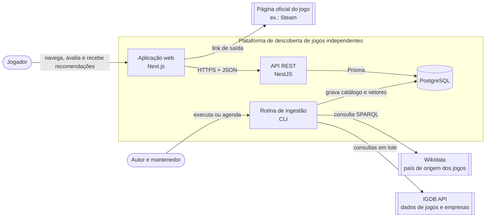
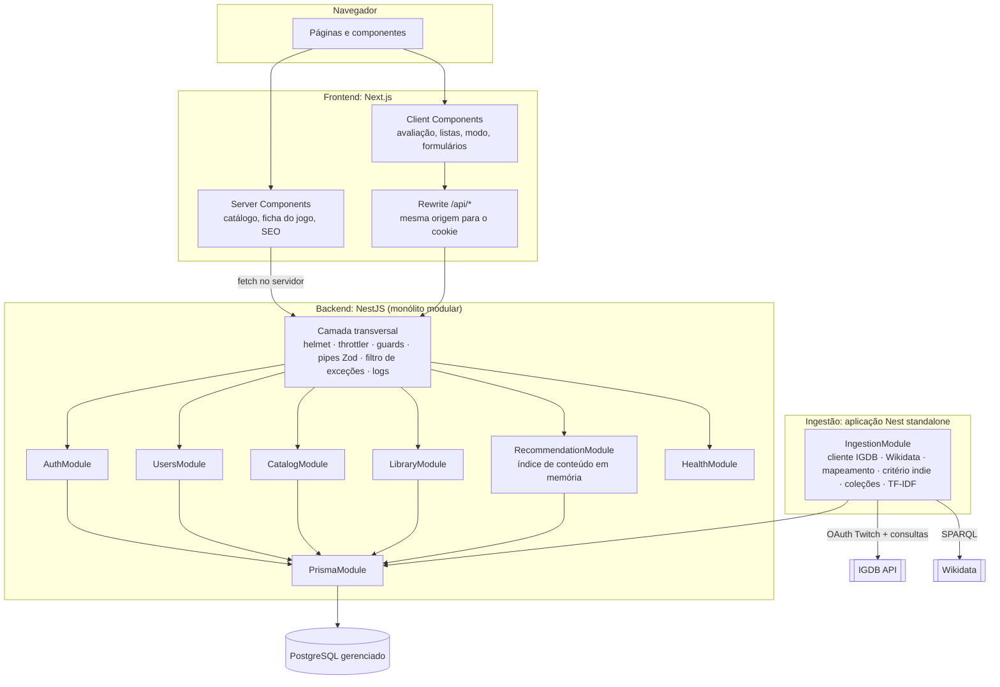
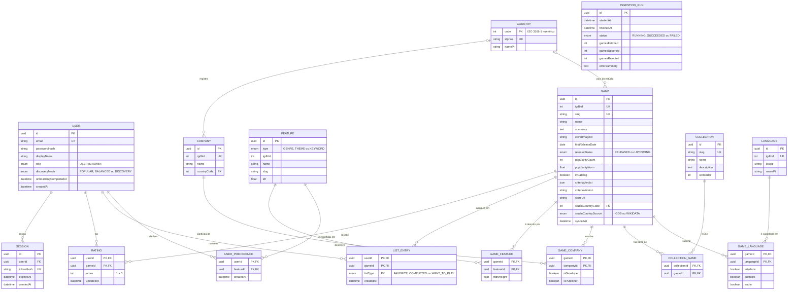
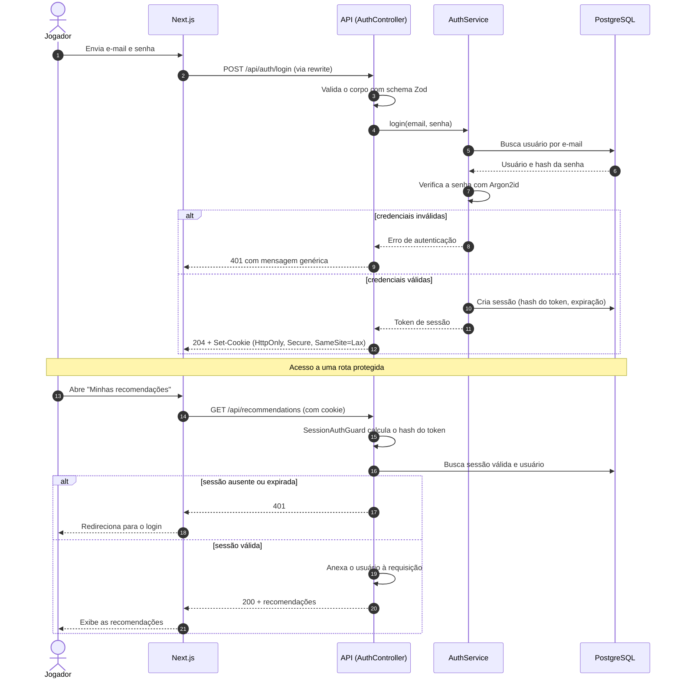
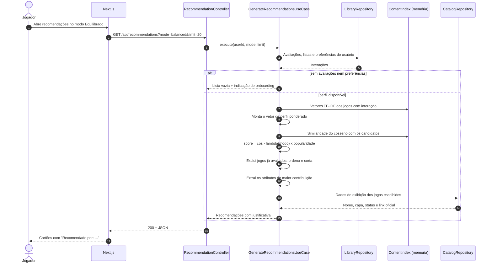
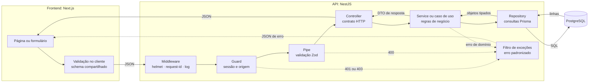

# Proposta técnica de desenvolvimento: plataforma de descoberta de jogos independentes

Oct 19, 2026 · @Victor Gopfert

## 1. Identificação e objetivo

| Campo | Valor |
| --- | --- |
| Projeto | Plataforma Web de Descoberta de Jogos Independentes |
| Natureza | Trabalho de Conclusão de Curso, modalidade projeto técnico |
| Curso | Tecnologia em Análise e Desenvolvimento de Sistemas, UERJ |
| Autor | Victor Gopfert Ferreira Figueiredo |
| Orientador | Leonardo da Silva Bóia |
| Documento de origem | *Plataforma Web de Descoberta de Jogos Independentes: proposta* (versão conceitual, outubro de 2026) |

**Objetivo deste documento:** transformar a proposta conceitual em um plano técnico e de execução que um único desenvolvedor consiga cumprir em menos de seis meses, entregando na defesa um MVP funcional, testado, documentado e demonstrável. Ele é a referência oficial durante a implementação: quando uma decisão aqui conflitar com uma ideia nova, a ideia nova entra no backlog pós-defesa, a menos que substitua algo de mesmo custo.

**Objetivo do sistema:** recomendar jogos independentes a jogadores pela afinidade entre as características de cada jogo e as preferências de cada pessoa, mostrando o motivo de cada indicação, deixando o usuário calibrar o peso da popularidade e incluindo jogos ainda não lançados.

Neste documento, três marcações distinguem a força de cada decisão:

- **Obrigatório:** faz parte do MVP ou da stack base e não muda sem revisão formal deste documento.
- **Recomendado:** escolha padrão, que pode ser trocada por alternativa equivalente sem afetar o restante.
- **Futuro:** fora da defesa, planejado para a Fase B.

## 2. Resumo executivo

**O sistema é um monólito modular em NestJS, com frontend Next.js e PostgreSQL via Prisma, organizado em monorrepositório e implantado em serviços sem custo.** O catálogo é montado por uma rotina de ingestão em lote a partir da API pública da IGDB; o usuário nunca consulta a IGDB diretamente, e a aplicação continua funcionando se ela estiver fora do ar.

As decisões centrais:

- **Recomendação por conteúdo, sem IA generativa no MVP.** Cada jogo vira um vetor TF-IDF de gêneros, temas e palavras-chave; o perfil do usuário é a média ponderada dos jogos que ele avaliou; a pontuação é a similaridade do cosseno menos um termo de popularidade cujo peso o usuário escolhe em três modos. A abordagem é determinística, explicável, testável e funciona com jogos sem nenhuma avaliação, o que inclui os não lançados.
- **Autenticação por sessão em cookie HttpOnly, com senha em Argon2id.** O frontend fala com a API pela mesma origem, por meio de um *rewrite* do Next.js, o que evita os problemas de cookies entre domínios.
- **Padrões com justificativa, não por padrão.** Controllers, services e repositories em todos os módulos; casos de uso dedicados só onde há orquestração real (recomendação e ingestão); regras de negócio críticas como funções puras, testáveis sem banco nem framework.
- **Contratos únicos em Zod**, compartilhados entre frontend e backend num pacote do monorrepositório e validados no NestJS pelo mecanismo nativo de *Standard Schema*.

O MVP tem 16 funcionalidades P0, que demonstram a proposta central de ponta a ponta: cadastro, catálogo independente com filtros, coleções culturais curadas, ficha do jogo, avaliações e listas, partida a frio, recomendações com motivo, seleção do grau de novidade e uma avaliação offline mensurável do recomendador.

O cronograma tem 24 semanas, com a premissa de 15 horas semanais dedicadas ao TCC. Prevê implantação já na semana 4, recomendação funcionando pela API na semana 16, congelamento de funcionalidades ao fim da semana 20 e duas semanas finais de margem antes da banca. Um ambiente local completo, com PostgreSQL embutido no projeto, serve de contingência para a demonstração.

## 3. Escopo e premissas

### Dentro do escopo da defesa

- Aplicação web pública para jogadores, com cadastro e área autenticada.
- Catálogo de jogos independentes, lançados e por lançar, montado por ingestão em lote da IGDB.
- Recomendação personalizada por conteúdo, com motivo visível e três modos de popularidade.
- Avaliação offline do recomendador e teste de usabilidade com jogadores.
- API documentada, testes automatizados dos fluxos críticos e ambiente implantado.

### Fora do escopo da defesa

- Qualquer funcionalidade operada por estúdios (cadastro de jogos, área do desenvolvedor).
- Recursos sociais, comentários, notificações e e-mail transacional.
- IA generativa, embeddings e filtragem colaborativa.
- Aplicativo móvel nativo e internacionalização: a interface é em português.
- Venda, intermediação ou qualquer modelo comercial.

### Premissas

| # | Premissa | Se for falsa |
| --- | --- | --- |
| PR-01 | Um único desenvolvedor, sem equipe, em nível de graduação | O plano já é dimensionado para isso |
| PR-02 | Cerca de 15 horas semanais dedicadas ao TCC: 12 de desenvolvimento e 3 de escrita e atividades acadêmicas | Com menos horas, aplicar o plano de corte da seção 16 já no marco M1 |
| PR-03 | 24 semanas até a banca, ancoradas no fim do período letivo em 24/04/2027 | Ao saber a data exata da defesa, recalcular os marcos a partir dela |
| PR-04 | A API da IGDB continua gratuita para uso não comercial, com atribuição visível | Confirmar os termos na tarefa B-07; se mudarem, o MVP roda com um recorte salvo do catálogo |
| PR-05 | Hospedagem e banco em camadas gratuitas, sem cartão de crédito | O ambiente local (PostgreSQL embutido, B-04) é a contingência oficial da demonstração |
| PR-06 | O catálogo recortado tem cerca de 20 mil jogos. **Revisada no M0 (19/10/2026):** a premissa original era "poucos milhares", mas a IGDB tem 130 mil jogos indie; o recorte aprovado (relatório do M0, `docs/m0-relatorio-igdb.md`, seção 8) mantém só jogos com ficha completa e algum sinal de interesse | Reduzir o recorte (por exemplo, por ano de lançamento) até caber no banco gratuito e na memória da API |
| PR-07 | As pesquisas de campo de outubro de 2026 já estão concluídas e entram no TCC como metodologia | Nenhuma nova pesquisa é necessária antes do teste de usabilidade |

### Decisões herdadas da proposta conceitual

Estas decisões vieram das pesquisas com desenvolvedores e jogadores e não são reabertas aqui: popularidade calibrada pelo usuário, com o equilíbrio como padrão; jogos não lançados no catálogo; país do estúdio como filtro secundário, sem seção própria; idioma e temas como recortes de navegação; critério de indie público, que não exclui um jogo só por ele ter publisher; partida a frio que pede no máximo quatro avaliações; e neutralidade comercial.

**Revisão no M0 (19/10/2026), por decisão do autor:** país do estúdio e cultura retratada passam a ser tratados como diferenciais da plataforma. O país continua como filtro, agora com a IGDB complementada pelo Wikidata, e a cultura retratada ganha navegação própria por coleções curadas (F-24), que deixa de ser P2. As medições que sustentam a decisão estão no relatório do M0, `docs/m0-relatorio-igdb.md`, seção 8.8.

## 4. Requisitos e MVP

**O MVP é o conjunto P0: 16 funcionalidades que permitem a um jogador se cadastrar, informar o próprio gosto, receber recomendações explicadas e escolher o grau de novidade, sobre um catálogo real de jogos independentes.** P1 entra se sobrar capacidade depois do marco M2, sem nunca ser dependência de um P0. P2 é pós-defesa.

Complexidade: **B** baixa (até um dia de trabalho), **M** média (alguns dias), **A** alta (uma semana ou mais, com incerteza técnica).

### P0: essenciais para a defesa

| ID | Funcionalidade | Justificativa | Critérios de aceitação | Depende de | Compl. |
| --- | --- | --- | --- | --- | --- |
| F-01 | **Cadastro, login e logout** por e-mail e senha | Recomendação personalizada exige identidade persistente | E-mail único; senha com pelo menos 8 caracteres; senha armazenada só como hash Argon2id; login cria sessão em cookie HttpOnly; logout invalida a sessão no servidor; erros de login com mensagem genérica | — | M |
| F-02 | **Ingestão do catálogo** a partir da IGDB, por linha de comando | O catálogo precisa ser amplo e automático, sem cadastro manual | Importa jogos lançados e por lançar do recorte definido em M0; execução repetida não duplica registros; respeita o limite de requisições; cada execução fica registrada com contagens e erros | F-03, F-04 | A |
| F-03 | **Critério de jogo independente** configurável e documentado | O termo não tem definição única; o critério precisa ser público e testável | Regras em arquivo versionado; publicar um jogo não exclui, nem para grande publisher; jogo desenvolvido, na data de lançamento, por grande empresa ou por estúdio que ela controla (integral ou majoritariamente) é excluído; resultado verificado contra um conjunto de casos reais, com acertos e erros documentados | — | M |
| F-04 | **Vetorização de conteúdo** (TF-IDF) dos jogos | Base da recomendação e da explicação | Cada jogo tem pesos por gênero, tema e palavra-chave, com norma 1; atributos raros ou comuns demais são descartados por limites configuráveis; recálculo idempotente | — | M |
| F-05 | **Busca e navegação do catálogo** por título, gênero, tema e situação (lançado ou em breve) | Descoberta não personalizada e porta de entrada sem login | Filtros combináveis; paginação; estado dos filtros na URL; acessível sem login | F-02 | M |
| F-06 | **Filtros de idioma (português) e país do estúdio** | Idioma pesou cinco vezes mais que país na pesquisa; país fica como recorte secundário | Combináveis com os de F-05; jogos sem o dado não aparecem como "não tem", e sim como "não informado". **Regra de portão (revisada no M0):** idioma segue P0 com 95,5% de cobertura. O país do estúdio vem da IGDB e, na falta dela, do Wikidata (cerca de 50% de cobertura somada); no filtro, cada país só aparece como opção se tiver pelo menos 20 jogos no catálogo | F-05, M0 | M |
| F-07 | **Ficha do jogo** com capa, resumo, gêneros, temas, estúdio, país, situação e link para a página oficial | É onde a recomendação se converte em interesse pelo jogo | Selo "Em breve" para não lançados; link externo abre a página oficial; atribuição à IGDB visível; metadados de página gerados no servidor | F-02 | M |
| F-08 | **Avaliação de 1 a 5 e listas** (favorito, concluído, quero jogar) | Fonte do perfil de preferências | Criar, alterar e remover; só o próprio usuário altera seus dados; alteração reflete na próxima recomendação | F-01, F-07 | M |
| F-09 | **Página de perfil** com avaliações e listas | O usuário precisa ver e corrigir o que alimenta as recomendações | Lista avaliações e listas com acesso à ficha de cada jogo; estados vazios orientam o próximo passo | F-08 | B |
| F-10 | **Partida a frio**: escolha de pelo menos 3 gêneros ou temas e avaliação opcional de até 4 jogos | Sem perfil não há recomendação; 16,7% dos jogadores não avaliariam nenhum jogo | Pode pular a etapa de avaliação; preferências geram recomendações mesmo sem avaliações; aparece no primeiro acesso e pode ser refeita | F-08, F-11 | M |
| F-11 | **Recomendações personalizadas com motivo** | Núcleo da proposta | Retorna os N mais bem pontuados, sem jogos já avaliados; cada item traz de 1 a 3 atributos que mais contribuíram; mesmo estado gera mesma lista; usuário sem perfil é levado à partida a frio | F-04, F-08 | A |
| F-12 | **Modo de descoberta**: Populares, Equilibrado e Descobertas | 75% dos jogadores querem equilíbrio ou escolha; nenhum dos lados quer penalização fixa | Padrão Equilibrado; escolha persistida no usuário; trocar o modo muda a lista de forma observável | F-11 | B |
| F-13 | **Página "Como funciona"**: critério de indie, lógica da recomendação e origem dos dados | Transparência é princípio da proposta | Explica o critério em linguagem simples, lista as grandes empresas, os estúdios controlados e as exceções manuais com o motivo e a fonte de cada uma, e descreve como as coleções culturais são curadas; acessível sem login | F-03 | B |
| F-14 | **Avaliação offline do recomendador** | Resultado mensurável do TCC | Script gera, para perfis simulados, cobertura de catálogo e popularidade média das recomendações em cada modo; resultado exportável em tabela e reproduzível | F-11, F-12 | M |
| F-15 | **Documentação da API e verificação de saúde** | Contrato verificável e monitoramento mínimo | Swagger lista todos os endpoints P0 com exemplos e erros; rota de saúde informa API e banco | — | B |
| F-24 | **Coleções culturais curadas** ("Explore por cultura") | Cultura retratada pesou 33,3% na pesquisa; nenhuma fonte de dados registra a cultura de forma ampla (medido no M0), então a navegação é feita por curadoria transparente. Promovida de P2 a P0 no M0 | Coleções definidas em arquivo versionado, com nome, descrição e jogos aprovados; candidatos sugeridos automaticamente (palavras-chave, resumo e Wikidata) e revisados pelo autor; cada coleção com pelo menos 10 jogos, com destaque para a cultura brasileira; vitrine na página inicial e no catálogo, página da coleção e indicação na ficha do jogo; acessível sem login | F-02, F-07 | M |

### P1: importantes, mas negociáveis

| ID | Funcionalidade | Justificativa | Critérios de aceitação | Depende de | Compl. |
| --- | --- | --- | --- | --- | --- |
| F-16 | **Registro de cliques de saída** para a página oficial | Único indicador do benefício ao estúdio | Cada clique gera um evento com jogo e data; usuário opcional; relatório por jogo | F-07 | B |
| F-17 | **Jogos parecidos** na ficha do jogo | Reaproveita os vetores e ajuda quem não está logado | Até 6 jogos por similaridade de conteúdo, com o mesmo modo de popularidade | F-04 | B |
| F-18 | **Sitemap e robots** para indexação | Ajuda a plataforma a ser encontrada, risco de adesão apontado na pesquisa | Sitemap lista as fichas públicas; atualizado após ingestão | F-07 | B |
| F-19 | **Exclusão da própria conta** e dos dados associados | Minimização de dados (LGPD) | Remove usuário, sessões, avaliações, listas e preferências após confirmação | F-01 | B |
| F-20 | **Edição de perfil**: nome de exibição e troca de senha | Manutenção básica da conta | Troca de senha exige a senha atual e encerra as outras sessões | F-01 | B |
| F-21 | **Ingestão agendada** | Mantém o catálogo atualizado sem ação manual | Execução periódica no CI com segredos protegidos; falha gera alerta no próprio CI | F-02 | B |

### P2: pós-defesa

| ID | Funcionalidade | Justificativa |
| --- | --- | --- |
| F-22 | Sugestão de jogo ausente pela URL da loja, com moderação | Pedido de desenvolvedores; jogos pequenos e por lançar podem faltar nas bases |
| F-23 | Área do estúdio para descrever os próprios jogos | Pedido de desenvolvedores; exige verificação de identidade |
| F-25 | Recursos de comunidade: perfis públicos e listas compartilhadas | Pedido de desenvolvedores; só faz sentido com base de usuários |
| F-26 | Recuperação de senha por e-mail | Exige provedor de e-mail transacional |
| F-27 | Recomendação híbrida com embeddings semânticos | Evolução opcional, condicionada à avaliação da seção 12 |
| F-28 | Filtragem colaborativa | Exige volume de interações que o MVP não terá |
| F-29 | Avisos de lançamento de jogos acompanhados | Depende de e-mail ou notificação |
| F-30 | Importação da biblioteca da Steam para iniciar o perfil | Integração externa adicional |

### Requisitos não funcionais

| ID | Requisito | Como verificar |
| --- | --- | --- |
| RNF-01 | **Segurança**: senhas em Argon2id, cookies HttpOnly + Secure + SameSite=Lax, verificação de origem em requisições que alteram estado, limite de tentativas no login, cabeçalhos de segurança, validação de toda entrada | Testes e2e de autenticação e revisão da lista da seção 8 antes do congelamento |
| RNF-02 | **Independência da fonte externa**: nenhuma requisição de usuário depende da IGDB | Demonstração com credenciais da IGDB removidas |
| RNF-03 | **Desempenho perceptível**: catálogo e recomendações respondem sem espera perceptível na demonstração | Medir e registrar o tempo de resposta com o catálogo real em M2; investigar se a resposta não for imediata. Sem meta numérica arbitrária |
| RNF-04 | **Manutenibilidade**: TypeScript estrito, lint e formatação automáticos, CI verde para integrar | Hook de pre-commit e pipeline bloqueiam violações |
| RNF-05 | **Acessibilidade básica**: HTML semântico, rótulos em formulários, contraste e navegação por teclado nos fluxos P0 | Checagem manual e com a auditoria de acessibilidade do navegador nos fluxos P0 |
| RNF-06 | **Dados e termos de uso**: atribuição à IGDB, uso não comercial, coleta apenas de e-mail e nome de exibição | Revisão antes da implantação pública |
| RNF-07 | **Observabilidade mínima**: logs estruturados com identificador de requisição; histórico de ingestões | Log de uma requisição rastreável ponta a ponta; tabela de execuções de ingestão |

## 5. Arquitetura

**Monólito modular: uma única API NestJS dividida em módulos por domínio, um frontend Next.js e um banco PostgreSQL, com a ingestão rodando como processo separado que reaproveita o mesmo código.** Os diagramas de contexto, arquitetura e fluxo de dados estão na seção 11.

### Por que monólito modular

Um único desenvolvedor, um único banco e um domínio pequeno não justificam microsserviços: eles multiplicariam implantação, observabilidade e contratos sem ganho real. O monólito modular dá as fronteiras que importam — cada módulo tem seus controllers, serviços e repositórios, e só expõe o que outros módulos precisam — e permite extrair um módulo no futuro, se um dia for necessário.

### Monorrepositório (obrigatório)

Um único repositório com *workspaces* do pnpm:

```
/
├─ apps/
│  ├─ api/          NestJS: API REST e aplicação de ingestão
│  └─ web/          Next.js: interface
├─ packages/
│  └─ contracts/    schemas Zod e tipos compartilhados
├─ scripts/db.mjs       PostgreSQL local (pnpm db:start / db:stop)
├─ tsconfig.base.json
└─ pnpm-workspace.yaml
```

| Critério | Monorrepositório | Repositórios separados |
| --- | --- | --- |
| Contratos entre frontend e backend | Um único pacote de schemas, importado pelos dois lados | Duplicação ou publicação de pacote |
| Lint, formatação e hooks | Uma configuração | Uma por repositório |
| CI | Um pipeline que testa tudo junto | Pipelines separados, mudanças cruzadas em dois PRs |
| Implantação | Cada app aponta para sua pasta | Natural |
| Custo | Configurar o pacote compartilhado para os dois builds | Nenhum custo de configuração |

Para um desenvolvedor só, o contrato único e o pipeline único pesam mais que o custo inicial de configuração, que fica isolado na tarefa B-01. Ferramentas de orquestração de monorrepositório, como Turborepo, são **opcionais**: os scripts do pnpm bastam no tamanho deste projeto.

### Módulos da API

| Módulo | Responsabilidade | Expõe para outros módulos |
| --- | --- | --- |
| `AuthModule` | Cadastro, login, logout, sessões, guard de autenticação | `SessionAuthGuard`, decorators `@Public()` e `@CurrentUser()` |
| `UsersModule` | Dados do usuário e modo de descoberta | `UsersService` |
| `CatalogModule` | Busca, filtros, ficha do jogo, listas de gêneros e temas, coleções culturais | `CatalogRepository` (leitura) |
| `LibraryModule` | Avaliações, listas e preferências de partida a frio | `LibraryRepository` (leitura) |
| `RecommendationModule` | Índice de conteúdo em memória, pontuação, explicação | — |
| `IngestionModule` | Cliente IGDB, mapeamento, critério indie, TF-IDF, execução | — (só carregado pela aplicação de ingestão) |
| `HealthModule` | Saúde da API e do banco | — |
| `PrismaModule` | Cliente Prisma único e configurado | `PrismaService` |

### Duas entradas, o mesmo código

A API sobe com `NestFactory.create` e carrega todos os módulos, menos o de ingestão. A ingestão é uma **aplicação standalone** do Nest (contexto de aplicação sem servidor HTTP), executada por linha de comando, que carrega `IngestionModule` e `PrismaModule`. Assim, a rotina pesada de ingestão nunca disputa recursos com as requisições dos usuários, e a API não precisa conhecer credenciais da IGDB. Ao fim de uma ingestão, a API recarrega o índice de conteúdo na próxima inicialização ou por um endpoint interno protegido por segredo de ambiente.

### Frontend e mesma origem

O Next.js usa o App Router. Páginas públicas (catálogo, ficha, "Como funciona") são Server Components, que buscam dados no servidor e geram metadados para buscadores. Interações (avaliar, listas, modo, formulários) são Client Components. O navegador chama sempre `/api/*` no próprio domínio do frontend, e um *rewrite* do Next.js repassa a chamada para a API. Isso mantém o cookie de sessão como cookie primeiro (*first-party*), sem depender de cookies entre domínios, que navegadores restringem cada vez mais.

### Contratos da API

Prefixo global `/api`. Respostas em JSON; erros sempre no mesmo formato.

| Método e rota | Acesso | Propósito |
| --- | --- | --- |
| `POST /api/auth/register` | Público | Cadastro |
| `POST /api/auth/login` | Público | Login; define o cookie de sessão |
| `POST /api/auth/logout` | Autenticado | Encerra a sessão |
| `GET /api/auth/me` | Autenticado | Usuário atual |
| `GET /api/games` | Público | Busca com filtros e paginação |
| `GET /api/games/:slug` | Público | Ficha do jogo |
| `GET /api/collections` | Público | Coleções culturais curadas |
| `GET /api/collections/:slug` | Público | Jogos de uma coleção, com paginação |
| `GET /api/features?type=GENRE\|THEME` | Público | Opções de filtro e de partida a frio |
| `PUT /api/me/ratings/:gameId` / `DELETE` | Autenticado | Cria, altera ou remove avaliação |
| `PUT /api/me/lists/:listType/:gameId` / `DELETE` | Autenticado | Adiciona ou remove de lista |
| `GET /api/me/library` | Autenticado | Avaliações e listas do usuário |
| `PUT /api/me/preferences` | Autenticado | Preferências de partida a frio |
| `PATCH /api/me` | Autenticado | Modo de descoberta |
| `GET /api/recommendations?mode=&limit=` | Autenticado | Recomendações com motivo |
| `GET /api/health` | Público | Saúde da API, do banco e do índice de conteúdo |
| `POST /api/internal/reload-index` | Segredo de ambiente | Recarrega o índice de conteúdo após uma ingestão; fora da documentação pública |

Formato de erro padronizado, produzido pelo filtro global de exceções:

```json
{ "statusCode": 409, "error": "Conflict", "message": "E-mail já cadastrado", "requestId": "b1f3…" }
```

### Configuração por ambiente

Todas as variáveis (`DATABASE_URL`, `PORT`, `SESSION_TTL_DAYS`, `WEB_ORIGIN`, `IGDB_CLIENT_ID`, `IGDB_CLIENT_SECRET`, `INTERNAL_RELOAD_SECRET`, `NODE_ENV`; no frontend, `API_URL` para o *rewrite*, acrescentadas no B-02) são lidas pelo `@nestjs/config` e validadas por um schema Zod na inicialização: se faltar algo, a aplicação não sobe e diz o que falta. Um `.env.example` versionado documenta cada uma; nenhum `.env` real entra no repositório.

## 6. Stack e justificativas

**Obrigatória** = faz parte do MVP e está no escopo da defesa. **Recomendada** = escolha padrão, trocável por alternativa equivalente sem afetar o plano. **Opcional** = só se sobrar tempo ou se resolver um problema concreto.

### Base

| Tecnologia | Classe | Papel | Justificativa |
| --- | --- | --- | --- |
| Node.js 24 LTS (≥ 24.9) | Obrigatória | Runtime da API e do build do frontend | Versão com suporte longo, compatível com NestJS 12 e Prisma 7. **Alterado no B-02 (19/10/2026):** era Node 22, mas o Jest só carrega os pacotes ESM do NestJS 12 numa API CommonJS a partir do Node 24.9 (R-06); o Node 22 também sai de suporte em abril de 2027 |
| pnpm (workspaces) | Obrigatória | Gerenciador de pacotes e monorrepositório | Workspaces nativos, instalação rápida, um lockfile só |
| TypeScript (modo `strict`) | Obrigatória | Linguagem dos três pacotes | Tipos compartilhados entre frontend e backend; erros pegos na compilação |
| Zod | Obrigatória | Schemas de validação em `packages/contracts` | Uma definição gera validação em tempo de execução e tipo estático, usada nos dois lados |

### Backend

| Tecnologia | Classe | Papel | Justificativa |
| --- | --- | --- | --- |
| NestJS 12 | Obrigatória | Framework da API | Módulos, injeção de dependência, guards e pipes prontos; a versão 12 aceita schemas *Standard Schema* (como Zod) diretamente nos decorators `@Body`, `@Query` e `@Param` |
| Formato de módulo CommonJS | Recomendada | Formato do projeto da API | O NestJS 12 publica seus pacotes como ESM e a CLI pergunta o formato ao criar o projeto. CommonJS reduz atrito com Jest. Verificado no B-02: build, execução e cliente do Prisma 7 (`moduleFormat = "cjs"`) funcionam; o Jest exige Node 24.9+ com `--experimental-vm-modules`. Decisão: CommonJS com Node 24, registrada no README (risco R-06) |
| `@nestjs/config` | Obrigatória | Variáveis de ambiente | Leitura centralizada, validada por schema Zod |
| `@nestjs/swagger` | Obrigatória | Documentação OpenAPI em `/api/docs` | Geração a partir dos controllers. A geração automática a partir dos schemas Zod só será adotada se o suporte estiver estável no setup; caso contrário, decorators de documentação escritos à mão nos endpoints P0 |
| `@nestjs/throttler` | Obrigatória | Limite de taxa nas rotas de autenticação | Dificulta tentativa de senha em massa |
| helmet | Obrigatória | Cabeçalhos de segurança HTTP | Proteções básicas com uma linha de configuração |
| cookie-parser | Obrigatória | Leitura do cookie de sessão | Necessário para a autenticação por sessão |
| argon2 | Obrigatória | Hash de senha (Argon2id) | Algoritmo recomendado pela OWASP para armazenamento de senhas |
| Prisma 7 + `@prisma/adapter-pg` | Obrigatória | ORM, migrations e seed | Schema declarativo, migrations versionadas e cliente tipado. No Prisma 7 o gerador é `prisma-client` com `output` obrigatório, o cliente exige *driver adapter* e a URL do banco fica em `prisma.config.ts`; o seed roda explicitamente com `prisma db seed` |
| PostgreSQL 18 | Obrigatória | Banco relacional | Mesma versão principal no ambiente local e no provedor; o Neon oferece a 18 |
| Logger nativo do Nest em modo JSON | Recomendada | Logs estruturados (RNF-07) | O `ConsoleLogger` do Nest aceita saída em JSON; um middleware acrescenta o `requestId`. Sem dependência extra |
| pino (via `nestjs-pino`) | Opcional | Logs estruturados alternativos | Só se o logger nativo não atender na hospedagem |

### Frontend

| Tecnologia | Classe | Papel | Justificativa |
| --- | --- | --- | --- |
| Next.js (App Router) | Obrigatória | Interface web | Server Components para páginas públicas indexáveis e metadados por página; Client Components para interações; *rewrites* para a mesma origem |
| Tailwind CSS | Recomendada | Estilização | Produtividade sem criar biblioteca de componentes própria |
| react-hook-form + resolver Zod | Recomendada | Formulários | Reaproveita os schemas de `packages/contracts` no cliente |
| TanStack Query | Opcional | Cache de dados no cliente | Os Server Components resolvem a maior parte das leituras; só entra se a atualização otimista das avaliações ficar trabalhosa sem ele |

### Qualidade, testes e entrega

| Tecnologia | Classe | Papel | Justificativa |
| --- | --- | --- | --- |
| ESLint + Prettier | Obrigatória | Padrões de código e formatação | Configuração única na raiz do monorrepositório |
| Husky + lint-staged | Obrigatória | Hook de pre-commit | Lint e formatação só nos arquivos alterados, rápido o bastante para não ser desligado |
| Jest + Supertest | Obrigatória | Testes unitários e e2e da API | Padrão do ecossistema Nest, com utilitários de teste prontos |
| Vitest + Testing Library | Opcional | Testes de componentes do frontend | Apenas para componentes com lógica (avaliação, seletor de modo) |
| Playwright | Opcional (P1) | Testes ponta a ponta no navegador | Útil para o fluxo da demonstração, mas não é condição para a defesa |
| GitHub Actions | Obrigatória | CI | Gratuito para repositório público; aceita PostgreSQL como serviço no job de testes |
| PostgreSQL embutido (`embedded-postgres`) | Obrigatória | Banco local | Binários oficiais do PostgreSQL 18 instalados pelo `pnpm install`, sem Docker nem permissão de administrador; banco local idêntico entre máquinas e base da contingência da demonstração. **Substitui o Docker Compose**, indisponível na máquina do autor (B-04, 19/10/2026). O pacote é marcado como beta no npm, por isso a versão fica fixada |

### Hospedagem sem custo

| Componente | Escolha | Limitações conhecidas | Consequência para o plano |
| --- | --- | --- | --- |
| Frontend | Vercel, plano gratuito | Uso pessoal e não comercial | Adequado a um TCC |
| API | Render, *web service* gratuito | 512 MB de memória; hiberna após 15 minutos sem tráfego e leva cerca de um minuto para acordar; sistema de arquivos efêmero; 750 horas de instância por mês na conta | Acordar a API antes de demonstrar; o índice em memória precisa caber em 512 MB (dimensionado no M0); um único serviço no ar o mês todo usa no máximo 744 horas |
| Banco | Neon, plano gratuito | 1 GB por projeto (eram 0,5 GB até 02/10/2026: https://neon.com/docs/changelog/2026-10-02); o computador do banco suspende após 5 minutos ociosos e volta na primeira consulta; 100 CU-horas de computação e 5 GB de tráfego de saída por projeto por mês, e ao estourar o banco fica suspenso até o mês seguinte, sem perder dados (conferido no B-38, 20/10/2026) | O catálogo recortado, de cerca de 20 mil jogos, cabe com folga; o banco não expira; a computação fica no tamanho mínimo, e o consumo é conferido no painel do Neon antes de cada marco e da demonstração |
| Banco (descartado) | Render Postgres gratuito | Expira 30 dias após a criação | Não serve para um projeto de 24 semanas |

Os limites dos planos gratuitos mudam com frequência. Eles devem ser conferidos de novo na semana 3 (B-38) e na semana 21. Se qualquer serviço deixar de atender, a contingência é o ambiente local, com o PostgreSQL embutido e um dump do banco (B-41), ensaiado antes da defesa.

## 7. Organização do código e padrões

### Estrutura de pastas

```
apps/api/
├─ prisma/
│  ├─ schema.prisma
│  ├─ migrations/
│  └─ seed.ts                 países, idiomas e um conjunto pequeno de jogos de teste
├─ prisma.config.ts
├─ config/indie-criteria.json  critério indie versionado
├─ src/
│  ├─ main.ts                  entrada da API
│  ├─ ingest.ts                entrada da ingestão (aplicação standalone)
│  ├─ app.module.ts
│  ├─ config/                  schema Zod das variáveis de ambiente
│  ├─ common/
│  │  ├─ filters/              filtro global de exceções
│  │  ├─ guards/               SessionAuthGuard, OriginGuard
│  │  ├─ decorators/           @Public(), @CurrentUser()
│  │  ├─ middleware/           request-id
│  │  └─ errors/               erros de domínio
│  ├─ prisma/                  PrismaModule e PrismaService
│  └─ modules/
│     ├─ auth/                 controller, service, sessions.repository
│     ├─ users/
│     ├─ catalog/              controller, service, catalog.repository
│     ├─ library/
│     ├─ recommendation/
│     │  ├─ content-index.ts
│     │  ├─ scoring.ts         funções puras
│     │  ├─ tfidf.ts           funções puras, usadas pela ingestão e pelo índice
│     │  └─ generate-recommendations.use-case.ts
│     ├─ ingestion/
│     │  ├─ run-ingestion.use-case.ts   orquestração
│     │  ├─ igdb/              cliente, limitador, token, schema, mapeador e fonte do catálogo
│     │  ├─ criteria/          critério indie: leitura do arquivo e avaliação (função pura)
│     │  ├─ popularity/        contagem reconstruída e normalização (funções puras)
│     │  ├─ review-flags/      alertas e diferença entre execuções (funções puras)
│     │  └─ persistence/       gravação do catálogo em lote
│     └─ health/
└─ test/                       e2e, fixtures da IGDB e builders de dados

apps/web/src/app/
├─ (public)/                   catálogo, jogos/[slug], como-funciona
├─ (auth)/                     entrar, cadastrar
└─ (account)/                  recomendacoes, perfil, boas-vindas (onboarding)

packages/contracts/src/
├─ auth.ts  catalog.ts  library.ts  recommendation.ts  errors.ts
```

Cada módulo tem testes unitários ao lado do arquivo (`*.spec.ts`); os e2e ficam em `apps/api/test`.

### Padrões adotados

| Padrão | Onde | Por quê | Onde **não** usar |
| --- | --- | --- | --- |
| Controller | Todo módulo com rotas HTTP | Concentra o contrato HTTP: rota, status, validação de entrada e documentação Swagger. Não tem regra de negócio | — |
| Service | Auth, Users, Catalog, Library | Regras simples de negócio e orquestração de repositórios | Não criar service só para repassar chamada ao repositório sem lógica |
| Caso de uso (*use case*) | `GenerateRecommendationsUseCase` e `RunIngestionUseCase` | São os dois fluxos com várias etapas, várias fontes de dados e regras próprias; isolá-los facilita testar e explicar na banca | CRUD de avaliações, listas e usuários: um service basta |
| Repository | Um por agregado (sessões, catálogo, biblioteca, usuários) | Isola as consultas Prisma, permite substituí-las por *fakes* nos testes de service e deixa as consultas complexas de filtro em um só lugar | Sem repositório genérico base nem interface duplicando cada classe: em TypeScript, o *fake* de teste pode implementar o mesmo tipo |
| Funções puras | Pontuação, TF-IDF, critério indie, mapeamento IGDB | São o núcleo verificável do TCC: entrada conhecida, saída conhecida, sem banco | — |
| Schema de validação (Zod) | `packages/contracts`, aplicado com a opção `schema` dos decorators e pipe de validação | Uma definição valida no cliente e no servidor e gera o tipo | Não duplicar com DTOs baseados em class-validator |
| Middleware | `helmet`, `cookie-parser`, request-id | Preocupações transversais que valem para toda requisição, antes do roteamento | Não colocar autenticação em middleware: o guard tem acesso aos metadados da rota |
| Guard | `SessionAuthGuard` global com exceção por `@Public()`; `OriginGuard` em métodos que alteram dados | Protegido por padrão: uma rota nova esquecida fica fechada, não aberta | Sem `RolesGuard` no P0: não há rota de administração na interface (o papel `ADMIN` existe só no modelo, para o P2) |
| Filtro de exceções | Global | Formato único de erro, sem vazar *stack trace* ou detalhes do Prisma | — |
| Factory (provider com `useFactory`) | `PrismaClient` com o *adapter*, `IgdbClient` com credenciais | Objetos que dependem de configuração lida na inicialização | Não criar classes *factory* próprias: o mecanismo do Nest basta |
| *Test data builder* | `test/builders` | Cria usuários, jogos e avaliações de teste com valores padrão legíveis | — |

### O que foi descartado

| Abordagem | Motivo |
| --- | --- |
| Clean Architecture completa (entidades de domínio separadas do Prisma, portas e adaptadores para tudo) | Duplicaria cada modelo e cada consulta sem regra de domínio que justifique; o isolamento necessário já vem dos repositórios e das funções puras |
| CQRS, filas, Redis, eventos | Não há carga nem fluxos assíncronos que exijam; a ingestão já é um processo separado |
| Microsserviços | Ver seção 5 |
| GraphQL | REST com OpenAPI atende os contratos e é mais simples de documentar e testar |

### Convenções

- **Commits**: Conventional Commits (`feat:`, `fix:`, `test:`, `docs:`, `chore:`), o que facilita relatar a evolução no TCC.
- **Branches**: `main` sempre implantável; uma branch curta por item do backlog, com o ID no nome (ex.: `B-17-login`), integrada por *pull request* com CI verde.
- **Migrations**: `prisma migrate dev` só na máquina local; `prisma migrate deploy` no CI e na produção. Migrations aplicadas nunca são editadas.
- **Nomes**: código e banco em inglês; textos da interface em português.

## 8. Segurança e autenticação

### Decisão: sessão no banco com cookie, não JWT

| Critério | Sessão opaca no banco | JWT de acesso + *refresh token* |
| --- | --- | --- |
| Logout e revogação | Apagar a linha da sessão encerra o acesso na hora | Exige lista de revogação ou tokens curtos com renovação |
| Peças a implementar | Tabela de sessões, guard, cookie | Assinatura, rotação de refresh, armazenamento seguro no cliente, detecção de reuso |
| Custo por requisição | Uma consulta por índice único | Nenhuma consulta (vantagem que só pesa em escala) |
| Risco de erro de implementação | Baixo | Médio a alto |

Com um único frontend na mesma origem e sem clientes móveis, a vantagem do JWT (não consultar o banco) não compensa a complexidade. A sessão no banco é mais simples de explicar, testar e revogar.

### Como funciona

1. **Cadastro**: e-mail normalizado (minúsculas, sem espaços), senha com no mínimo 8 caracteres validada pelo schema; hash Argon2id com parâmetros no mínimo iguais à configuração recomendada pela OWASP (19 MiB de memória, 2 iterações, paralelismo 1).
2. **Login**: em caso de falha, mensagem genérica ("e-mail ou senha incorretos"), sem revelar qual campo errou. Em caso de sucesso, gera um token aleatório de 32 bytes, guarda no banco **apenas o hash SHA-256** do token e envia o token no cookie `sid` com `HttpOnly`, `Secure` (em produção), `SameSite=Lax`, `Path=/` e expiração de 7 dias.
3. **Rota protegida**: o `SessionAuthGuard` lê o cookie, calcula o hash, busca a sessão não expirada e anexa o usuário à requisição. Sem sessão válida, responde 401.
4. **Logout**: apaga a sessão no banco e limpa o cookie.
5. **Expiração**: prazo fixo de 7 dias, sem renovação deslizante no P0. Sessões expiradas são removidas ao final de cada execução de ingestão.

### Autorização

- Toda rota `/api/me/*` e `/api/recommendations` usa o `userId` **da sessão**, nunca de parâmetro ou corpo. Assim, um usuário não tem como alterar dados de outro: não existe rota que receba o ID de outro usuário.
- O papel `ADMIN` existe no modelo, mas nenhuma rota P0 depende dele. A ingestão é executada por linha de comando e o recarregamento do índice é protegido por segredo de ambiente.

### Proteções da API

| Ameaça | Medida |
| --- | --- |
| CSRF | `SameSite=Lax` impede o envio do cookie em requisições POST, PUT, PATCH e DELETE vindas de outros sites; como defesa adicional, o `OriginGuard` rejeita métodos que alteram dados quando o cabeçalho `Origin` não é a origem do frontend. Nenhuma rota GET altera dados |
| Força bruta no login | `@nestjs/throttler` com limite por IP nas rotas `/auth/*` |
| XSS e roubo de sessão | Cookie `HttpOnly` (inacessível ao JavaScript); React escapa conteúdo por padrão; `dangerouslySetInnerHTML` proibido por regra de lint; resumos vindos da IGDB tratados como texto puro |
| Cabeçalhos inseguros | helmet |
| Entrada malformada | Schemas Zod em corpo, consulta e parâmetros, com limites (paginação máxima, tamanho de texto, valores de enum) |
| SQL injection | Consultas pelo Prisma, sem SQL montado por concatenação |
| Vazamento de detalhes internos | Filtro global de exceções devolve mensagem genérica para erro 500 e registra o detalhe só no log |
| CORS | Desnecessário no fluxo normal (mesma origem via *rewrite*); quando habilitado, restrito a `WEB_ORIGIN` |
| Links externos | Abertos com `rel="noopener noreferrer"` |

### Segredos e dados pessoais

- Segredos (`DATABASE_URL`, credenciais da IGDB, segredo de recarga) só em variáveis de ambiente do provedor e do CI; nunca no repositório, no frontend ou nos logs.
- Logs registram método, rota, status, duração e `requestId`; nunca senha, cookie, token ou corpo de login.
- Coleta mínima, de acordo com o princípio da necessidade da LGPD: e-mail, nome de exibição, avaliações, listas e preferências. A página "Como funciona" informa que dados são guardados e para quê. A exclusão de conta pelo próprio usuário é P1 (F-19); até lá, exclusão mediante pedido por e-mail.
- Dependências: `pnpm audit` no CI como aviso, sem bloquear o build por vulnerabilidades sem correção disponível.

## 9. Testes e qualidade

**O critério é cobrir o que pode quebrar a demonstração ou a tese central, e não atingir um percentual de cobertura.** Nenhuma meta numérica de cobertura é definida; o relatório de cobertura é gerado apenas para orientar onde faltam testes.

### Níveis de teste

| Nível | Ferramenta | O que cobre | Classe |
| --- | --- | --- | --- |
| Unitário, funções puras | Jest | Pontuação (perfil ponderado, cosseno, penalidade por modo, desempate, exclusão de já avaliados, explicação), TF-IDF, critério indie, normalização de popularidade | Obrigatório |
| Unitário, mapeamento | Jest + fixtures JSON | Conversão de respostas reais da IGDB, salvas como fixtures no B-07, para o modelo interno, incluindo campos ausentes | Obrigatório |
| Unitário, services | Jest + *fakes* de repositório | Regras de cadastro (e-mail duplicado), avaliação fora de 1 a 5, modo inválido | Obrigatório |
| Integração e e2e da API | Jest + Supertest + PostgreSQL de teste | Cadastro, login, logout, rota protegida sem sessão; uma pessoa não altera dados de outra; avaliação e listas persistem; recomendações mudam conforme o modo; formato de erro | Obrigatório |
| Componentes do frontend | Vitest + Testing Library | Componente de avaliação e seletor de modo | Opcional |
| Ponta a ponta no navegador | Playwright | O roteiro da demonstração completo | P1 (B-55) |
| Avaliação offline da recomendação | Script de linha de comando | Métricas da seção 12 sobre perfis sintéticos | Obrigatório |
| Teste de usabilidade | Sessões moderadas com jogadores | Tarefas do fluxo principal e percepção das recomendações | Obrigatório (parte da avaliação do TCC) |

### Dados de teste

- O banco de teste é recriado por `prisma migrate reset` antes da suíte e limpo entre arquivos de teste.
- Um catálogo sintético pequeno (dezenas de jogos com atributos escolhidos a dedo) permite afirmar resultados exatos: "um perfil que gosta de *roguelike* e *pixel art* recebe primeiro o jogo X".
- Nenhum teste automatizado chama a IGDB real. O cliente IGDB é testado contra fixtures.

### Teste de usabilidade

Realizado na semana 21 (B-44), com 8 a 12 jogadores recrutados entre os respondentes da pesquisa que aceitaram contato e outros voluntários. Tarefas: criar conta, escolher preferências, encontrar um jogo por gênero, avaliar três jogos, trocar o modo de descoberta e dizer se entende por que um jogo foi recomendado. Registro: conclusão de cada tarefa, dificuldades observadas, um questionário SUS e uma pergunta aberta sobre a relevância das recomendações. O resultado é descrito no TCC como evidência qualitativa de amostra pequena, sem generalização.

### Pipeline de qualidade

| Momento | Verificações | Bloqueia? |
| --- | --- | --- |
| Pre-commit (Husky + lint-staged) | ESLint com correção automática e Prettier nos arquivos alterados | Sim |
| Pull request e push na `main` (GitHub Actions) | Instalação → `prisma generate` → lint → checagem de tipos → testes unitários → migrations no PostgreSQL de serviço → e2e → build da API e do frontend | Sim |
| Auditoria de dependências | `pnpm audit` | Não (só aviso) |
| Antes de cada marco | Execução manual do roteiro de demonstração no ambiente implantado | Sim, para fechar o marco |

A checagem de tipos roda no CI e não no pre-commit, para que o commit continue rápido.

### Definição de pronto de um item

Um item do backlog está concluído quando: o critério de conclusão do item foi atingido; há teste para a regra principal (quando houver regra); o CI está verde; o endpoint novo está no Swagger; e a mudança está implantada no ambiente de demonstração.

## 10. Modelagem de dados

O diagrama entidade-relacionamento completo está na seção 11 (diagrama 3).

### Entidades principais

| Entidade | Responsabilidade | Origem dos dados | Requisitos |
| --- | --- | --- | --- |
| `User` | Conta, papel e modo de descoberta escolhido | Cadastro | F-01, F-12 |
| `Session` | Sessão ativa (hash do token e expiração) | Login | F-01 |
| `Game` | Jogo do catálogo: nome, resumo, capa, lançamento, status, popularidade bruta e normalizada, se é indie, link oficial, país do estúdio e a origem desse dado | Ingestão (IGDB e Wikidata) | F-02, F-05, F-06, F-07 |
| `Company` | Desenvolvedora ou publicadora, com país | Ingestão | F-03, F-06 |
| `GameCompany` | Papel de cada empresa em cada jogo (desenvolvedora, publicadora) | Ingestão | F-03 |
| `Country` | Tabela de países (código ISO 3166-1 numérico, sigla, nome em português) | Seed | F-06 |
| `Feature` | Atributo de conteúdo: gênero, tema ou palavra-chave, com seu peso IDF | Ingestão | F-04, F-05, F-10 |
| `GameFeature` | Associação jogo-atributo com o peso TF-IDF | Ingestão | F-04, F-11 |
| `Language` e `GameLanguage` | Idiomas e tipo de suporte (interface, legendas, áudio) | Seed + ingestão | F-06 |
| `Rating` | Nota de 1 a 5 de um usuário para um jogo | Usuário | F-08 |
| `ListEntry` | Jogo em uma lista do usuário (favoritos, concluídos, quero jogar) | Usuário | F-08 |
| `UserPreference` | Gêneros e temas escolhidos na partida a frio | Usuário | F-10 |
| `IngestionRun` | Registro de cada execução da ingestão: início, fim, status, contagens, versão do critério, escala da popularidade e resumo de erros | Ingestão | F-02 |
| `IngestionReviewFlag` | Alerta de revisão gerado por uma execução (estúdio sem efeito atual, empresa-mãe não revisada, data nova, mudança de lado, saída do conjunto candidato) | Ingestão | F-02 |
| `Collection` e `CollectionGame` | Coleção cultural curada (nome, descrição, ordem) e os jogos aprovados nela | Arquivo de curadoria versionado, sincronizado pela ingestão | F-24 |

### Decisões de modelagem

| Decisão | Justificativa |
| --- | --- |
| Chaves compostas em `Rating` (usuário, jogo), `ListEntry` (usuário, jogo, lista), `UserPreference` e tabelas associativas | O banco garante que não há duas avaliações do mesmo jogo pela mesma pessoa; o `PUT` vira um *upsert* simples |
| `igdbId` único em `Game`, `Company`, `Language`; único composto `(type, igdbId)` em `Feature` | Ingestão idempotente: rodar duas vezes atualiza em vez de duplicar. Gêneros, temas e palavras-chave têm numerações independentes na IGDB |
| `slug` único em `Game` | URLs legíveis e estáveis para a ficha do jogo e para buscadores |
| Jogo rejeitado na primeira avaliação não é gravado; jogo gravado que passa a ser rejeitado fica com `inCatalog = false`, com o veredito (`criteriaVerdict`) e a versão do critério (`criteriaVersion`, hash do arquivo) | Avaliações e listas apontam para o jogo, então ele não é apagado. O campo se chama `inCatalog`, não `isIndie`, porque o jogo sai também por motivos que não dizem nada sobre ser indie (cancelado, ficha incompleta, sem sinal de interesse); as consultas da interface sempre filtram `inCatalog = true` (renomeado no B-13) |
| Índices em `Game(inCatalog, releaseStatus)`, `Game(studioCountryCode)`, `GameFeature(featureId)`, `Company(countryCode)` e `Session(expiresAt)` | Correspondem aos filtros do catálogo, à busca por atributo e à limpeza de sessões |
| Busca textual por nome com `ILIKE` no P0 | Suficiente para cerca de 20 mil jogos; busca *full-text* do PostgreSQL fica como P2 |
| Recomendações não são persistidas | São calculadas na hora a partir do índice em memória; persistir criaria problema de invalidação sem benefício no MVP |
| Imagens de capa não são armazenadas | Guarda-se só o identificador da imagem; a URL é montada para a CDN de imagens da IGDB, com atribuição visível |
| Critério indie em arquivo JSON versionado (`config/indie-criteria.json`) | Fica rastreável no Git, revisável na banca e alterável sem migration |
| `popularityCount` (a contagem reconstruída, inteira) e `popularityNorm` gravados no jogo; a unidade da IGDB, o máximo e a mediana gravados em `IngestionRun` | A unidade muda todo dia com a base de usuários da IGDB, mas a contagem de um jogo não: guardar a contagem evita regravar todo o catálogo a cada execução, e a fração da IGDB se recupera multiplicando a contagem pela unidade da execução (B-13) |
| País do estúdio resolvido na ingestão e gravado em `Game.studioCountryCode`, com `studioCountrySource` (IGDB ou WIKIDATA) | A IGDB tem o país em 39% do catálogo e o Wikidata completa até cerca de 50% (M0); resolver uma vez na ingestão mantém a consulta do filtro simples e deixa a origem do dado rastreável |
| Coleções em arquivo versionado (`config/collections.json`), sincronizadas pela ingestão | A curadoria fica revisável no Git e na banca, como o critério indie; o banco guarda só o resultado para as consultas |
| Datas em UTC; IDs internos UUID | Padrão sem ambiguidade; os IDs internos não expõem a contagem de usuários |

### Volume esperado

O tamanho do catálogo foi definido no M0 (B-07): cerca de 20 mil jogos, depois do recorte aprovado (relatório do M0, `docs/m0-relatorio-igdb.md`, seção 8). Nessa ordem de grandeza, tanto o banco gratuito de 1 GB quanto o índice em memória dentro dos 512 MB da API têm folga (índice estimado em poucos MB); os valores reais são medidos na carga inicial (B-14) e no B-31, e não presumidos. Se o catálogo ficar grande demais, o corte é feito por data de lançamento ou por um mínimo de popularidade, registrado no critério de ingestão.

## 11. Diagramas

Todos os diagramas estão em Mermaid e foram validados com o renderizador oficial (`@mermaid-js/mermaid-cli`). Ao exportar este documento para Markdown, eles renderizam diretamente no GitHub e podem ser versionados em `docs/` no repositório.

### 11.1 Diagrama de contexto

Quem usa o sistema e com quais sistemas externos ele conversa. A IGDB só é acessada pela rotina de ingestão.



### 11.2 Arquitetura do sistema

Monólito modular com camada transversal comum; a ingestão é uma segunda entrada que reutiliza o `PrismaModule`.



### 11.3 Entidade-relacionamento

Atributos essenciais, chaves e cardinalidades. Tabelas associativas usam chave primária composta.



`INGESTION_RUN` não tem relacionamentos: é um registro de auditoria das execuções.

### 11.4 Sequência de autenticação e acesso a rota protegida



### 11.5 Sequência de recomendação



### 11.6 Fluxo de dados entre as camadas

Caminho de uma requisição que altera dados, com os pontos de saída por erro (linhas tracejadas).



## 12. Recomendação e análise de IA

**Decisão: recomendação por conteúdo com TF-IDF, similaridade do cosseno e um termo de popularidade ajustável pelo usuário (alternativa 2). Nenhuma IA generativa nem serviço externo no MVP.** Uma evolução com embeddings semânticos fica como P2 (F-27), condicionada a critérios de avaliação definidos abaixo.

### Comparação das alternativas

| Critério | (1) Regras e filtros | (2) Pontuação e ranqueamento por conteúdo | (3) IA: embeddings, modelos ou serviços externos |
| --- | --- | --- | --- |
| Como funciona | Mostra jogos que têm os gêneros ou temas escolhidos, ordenados por popularidade | Vetor de atributos por jogo, perfil ponderado pelas avaliações, ranqueamento por similaridade com ajuste de popularidade | Vetores semânticos dos resumos, gerados por modelo; ou ranqueamento e explicação por modelo de linguagem via API |
| Personalização | Baixa: duas pessoas com os mesmos filtros recebem a mesma lista | Real: cada avaliação muda o perfil, inclusive avaliações negativas | Potencialmente maior, ao capturar semelhanças que os atributos não descrevem |
| Dados necessários | Atributos dos jogos | Atributos dos jogos e as avaliações do próprio usuário; nenhum dado de outros usuários | Resumos de boa qualidade em todos os jogos; os da IGDB são curtos ou ausentes em parte dos jogos pequenos (a medir no B-07) |
| Complexidade | Baixa | Média: álgebra de vetores esparsos, sem bibliotecas especiais | Alta: pipeline de modelo, armazenamento de vetores densos, calibração do híbrido |
| Custo | Nenhum | Nenhum | Modelo local: tempo de processamento na ingestão e memória. Serviço externo: custo por chamada, chave de API e dependência em tempo de requisição |
| Testabilidade | Alta | Alta: determinística, com resultado exato verificável em catálogo sintético | Baixa a média: resultados difíceis de prever; com modelo de linguagem, não determinísticos |
| Explicação ao usuário | Trivial ("você escolheu Roguelike") | Exata: os atributos que mais contribuíram para a pontuação | Embeddings não explicam por si só; explicação gerada por modelo de linguagem pode afirmar algo falso sobre o jogo |
| Jogos sem avaliações e não lançados | Funciona | Funciona: depende só dos atributos do jogo | Funciona com embeddings, se o resumo existir |
| Controle de popularidade | Por ordenação | Termo explícito na fórmula, com peso por modo | Precisa ser combinado com um termo explícito do mesmo jeito |
| Impacto no cronograma | Mínimo, mas não sustenta a proposta central nem o resultado do TCC | Cerca de três semanas (B-31 a B-33, B-36, B-37), já previstas | Mais algumas semanas e um risco técnico novo, sem ganho comprovado sobre a alternativa 2 |

A alternativa 1 não é recomendação personalizada: é o catálogo filtrado, que já existe em F-05 e será usado como *baseline* na avaliação. A alternativa 3 não é justificável no MVP: a proposta central (descoberta explicada, com controle de popularidade e jogos não lançados) é inteiramente atendida pela alternativa 2, e a IA adicionaria custo, incerteza e perda de explicabilidade sem uma melhora que possa ser demonstrada antes da defesa.

### Como a alternativa 2 funciona

**1. Vetores dos jogos (na ingestão, B-12).** Cada jogo é descrito por seus gêneros, temas e palavras-chave. O peso de cada atributo é o IDF (atributos raros pesam mais), multiplicado por um peso por tipo (palavras-chave valem menos que gêneros e temas, por serem mais ruidosas). Atributos presentes em pouquíssimos jogos ou em quase todos são descartados por limites configuráveis. Cada vetor é normalizado para norma 1.

**2. Perfil do usuário (na requisição).**

```
peso do jogo i:      w_i = (nota_i − 3) + b_i
  b_i = bônus de lista: favorito 2 · concluído 1 · quero jogar 0,5 (0 se não estiver em lista)
  jogo só em lista, sem nota: w_i = b_i

perfil:              u = Σ w_i · v_i  +  β · Σ e_f
  v_i = vetor do jogo i
  e_f = vetor unitário de cada gênero ou tema escolhido na partida a frio
  β   = peso das preferências declaradas (inicial 1)
```

Notas 1 e 2 entram com peso negativo e afastam o perfil daqueles atributos; nota 3 é neutra.

**3. Pontuação de cada candidato j.**

```
score(j) = cos(u, v_j) − λ_modo · pop_j

pop_j = log(1 + p_j/u) / log(1 + p_max/u)      popularidade normalizada entre 0 e 1
λ_modo (valores iniciais):  Populares −0,2 · Equilibrado 0 · Descobertas +0,3
```

`p_j` é a fração da base de usuários da IGDB que marcou o jogo como "quero jogar" (primitivo "Want to Play" do PopScore), o mesmo indicador para jogos lançados e não lançados; zero quando não houver valor. **Revisto no B-13:** o valor não é uma contagem. Todos os 16.730 valores do catálogo aceito são múltiplos inteiros de 1/881.744, então o sistema reconstrói a contagem dividindo pela unidade `u`, a menor fração positiva da execução; se algum valor sair da grade, a execução falha em vez de normalizar errado. `p_max` é o máximo do **catálogo aceito** (763 pessoas em 23/10/2026), não o da IGDB inteira (1.708). Com o valor bruto na fórmula, `log(1 + p) ≈ p` e a normalização vira linear: a mediana de `pop_j` sairia 0,0066; com a contagem, sai 0,27, e o p90, 0,57. Limitação: a IGDB recalcula o valor todo dia, mas o sistema só o atualiza a cada ingestão. **Decidido no M0** (relatório do M0, `docs/m0-relatorio-igdb.md`, seção 8): substitui a proposta original (contagem de avaliações e, para não lançados, `hypes`), porque existe para 91% dos jogos lançados e 43% dos não lançados, enquanto as avaliações existem em 47% do catálogo (praticamente só lançados) e os `hypes` em 27% dos não lançados. A escala logarítmica evita que poucos sucessos dominem a normalização.

**4. Seleção.** Candidatos são todos os jogos indie que o usuário não avaliou e que não estão em nenhuma de suas listas. Ordenação por pontuação; empate resolvido pelo identificador, para que o mesmo estado produza sempre a mesma lista. A popularidade não entra no desempate (decisão do B-12): ela já está no termo λ do modo e, no desempate, contaria duas vezes, uma delas invisível. Os empates são frequentes (ver `docs/vetorizacao-tfidf.md`) e o tratamento deles é do B-32. Filtros opcionais da requisição (por exemplo, só "em breve") são aplicados antes do corte.

**5. Explicação.** A contribuição de cada atributo k para a similaridade é `u_k · v_jk / (‖u‖ · ‖v_j‖)`. Os 1 a 3 atributos com maior contribuição positiva viram o texto "Recomendado por: Roguelike, Pixel art". No modo Descobertas, quando o termo de popularidade foi decisivo, o cartão acrescenta "pouco conhecido".

**6. Execução.** O `ContentIndex` carrega os vetores de todos os jogos indie na memória da API ao iniciar (B-31). Cada recomendação é uma varredura sobre vetores esparsos de cerca de 20 mil jogos, sem consulta pesada ao banco. O tempo de resposta e a memória ocupada são medidos com o catálogo real no M2 (RNF-03).

Todos os pesos (bônus de lista, β, peso por tipo de atributo, limites de descarte e λ por modo) ficam em um arquivo de configuração versionado e são ajustados no B-37 com o protocolo abaixo, não por intuição.

**Vetorização (B-12, 22–23/10/2026).** Configuração em `apps/api/config/recommendation.json` e medições em `docs/vetorizacao-tfidf.md`. Atributo mantido se aparece em pelo menos 3 jogos e em no máximo 80% deles, e 245 palavras-chave de metadados (loja, plataforma, eventos, prêmios, financiamento, opções técnicas) ficam de fora. A normalização padrão é **por bloco**: gênero, tema e palavra-chave normalizados separadamente, com fatias de 40/30/30, e a fatia de um bloco ausente redistribuída entre os presentes. Foi adotada pelo argumento estrutural (com a normalização global, palavras-chave raras, com IDF até 14 vezes o de um gênero comum, dominam o vetor e o motivo exibido) e porque a plataforma é de descoberta; a medição preliminar com 14 pares não a confirmou no ranqueamento, e o modo global segue configurável para o B-37. A cobertura de etiquetas (21,1% do catálogo com vetor idêntico ao de 10 ou mais jogos) foi escalada como decisão do M0.

### Casos-limite e contingências

| Situação | Comportamento |
| --- | --- |
| Usuário sem avaliações nem preferências | A API devolve lista vazia com indicação de onboarding; a interface leva à partida a frio |
| Perfil só com notas negativas ou neutras (vetor sem componente positiva) | Recomenda os jogos mais populares dos gêneros preferidos, se houver, ou do catálogo; o cartão informa que a lista vai melhorar com mais avaliações |
| Poucos candidatos depois dos filtros | Devolve os que houver, sem completar com jogos fora do filtro |
| IGDB indisponível | Nenhum efeito sobre o usuário: a recomendação usa apenas dados já ingeridos (RNF-02) |
| Índice ainda carregando na inicialização | Rota de recomendações responde 503 com mensagem clara; a rota de saúde informa o estado |

### Avaliação da qualidade (F-14, B-37)

Não haverá usuários reais suficientes para métricas de uso. A avaliação combina um protocolo offline reproduzível com o teste de usabilidade.

**Perfis sintéticos.** Para cada gênero e tema relevante do catálogo, o script sorteia, com semente fixa, um perfil que avalia bem alguns jogos que têm aquele atributo e mal alguns que não têm.

| Métrica | Definição | O que se espera |
| --- | --- | --- |
| Acerto por omissão (*leave-one-out hit rate*@20) | Esconde um dos jogos bem avaliados do perfil e verifica se ele volta entre os 20 primeiros | Superar os dois *baselines*: aleatório e "mais populares dos gêneros preferidos" (alternativa 1) |
| Cobertura de catálogo@20 | Fração do catálogo que aparece em algum top-20 entre todos os perfis | Maior em Descobertas do que em Populares |
| Popularidade média das recomendações (ARP@20) | Média de `pop_j` dos 20 primeiros | Ordem Populares > Equilibrado > Descobertas, com diferença observável |
| Fração de jogos não lançados@20 | Proporção de "em breve" no top-20 | Presente nos três modos, sem dominar nenhum deles; se dominar, revisar o `p_j` dos não lançados |
| Determinismo | Mesmo estado, mesma lista | Verificado por teste automatizado |

Os critérios são comparativos (contra *baselines* e entre modos), não metas numéricas arbitrárias. Os resultados, com a semente e a configuração usadas, entram no TCC como tabela. No teste de usabilidade, os jogadores dizem se entendem o motivo das recomendações e se reconhecem os jogos sugeridos como compatíveis com o próprio gosto, o que complementa o protocolo offline com percepção humana, sem pretensão estatística.

### Evolução opcional com IA (P2, F-27)

**O que seria:** um modelo de embeddings de texto de código aberto, executado localmente durante a ingestão, gera um vetor semântico para o resumo de cada jogo. A pontuação passa a ser híbrida: `α · cos_TF-IDF + (1 − α) · cos_semântico − λ_modo · pop`. Os vetores são calculados uma vez e guardados; nenhuma requisição de usuário chama modelo ou serviço externo.

**Quando adotar:** só se, no mesmo protocolo offline, o híbrido tiver acerto por omissão maior que o TF-IDF sem reduzir a cobertura nem aumentar a popularidade média no modo Descobertas, e se um pequeno conjunto de julgamentos humanos (pares "este jogo é parecido com aquele?") concordar mais com o híbrido. Sem isso, a evolução não é adotada.

**Pré-requisitos a medir antes:** fração dos jogos com resumo útil (medida no B-07) e memória adicional na API (vetores densos de poucas centenas de dimensões para alguns milhares de jogos ocupam alguns megabytes, mas o valor real deve ser medido).

**Contingência:** jogo sem resumo ou sem vetor semântico usa só a parte TF-IDF (`α = 1`). A explicação continua vindo dos atributos TF-IDF.

### Descartado, com motivo

| Abordagem | Motivo |
| --- | --- |
| API externa de embeddings ou de modelo de linguagem no MVP | Custo, chave de API, dependência em tempo de requisição e nenhum ganho demonstrável antes da defesa |
| Explicações geradas por modelo de linguagem | Podem afirmar algo falso sobre o jogo; não são determinísticas nem testáveis; a explicação por atributos já é exata |
| Filtragem colaborativa | Exige volume de interações entre muitos usuários, que o MVP não terá; favorece itens populares, o oposto da proposta. Fica como P2 (F-28) |

## 13. Backlog

**Esforço relativo:** **P** = 2 a 4 horas · **M** = 5 a 10 horas · **G** = 12 a 20 horas de trabalho efetivo, já incluindo o tempo de aprender a biblioteca envolvida e escrever os testes do item. Nenhum item passa de G; se um item crescer além disso durante a execução, ele é dividido.

O critério de conclusão de cada item soma-se à definição de pronto da seção 9 (teste da regra principal, CI verde, Swagger atualizado, implantado).

### E0. Ambiente e fundação

| ID | Item | Prior. | Depende de | Critério de conclusão | Esf. |
| --- | --- | --- | --- | --- | --- |
| B-01 | Monorrepositório pnpm com `apps/api`, `apps/web`, `packages/contracts` e `tsconfig.base` estrito | P0 | — | Os três pacotes compilam; `contracts` é importado pela API e pelo frontend | M |
| B-02 | Projetos NestJS 12 e Next.js criados; Swagger em `/api/docs`; prefixo `/api`; *rewrite* `/api/*`; verificação de compatibilidade CommonJS × Prisma 7 | P0 | B-01 | Página do Next.js chama uma rota da API pela mesma origem; decisão CJS ou ESM registrada no README | P |
| B-03 | ESLint, Prettier, Husky e lint-staged na raiz | P0 | B-01 | Commit com erro de lint é bloqueado | P |
| B-04 | PostgreSQL local embutido no projeto (`pnpm db:start` / `db:stop`), em vez de Docker Compose, que ficou indisponível na máquina do autor (decisão de 19/10/2026) | P0 | B-01 | `pnpm db:start` sobe o banco com a mesma versão principal do provedor | P |
| B-05 | Pipeline de CI: instalação, lint, tipos, testes, build; PostgreSQL de serviço para e2e | P0 | B-03 | PR com teste falhando fica vermelho; e2e de exemplo roda contra o banco de serviço | P |
| B-06 | Schema Zod das variáveis de ambiente e `.env.example` | P0 | B-02 | API não sobe sem variável obrigatória e informa qual falta | P |

### E1. Catálogo e ingestão

| ID | Item | Prior. | Depende de | Critério de conclusão | Esf. |
| --- | --- | --- | --- | --- | --- |
| B-07 | **Spike da IGDB (marco M0):** credenciais, termos de uso, campos disponíveis, cobertura de país, idioma, resumo e indicador pré-lançamento; recorte e tamanho do catálogo; fixtures salvas | P0 | — | Relatório curto com cobertura medida de cada campo, tamanho estimado do catálogo, decisão de portão do F-06 e fixtures reais versionadas | M |
| B-08 | Schema Prisma do catálogo (Game, Company, Country, GameCompany, Feature, GameFeature, Language, GameLanguage, IngestionRun), primeira migration e seed de países e idiomas | P0 | B-02, B-04, B-07 | `migrate dev` e `db seed` rodam do zero; `migrate deploy` roda no CI | M |
| B-09 | Cliente IGDB: token OAuth da Twitch, paginação, limite de requisições por segundo, novas tentativas com espera | P0 | B-06, B-07 | Teste com servidor simulado comprova o limite de taxa e a renovação do token | M |
| B-10 | Mapeador IGDB → modelo interno | P0 | B-07 | Testes com as fixtures, incluindo campos ausentes, passam | M |
| B-11 | Critério indie configurável em JSON (F-03), incluindo o recorte do catálogo aprovado no M0 e a exclusão do tema Erotic (relatório do M0, `docs/m0-relatorio-igdb.md`, seção 8) | P0 | B-10 | Conjunto de casos reais documentado com acertos e erros; jogo com publisher pequena não é excluído | M |
| B-12 | Cálculo de IDF e vetores TF-IDF normalizados (F-04) | P0 | B-08, B-10 | Testes com catálogo sintético verificam pesos, norma 1 e descarte por limites | M |
| B-13 | `RunIngestionUseCase` em aplicação standalone: busca, mapeia, filtra, grava em lote, busca a popularidade "Want to Play" do PopScore, calcula vetores, registra `IngestionRun` (F-02) | P0 | B-09, B-11, B-12 | Duas execuções seguidas não duplicam registros; falha parcial fica registrada com resumo de erros; é sinalizado para verificação o jogo novo de estúdio da tabela "sem efeito atual" de `docs/criterio-indie-casos.md`, ou cuja desenvolvedora tem empresa-mãe na IGDB fora da lista de grandes, ou na lista mas fora dos estúdios controlados; o critério dos jogos já no catálogo é reavaliado a cada execução, e o jogo sem data que ganha data de lançamento é sinalizado para verificação. **Concluído em 24/10/2026:** carga real no banco local com 20.050 jogos em cerca de 7 min e até 559 MB de pico, com gravação de 16 s numa transação; a segunda execução seguida não regravou nenhuma linha. A popularidade passou a usar a contagem reconstruída (seção 12), o sinal de interesse ganhou a carência pós-lançamento de 180 dias para jogo que já estava no catálogo e `isIndie` virou `inCatalog` (`docs/ingestao.md`) | G |
| B-14 | Carga inicial do catálogo real no banco de produção | P0 | B-13, B-38, B-60 | Catálogo carregado; tamanho do banco e contagens registrados. **Concluído em 24/10/2026:** 20.051 jogos (14.057 lançados, 3.152 por lançar com data e 2.842 sem data) carregados pelo workflow manual "Ingestão" do GitHub Actions; banco de 69 MB pelo `pg_database_size` (32,44 MB no painel de uso do Neon), dentro do limite de 1 GB; 2,94 CU-h de computação no mês; 0 alertas; a segunda execução do mesmo dia regravou só 3 linhas (`docs/ingestao.md`) | P |
| B-60 | Medição da regra de controle do critério indie: duas amostras de cerca de 10 jogos, uma dos excluídos pela regra e outra dos aceitos, classificadas à mão | P0 | B-59 | Amostras classificadas e registradas em `docs/criterio-indie-casos.md`, com a taxa de erro em cada sentido; a amostra dos aceitos mede o erro mais provável da regra nova (aceitar jogo de estúdio controlado fora da lista). **Concluído em 23/10/2026:** 10 de 10 exclusões corretas e 6 de 10 aceitos corretos, com os outros 4 sem desenvolvedora creditada. Achados: lacuna na lista de grandes, corrigida por um teste de entrada escrito e aplicado às 134 empresas no topo das cadeias de empresa-mãe (5 acrescentadas, 106 avaliadas e recusadas); e aceitos sem desenvolvedora (1,54% das avaliações; 23,15% dos jogos), escalado ao M0 sem regra de reserva | P |
| B-59 | Medição dos falsos negativos do critério indie: sortear de 8 a 10 jogos excluídos pela regra e classificá-los à mão | P0 | B-11 | Amostra classificada e registrada em `docs/criterio-indie-casos.md`, com a taxa de indies legítimos excluídos; se a taxa for alta, a regra de publisher é revista antes do B-14. **Concluído em 22/10/2026:** taxa de 8 em 10; regra trocada pela de controle do estúdio na data de lançamento, com 56 estúdios verificados em fonte. Estimado como P, concluído como M: a revisão exigiu verificar a aquisição de cerca de 60 estúdios | M |
| B-61 | Decisão sobre o "Want to Play" como sinal de interesse do critério indie | P0 | B-13 | Decisão registrada em `docs/criterio-indie-casos.md` com duas medições lado a lado: quantos jogos a carência pós-lançamento corrigida mantém e quantos saem ao fim dela, e quantos o "Want to Play" admitiria por contagem mínima (hoje, entre os 89.793 rejeitados por falta de sinal: 20.386 com valor positivo, 9.211 com contagem de pelo menos 2 e 2.564 com pelo menos 5) | P |
| B-56 | Enriquecimento do país do estúdio pelo Wikidata na ingestão (F-06) | P0 | B-13 | Jogos sem país na IGDB recebem o do Wikidata quando existir, cruzando pelo identificador da IGDB; origem do dado gravada; cobertura final medida e registrada. **Concluído em 24/10/2026:** 47,8% do catálogo com país (39,2% pela IGDB e 8,6% pelo Wikidata), contra cerca de 50% estimados no M0; 250 jogos brasileiros (45 pelo Wikidata); 48 países com 20 jogos ou mais. A IGDB tem precedência, porque o Wikidata diverge dela em 4,6% dos jogos que as duas informam e os erros aparecem dos dois lados; se o Wikidata falhar, a ingestão segue e mantém os países que vieram dele (`docs/ingestao.md`) | P |

### E2. Contas e autenticação

| ID | Item | Prior. | Depende de | Critério de conclusão | Esf. |
| --- | --- | --- | --- | --- | --- |
| B-15 | Modelos User e Session com migration | P0 | B-08 | Migration aplicada local e no CI | P |
| B-16 | Cadastro com Argon2id e e-mail único (F-01) | P0 | B-15 | E-mail duplicado devolve 409; senha nunca aparece em resposta nem em log | P |
| B-17 | Login, logout, `GET /auth/me`, `SessionAuthGuard` global e `@Public()` (F-01) | P0 | B-16 | Rota sem `@Public()` responde 401 sem cookie; logout invalida a sessão no servidor | M |
| B-18 | Proteções: throttler no login, helmet, `OriginGuard`, filtro global de exceções, request-id e logs em JSON | P0 | B-17 | Excesso de tentativas devolve 429; requisição com `Origin` estranho é rejeitada; erro 500 não expõe detalhes | M |
| B-19 | Suíte e2e de autenticação | P0 | B-18, B-05 | Cobre cadastro, login, credencial errada, rota protegida, logout e sessão expirada, no CI | M |
| B-64 | Páginas de entrar e cadastrar e estado de sessão no cabeçalho (F-01) | P0 | B-17, B-40 | Cadastro, login e logout pela interface no ambiente implantado; foco funcional, sem trabalho de design: o visual vem depois, com apoio de design gráfico e um documento de telas | P |

### E3. Descoberta e interface pública

| ID | Item | Prior. | Depende de | Critério de conclusão | Esf. |
| --- | --- | --- | --- | --- | --- |
| B-20 | `GET /games` com busca por nome, filtros de gênero, tema e situação, paginação e ordenação; `GET /features` (F-05) | P0 | B-08, B-14 | Filtros combinados retornam o esperado em testes com dados conhecidos; limite máximo de página respeitado | M |
| B-21 | Filtros de idioma português e país do estúdio, com "não informado" (F-06) | P0 | B-20, B-56 | Filtros funcionam combinados; o filtro de país só lista países com pelo menos 20 jogos | P |
| B-22 | `GET /games/:slug` com empresas, país, atributos e link oficial | P0 | B-08 | 404 padronizado para slug inexistente | P |
| B-23 | Página de catálogo com filtros na URL (F-05, F-06) | P0 | B-20, B-40 | Link copiado reabre a mesma busca; funciona sem login; estados vazio e de erro tratados | M |
| B-24 | Página do jogo com selo "Em breve", atribuição à IGDB e metadados gerados no servidor (F-07) | P0 | B-22, B-40 | Título e descrição aparecem no HTML inicial; link externo abre a página oficial | M |
| B-25 | Página "Como funciona" (F-13) | P0 | B-11, B-40 | Explica critério, recomendação, modos, curadoria das coleções e origem dos dados; lista as grandes empresas, os estúdios controlados e as exceções manuais, com motivo e fonte, a partir do arquivo de critério | P |
| B-57 | Coleções culturais: modelo e migration, arquivo `config/collections.json`, script que sugere candidatos (palavras-chave, resumo e Wikidata), sincronização na ingestão, `GET /collections` e `GET /collections/:slug` (F-24) | P0 | B-13, B-20 | De 8 a 10 coleções iniciais revisadas pelo autor, com destaque para a cultura brasileira e pelo menos 10 jogos cada; endpoints no Swagger | M |
| B-58 | Interface das coleções: vitrine "Explore por cultura", página da coleção e indicação na ficha do jogo (F-24) | P0 | B-57, B-24 | Vitrine e página funcionam sem login; a ficha mostra as coleções do jogo | M |

### E4. Biblioteca do jogador

| ID | Item | Prior. | Depende de | Critério de conclusão | Esf. |
| --- | --- | --- | --- | --- | --- |
| B-26 | Modelos Rating, ListEntry e UserPreference com migration | P0 | B-15 | Restrições de unicidade e nota entre 1 e 5 garantidas pelo banco e pelo schema | P |
| B-27 | Endpoints de avaliação, listas, biblioteca, preferências e modo (`/me/*`) (F-08, F-12) | P0 | B-26, B-17 | `userId` vem só da sessão; `PUT` repetido não duplica | M |
| B-28 | Componentes de avaliação e listas na página do jogo (F-08) | P0 | B-27, B-24 | Usuário deslogado é levado ao login; logado vê o próprio estado e altera com retorno visual | M |
| B-29 | Página de perfil com avaliações e listas (F-09) | P0 | B-28 | Estados vazios orientam o próximo passo; remover avaliação pela página funciona | P |
| B-30 | E2e de biblioteca e posse dos dados | P0 | B-27, B-05 | Prova que uma pessoa não altera nem lê a biblioteca de outra | P |

### E5. Recomendação

| ID | Item | Prior. | Depende de | Critério de conclusão | Esf. |
| --- | --- | --- | --- | --- | --- |
| B-31 | `ContentIndex`: carga dos vetores na inicialização e recarga protegida por segredo | P0 | B-12, B-14 | Memória ocupada medida com o catálogo real e registrada; recarga sem reiniciar a API; decidido se `GameFeature.tfidfWeight` continua persistido ou se os pesos são reconstruídos na inicialização a partir do IDF de `Feature` (qualquer mudança no catálogo regrava os pesos: a execução de 25/10/2026, com 5 jogos a mais, regravou 135 mil das 189 mil linhas de `GameFeature`; `docs/ingestao.md`) | M |
| B-62 | Modo de jogo e perspectiva como quarto bloco do vetor de conteúdo (decisão do M0, seção 8.9) | P0 | B-12, B-13 | Ingestão grava os dois campos; bloco com fatia própria em `config/recommendation.json`, fora da explicação ao jogador (F-11); a fatia só fica acima de zero se melhorar o acerto@10 no protocolo do B-37 (a queda de vetores idênticos de 21% para 13,4% mede distinção, não qualidade) | M |
| B-63 | Palavras do resumo como bloco do vetor de conteúdo, em TF-IDF e sem embeddings (decisão do M0, seção 8.9) | P0 | B-31, B-62 | Pesos das palavras calculados em memória pela API a partir do resumo, com a lista de palavras irrelevantes e os limites de frequência em `config/recommendation.json`; fora da explicação ao jogador por enquanto (entrar ou não decide-se no B-37, com exemplos reais); a fatia só fica acima de zero se melhorar o acerto@10 no B-37. Pontos a observar no B-37, sem tratar antes: resumos só em inglês, sem radicalização, nomes próprios e linguagem de divulgação. Primeiro item do plano de corte depois dos P1 | M |
| B-32 | Núcleo de pontuação em funções puras: perfil ponderado, cosseno, termo de popularidade, seleção, desempate e explicação (F-11) | P0 | B-31 | Testes unitários com catálogo sintético comprovam ordem esperada, exclusão de já avaliados, efeito de nota negativa e atributos da explicação | G |
| B-33 | `GenerateRecommendationsUseCase` e `GET /recommendations` com os três modos e casos-limite (F-11, F-12) | P0 | B-32, B-27, B-17 | Resposta inclui motivo; sem perfil indica onboarding; tempo de resposta medido com o catálogo real (**marco M2**) | M |
| B-34 | Fluxo de partida a frio: escolha de gêneros e temas e avaliação opcional de até 4 jogos (F-10) | P0 | B-33, B-28 | Novo usuário sai do onboarding com recomendações, mesmo pulando as avaliações | M |
| B-35 | Página de recomendações com cartões, motivo e seletor de modo (F-11, F-12) | P0 | B-33, B-40 | Trocar o modo atualiza a lista e persiste a escolha | M |
| B-36 | E2e de recomendação e teste de determinismo | P0 | B-33 | Avaliar um jogo muda a lista seguinte; mesmo estado gera mesma lista; modos produzem listas diferentes | P |
| B-37 | Script de avaliação offline e calibração dos pesos (F-14) | P0 | B-33, B-62, B-63 | Tabela reproduzível com as métricas da seção 12 por modo e contra os *baselines*; configuração final versionada | M |

### E6. Implantação

| ID | Item | Prior. | Depende de | Critério de conclusão | Esf. |
| --- | --- | --- | --- | --- | --- |
| B-38 | Banco no Neon, criado com PostgreSQL 18; `migrate deploy` na implantação; limites do plano conferidos | P0 | — | Migrations aplicadas no banco remoto a partir do pipeline | P |
| B-39 | Implantação da API no Render com variáveis de ambiente e `GET /api/health` (F-15) | P0 | B-02, B-38 | Rota de saúde pública responde e informa o estado do banco | M |
| B-40 | Implantação do frontend na Vercel com *rewrite* para a API | P0 | B-02 | Cookie de sessão funciona no ambiente implantado | P |
| B-41 | Contingência local: dump do banco de produção, restauração no PostgreSQL embutido e roteiro de troca. O pacote embutido não traz `pg_dump` nem `pg_restore`: usar os binários portáteis oficiais do PostgreSQL 18 | P0 | B-04, B-14 | Demonstração completa roda só na máquina local, sem internet além das capas | P |

### E7. Documentação e acabamento

| ID | Item | Prior. | Depende de | Critério de conclusão | Esf. |
| --- | --- | --- | --- | --- | --- |
| B-42 | Revisão final do Swagger: exemplos e erros em todos os endpoints P0 (F-15) | P0 | B-33 | Cada endpoint P0 tem esquema de entrada, saída e erros documentados | P |
| B-43 | README: arquitetura, como rodar local, variáveis, ingestão, testes, implantação e contingência | P0 | B-41 | Outra pessoa sobe o ambiente local seguindo só o README | P |
| B-45 | Correções priorizadas a partir do teste de usabilidade (sem funcionalidade nova) | P0 | B-44 | Problemas graves resolvidos ou registrados como limitação no TCC | M |

### E8. Avaliação e defesa (horas acadêmicas)

| ID | Item | Prior. | Depende de | Critério de conclusão | Esf. |
| --- | --- | --- | --- | --- | --- |
| B-44 | Teste de usabilidade com 8 a 12 jogadores (roteiro, sessões, SUS, análise) | P0 | B-34, B-35 | Resultados tabulados e análise escrita | G |
| B-46 | Roteiro de demonstração e dois ensaios cronometrados, um deles com a contingência local | P0 | B-45, B-41 | Demonstração completa dentro do tempo da banca, nos dois ambientes | M |
| B-47 | Escrita do TCC (contínua, cerca de 3 horas semanais) | P0 | — | Capítulos entregues ao orientador nos marcos combinados | — |
| B-48 | Slides da defesa | P0 | B-37, B-44 | Slides revisados pelo orientador | M |

### P1: depois do M2, se houver capacidade

| ID | Item | Prior. | Depende de | Critério de conclusão | Esf. |
| --- | --- | --- | --- | --- | --- |
| B-49 | Registro de cliques de saída (F-16) | P1 | B-24 | Evento gravado por clique; consulta agregada por jogo | P |
| B-50 | Jogos parecidos na ficha (F-17) | P1 | B-32 | Até 6 jogos similares exibidos sem login | P |
| B-51 | Sitemap e robots (F-18) | P1 | B-24 | Sitemap lista as fichas públicas | P |
| B-52 | Exclusão da própria conta (F-19) | P1 | B-27 | Após confirmação, não resta nenhum dado do usuário | P |
| B-53 | Edição de nome e troca de senha (F-20) | P1 | B-17 | Troca exige a senha atual e encerra as outras sessões | M |
| B-54 | Ingestão agendada no GitHub Actions (F-21) | P1 | B-13 | Execução periódica registrada em `IngestionRun`; falha visível no CI | P |
| B-55 | E2e no navegador do roteiro de demonstração com Playwright | P1 | B-35 | Roteiro completo roda no CI | M |

### Capacidade

| Conjunto | Itens P / M / G | Estimativa (mínimo · ponto médio · máximo) |
| --- | --- | --- |
| P0 de desenvolvimento (E0 a E7) | 22 / 25 / 2 | 193 h · **286 h** · 378 h |
| Capacidade de desenvolvimento nas semanas 1 a 22 (12 h × 22) | — | 264 h |
| Semanas 23 e 24 (15 h × 2), sem item novo | — | 30 h, divididas entre ensaios, slides e absorção de atraso |

Com os itens acrescentados no M0 (B-56 a B-58), o ponto médio do P0 passou de 257 h para 275 h, e com o B-59 (aberto no B-11 como P e concluído como M), para 283 h, com o B-60 para 286 h e com o B-61 para 289 h, com o B-62 para cerca de 297 h e com o B-63 para cerca de 306 h e com o B-64 para cerca de 309 h, 45 h acima da capacidade das semanas 1 a 22. O autor decidiu não trocar nenhuma funcionalidade: a diferença é coberta pelas semanas 23 e 24 e pelo ritmo observado na semana 1, em que todo o E0 planejado para a sprint foi feito em um dia. O ritmo real é conferido a cada marco. Se a execução se aproximar do máximo, o plano de corte da seção 16 é aplicado nos marcos M1 e M2, e não na véspera da defesa. Os itens P1 só entram com horas que sobrarem depois do M2.

## 14. Cronograma até a defesa (Fase A)

**24 semanas numeradas, em 11 sprints de duas semanas e duas semanas finais de margem.** A semana 1 é a primeira semana de desenvolvimento (19/10/2026). A semana 24 é ancorada no fim do período letivo do TCC II, em 24/04/2027. Cada sprint tem cerca de 24 horas de desenvolvimento e 6 horas acadêmicas.

### Marcos

| Marco | Fim da semana | Data | O que precisa ser verdade |
| --- | --- | --- | --- |
| **M0** Viabilidade dos dados | 2 | 01/11/2026 | Relatório da IGDB concluído: termos confirmados, cobertura dos campos medida, tamanho do catálogo definido, portão do F-06 decidido |
| **M1** Catálogo real e contas implantados | 12 | 10/01/2027 | Qualquer pessoa navega o catálogo real de jogos indie no ambiente implantado e consegue se cadastrar e entrar |
| **M2** Recomendação ponta a ponta pela API | 16 | 07/02/2027 | `GET /recommendations` devolve listas com motivo nos três modos, com o catálogo real, testadas e implantadas |
| **Congelamento** | 20 | 07/03/2027 | Todos os P0 implementados. A partir daqui, nenhuma funcionalidade nova: só correções, testes, documentação e avaliação |
| **M3** MVP final | 22 | 21/03/2027 | Critérios de prontidão da seção 16 atendidos, teste de usabilidade realizado |
| **Banca** | 24 | até 04/04/2027 | Defesa (data exata a confirmar com o orientador) |

A sprint S6 (semanas 11–12, entregando o M1) atravessa o recesso de fim de ano. É o ponto mais apertado do cronograma: a premissa de 15 horas semanais não se sustenta nas festas, então a carga deve ser puxada para as semanas 5–10 sempre que possível, deixando o recesso como folga declarada em vez de sprint cheia.

### Sprints

| Sprint | Semanas | Objetivo | Itens | Critério de conclusão | Riscos principais |
| --- | --- | --- | --- | --- | --- |
| S1 | 1–2 | Fundação e viabilidade dos dados | B-01, B-02, B-03, B-04, B-07 | Monorrepositório rodando local com hooks; **M0** | R-04, R-05, R-06 |
| S2 | 3–4 | Implantação e CI desde o início | B-05, B-08, B-38, B-39, B-40 | API e frontend vazios implantados, banco remoto com migrations, CI verde | R-09, R-13 |
| S3 | 5–6 | Integração com a IGDB | B-06, B-09, B-10, B-11 | Cliente e mapeador testados com fixtures; critério indie validado contra casos reais | R-04 |
| S4 | 7–8 | Catálogo real no banco | B-12, B-13, B-14, B-56, B-59, B-60, B-61 | Ingestão completa executada em produção e registrada | R-11, R-12 |
| S5 | 9–10 | Contas e segurança | B-15, B-16, B-17, B-18, B-64, B-22 | Cadastro, login e logout funcionando no ambiente implantado | R-03 |
| S6 | 11–12 | Interface pública de descoberta | B-20, B-21, B-23, B-24 | **M1** | R-01 |
| S7 | 13–14 | Biblioteca, índice de conteúdo e coleções | B-19, B-26, B-27, B-31, B-57, B-62, B-63 | Avaliações e listas pela API; índice carregado com memória medida; e2e de autenticação no CI | R-07, R-09 |
| S8 | 15–16 | Núcleo da recomendação | B-32, B-33 | **M2** | R-12, R-08 |
| S9 | 17–18 | Recomendação e coleções na interface | B-28, B-35, B-36, B-30, B-58 | Jogador avalia na ficha e vê a lista mudar; e2e de recomendação e de posse no CI | R-01 |
| S10 | 19–20 | Partida a frio, perfil e avaliação offline | B-34, B-29, B-37, B-25 | Todos os P0 prontos; pesos calibrados; **congelamento** | R-01, R-10 |
| S11 | 21–22 | Avaliação com usuários e acabamento | B-44, B-45, B-41, B-42, B-43 | **M3**: critérios de prontidão atendidos | R-10, R-13 |
| Margem | 23–24 | Preparação da banca e absorção de atrasos | B-46, B-48, revisão do texto | Dois ensaios realizados, texto entregue, slides revisados | R-10 |

As dependências de cada item estão no backlog; a ordem acima respeita todas elas. A carga de S3, S4, S6 e S7 passa levemente das 24 horas no ponto médio e é compensada por S9 e S10, que ficam abaixo.

### Por que esta ordem

- **Dados primeiro (S1).** A IGDB é a maior incerteza do projeto. Descobrir na semana 2, e não na 10, que um campo não existe ou que os termos mudaram deixa tempo para reagir.
- **Implantação na semana 4 (S2).** Problemas de cookie, *rewrite*, variáveis e migrations aparecem cedo, quando o sistema ainda é pequeno. Cada sprint seguinte termina implantado.
- **Testes junto com o código.** Cada item já inclui seus testes (definição de pronto); as suítes e2e de autenticação, biblioteca e recomendação entram logo depois das funcionalidades que cobrem, não no fim.
- **Recomendação pela API antes da interface (S8 antes de S9).** O núcleo do TCC fica pronto e testado com quatro sprints de folga antes da banca.
- **Congelamento na semana 20.** Deixa duas semanas para usabilidade, correções e documentação, e mais duas de margem.

### Escrita do TCC e atividades acadêmicas (cerca de 3 horas semanais)

| Semanas | Foco da escrita |
| --- | --- |
| 1–8 | Introdução, fundamentação (sistemas de recomendação, viés de popularidade, mercado indie) e metodologia, incluindo as pesquisas de campo já realizadas |
| 9–18 | Desenvolvimento: requisitos, arquitetura, modelagem, recomendação, testes, a partir deste documento |
| 19–22 | Avaliação e resultados: avaliação offline (B-37) e usabilidade (B-44) |
| 23–24 | Conclusão, revisão final com o orientador, slides e ensaios |

Reuniões com o orientador a cada sprint, levando o que foi implantado e o trecho escrito. Este documento é revisado em cada marco, registrando o que mudou e por quê.

### Margem explícita

1. **Semanas 23 e 24 sem nenhum item de desenvolvimento.** Os ensaios e slides ocupam parte das 30 horas; o restante absorve atrasos.
2. **Folga das estimativas.** O ponto médio do P0 (cerca de 309 h, depois do M0 e dos B-59 a B-64) passa 45 h da capacidade das semanas 1 a 22 (264 h); a diferença sai das semanas 23 e 24 se o ritmo da semana 1 não se mantiver.
3. **Plano de corte (seção 16)**, aplicado em M1 ou M2 se o atraso acumulado passar de uma sprint.
4. **Itens P1 fora do caminho crítico.** Nenhum P0 depende deles; só entram depois do M2 com horas que sobrarem.

## 15. Plano pós-defesa (Fase B)

**A Fase B só começa depois da banca e não tem prazo fixo.** Ela segue em blocos de duas semanas, na ordem abaixo, e cada bloco termina implantado. Os itens P1 que tiverem entrado antes da defesa saem da lista.

### Bloco 1: completar o P1

| Ordem | Itens | Motivo da ordem |
| --- | --- | --- |
| 1 | B-52 exclusão de conta, B-53 edição de perfil | Obrigações básicas com os dados de quem usar a plataforma publicamente |
| 2 | B-54 ingestão agendada | Sem ela, o catálogo envelhece, sobretudo os jogos "em breve" |
| 3 | B-49 cliques de saída | Primeiro indicador do benefício para os estúdios, necessário para qualquer conversa futura com desenvolvedores |
| 4 | B-50 jogos parecidos, B-51 sitemap | Melhoram a descoberta sem login e a chegada por buscadores |
| 5 | B-55 e2e no navegador | Protege o fluxo principal antes de mudanças maiores |

### Bloco 2: P2, cada item com condição de entrada

| ID | Funcionalidade | Só começa quando |
| --- | --- | --- |
| F-26 | Recuperação de senha por e-mail | Houver um provedor de e-mail transacional sem custo que atenda o volume |
| F-22 | Sugestão de jogo ausente pela URL da loja, com moderação | Os cliques de saída mostrarem uso real e houver tempo para moderar; exige o papel `ADMIN` e um `RolesGuard` |
| F-27 | Recomendação híbrida com embeddings | A cobertura de resumos medida no B-07 for suficiente e o protocolo da seção 12 for aplicado antes da adoção |
| F-29 | Avisos de lançamento | F-26 existir (canal de e-mail) |
| F-30 | Importação da biblioteca da Steam | A API pública da Steam permitir o uso pretendido, verificado na documentação e nos termos vigentes |
| F-23 | Área do estúdio | Houver um método de verificação de identidade do estúdio e interesse demonstrado por desenvolvedores |
| F-25 | Recursos de comunidade | Houver base de usuários ativa que justifique moderação |
| F-28 | Filtragem colaborativa | Houver volume de interações suficiente para superar a recomendação por conteúdo no protocolo offline |

### O que muda na arquitetura na Fase B

Nada estrutural até F-22: os novos recursos são módulos novos no mesmo monólito. A única decisão prevista é o `RolesGuard` para a moderação. Mudanças de hospedagem só se os limites gratuitos forem atingidos por uso real, e não por antecipação.

## 16. Riscos e critérios de sucesso

Gravidade: **Alta** ameaça a defesa · **Média** atrasa ou empobrece o MVP · **Baixa** incômodo contornável.

### Riscos

| ID | Risco | Grav. | Impacto | Mitigação |
| --- | --- | --- | --- | --- |
| R-01 | **Atraso acumulado** por estimativas otimistas ou aprendizado mais lento | Alta | MVP incompleto na banca | Estimativas com faixa; verificação de horas reais a cada sprint; plano de corte acionado em M1 ou M2 se o atraso passar de uma sprint; congelamento na semana 20; duas semanas de margem |
| R-02 | **Arquitetura excessiva**: camadas, abstrações e padrões além do necessário | Média | Horas gastas em estrutura em vez de funcionalidade | Lista fechada de padrões da seção 7, com o que **não** fazer; padrão novo só com justificativa registrada neste documento |
| R-03 | **Autenticação e cookies** falhando no ambiente implantado (domínios, `Secure`, `SameSite`) | Média | Login funciona local e não em produção | Mesma origem via *rewrite*; implantação desde a semana 4; e2e de autenticação; login testado no ambiente implantado ao fim de S5 |
| R-04 | **Cobertura insuficiente da IGDB** para país, idioma, resumo ou jogos pequenos e não lançados | Média | Filtros vazios; recomendação pobre para parte do catálogo | Medição no M0; portão do F-06; "não informado" em vez de esconder; limitação descrita no TCC |
| R-05 | **Mudança de termos ou indisponibilidade da IGDB** | Alta | Sem fonte de catálogo | Termos confirmados no M0; ingestão em lote, nunca em tempo de requisição (RNF-02); dump do banco preserva o catálogo; atribuição visível |
| R-06 | **Incompatibilidade entre NestJS 12, Prisma 7, formato de módulo e Jest** | Média | Dias perdidos em configuração | Verificação no B-02, logo na semana 1; alternativa definida (ESM com Vitest); decisão registrada no README. **Ocorreu no B-02:** resolvido com Node 24 + `--experimental-vm-modules`, mantendo CommonJS e Jest |
| R-07 | **Testes deixados para o fim** | Média | Regressões perto da banca; falta de evidência no TCC | Testes fazem parte da definição de pronto; CI bloqueia integração; suítes e2e com sprint definida |
| R-08 | **Expansão de escopo com IA** ou outras ideias novas | Média | Desvio do caminho crítico | IA fora do MVP, com condições de entrada na seção 12; toda ideia nova vai para a Fase B, salvo troca por item de mesmo custo |
| R-09 | **Hibernação da hospedagem gratuita** (API dorme após 15 minutos; banco suspende após 5) | Baixa | Primeira requisição lenta durante a demonstração | Acordar API e banco alguns minutos antes da apresentação; aviso de carregamento na interface; contingência local |
| R-10 | **Obrigações acadêmicas concorrentes** (outras disciplinas, provas, estágio) | Alta | Semanas com menos horas que o previsto | Premissa de 15 horas revista em cada marco; escrita contínua em vez de concentrada no fim; plano de corte |
| R-11 | **Catálogo grande demais** para o banco gratuito ou para a memória da API | Média | Falha na carga ou na inicialização | Tamanho medido no M0 e memória medida no B-31; recorte por data ou popularidade mínima |
| R-12 | **Recomendações percebidas como ruins**, por palavras-chave ruidosas ou pesos mal calibrados | Média | Proposta central enfraquecida na banca | Peso menor para palavras-chave e descarte por limites; calibração com protocolo offline e *baselines*; teste de usabilidade com tempo para ajustes |
| R-13 | **Mudança ou fim de um plano gratuito** durante o projeto | Média | Ambiente de demonstração fora do ar | Limites conferidos nas semanas 3 e 21; banco que não expira; contingência local ensaiada (B-41, B-46) |
| R-14 | **Curadoria das coleções culturais** consome mais tempo que o previsto ou resulta em coleções pequenas | Média | Diferencial enfraquecido na demonstração | Candidatos sugeridos automaticamente; começar com 8 a 10 coleções e mínimo de 10 jogos cada; critério de curadoria público em "Como funciona" |

### Plano de corte

Aplicado de cima para baixo, só até recuperar o atraso. Cada corte é registrado neste documento e no TCC como limitação.

| Ordem | Corte | O que se perde |
| --- | --- | --- |
| 1 | Todos os itens P1 e os testes opcionais de componentes do frontend | Nada do MVP |
| 2 | Palavras do resumo no vetor de conteúdo (B-63) passam a P1 | Distinção entre os cerca de 13% de jogos que continuam com vetor idêntico depois de modo e perspectiva (decisão do M0, seção 8.9) |
| 3 | Swagger só com esquemas de entrada e saída, sem exemplos | Parte da documentação |
| 4 | Filtros de idioma e país (B-21) passam a P1 | Recorte secundário de navegação |
| 5 | Partida a frio só com escolha de gêneros e temas, sem a etapa de avaliação (a avaliação continua disponível na ficha) | Um passo de conveniência |
| 6 | Página de perfil só de leitura (remoção feita pela ficha do jogo) | Conveniência |
| 7 | Catálogo reduzido por data de lançamento | Amplitude do catálogo |

**Nunca são cortados:** contas e sessão (F-01), ingestão com critério indie e vetores (F-02 a F-04), catálogo e ficha (F-05, F-07), avaliações (F-08), partida a frio mínima (F-10), recomendações com motivo e modos (F-11, F-12), avaliação offline (F-14), testes críticos, implantação e contingência local.

### Critérios para considerar o MVP pronto (marco M3)

O MVP está pronto quando **todos** os itens abaixo forem verdadeiros e verificados no ambiente implantado:

| Área | Critério verificável |
| --- | --- |
| Fluxos essenciais | O roteiro de demonstração roda do início ao fim sem intervenção manual: cadastro → partida a frio → recomendações com motivo → troca de modo com lista diferente → avaliação de um jogo → lista atualizada → ficha com link oficial → logout |
| Requisitos | Cada critério de aceitação dos P0 (seção 4) foi conferido e marcado, incluindo a decisão registrada do portão do F-06 |
| Persistência | Avaliações, listas, preferências e modo continuam após logout, novo login e reinicialização da API |
| Validações | Entradas inválidas nos endpoints P0 devolvem 400 no formato padronizado; nenhuma rota `/me/*` aceita identificador de outro usuário |
| Testes críticos | Unitários de pontuação, TF-IDF, critério indie e mapeamento, e e2e de autenticação, posse dos dados e recomendação, todos verdes no CI da `main` |
| Segurança | Lista da seção 8 revisada item a item antes do congelamento (RNF-01) |
| Independência da IGDB | Demonstração executada com as credenciais da IGDB removidas da API (RNF-02) |
| Documentação mínima | Swagger com todos os endpoints P0; README que permite subir o ambiente local; relatório do M0; relatório da avaliação offline |
| Avaliação | Protocolo offline executado, com resultados comparados aos *baselines*; teste de usabilidade realizado e analisado |
| Ambiente | Ambiente implantado responde à rota de saúde; contingência local ensaiada com sucesso pelo menos uma vez |

Não há metas de cobertura de testes nem de tempo de resposta: os tempos são medidos e relatados (RNF-03), e o critério de testes é a lista de suítes críticas acima.

## 17. Referências técnicas

Consultadas em setembro e outubro de 2026. Versões e limites de planos gratuitos mudam; os pontos marcados "a confirmar" neste documento são verificados nas tarefas indicadas.

### Frameworks e bibliotecas

- NestJS. *Pipes* (validação e opção `schema` com Standard Schema). <https://docs.nestjs.com/pipes>
- NestJS. *Standalone applications*. <https://docs.nestjs.com/standalone-applications>
- NestJS. *Logger* (opção `json` do `ConsoleLogger`). <https://docs.nestjs.com/techniques/logger>
- NestJS. Notas de lançamento da v12.0.0 (requisitos de Node.js, pacotes ESM, Standard Schema). <https://newreleases.io/project/github/nestjs/nest/release/v12.0.0>
- Prisma. Changelog do Prisma ORM 7 (gerador `prisma-client`, *driver adapters*, `prisma.config.ts`). <https://www.prisma.io/changelog/2025-11-19>
- Next.js. *Metadata and OG images* (metadados gerados em Server Components). <https://nextjs.org/docs/app/getting-started/metadata-and-og-images>
- Next.js. *rewrites* (proxy para URL externa). <https://nextjs.org/docs/app/api-reference/config/next-config-js/rewrites>

### Segurança

- OWASP. *Password Storage Cheat Sheet* (parâmetros do Argon2id). <https://cheatsheetseries.owasp.org/cheatsheets/Password_Storage_Cheat_Sheet.html>
- OWASP. *Cross-Site Request Forgery Prevention Cheat Sheet* (SameSite e verificação de origem). <https://cheatsheetseries.owasp.org/cheatsheets/Cross-Site_Request_Forgery_Prevention_Cheat_Sheet.html>

### Dados e hospedagem

- IGDB. *API Documentation* (autenticação pela Twitch, limites de requisição, termos de uso; confirmados no B-07). <https://api-docs.igdb.com/>
- Wikidata. Propriedades *Internet Game Database game ID* (P5794), *country of origin* (P495), *developer* (P178) e *country* (P17); dados em domínio público (CC0). <https://www.wikidata.org/wiki/Property:P5794>
- Wikidata. *Query Service* (consultas SPARQL). <https://query.wikidata.org/>
- Render. *Deploy for Free* (hibernação após 15 minutos; Postgres gratuito expira em 30 dias). <https://render.com/docs/free>
- Neon. *Pricing* (plano gratuito). <https://neon.com/pricing>
- Copes, F. *Hosting free tiers* (comparação de planos gratuitos, consultada em setembro de 2026). <https://flaviocopes.com/hosting-free-tiers/>

### Recomendação e viés de popularidade

- Abdollahpouri, H. et al. *User-centered evaluation of popularity bias in recommender systems*, 2021. <https://arxiv.org/abs/2103.06364v1>
- Klimashevskaia, A. et al. *A survey on popularity bias in recommender systems*, 2024. <https://arxiv.org/abs/2308.01118v2>

### Documentos do próprio projeto

- *Plataforma Web de Descoberta de Jogos Independentes: proposta* (versão conceitual).
- Análise das entrevistas com desenvolvedores na BGS 2026.
- Análise da pesquisa com jogadores e decisão de escopo.
