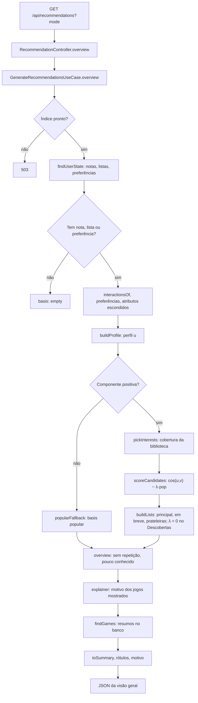

# Recomendação: núcleo de pontuação (B-32), rota (B-33), página (B-35), listas por interesse (B-71), estilos (B-74) e etiquetas (B-78)

O núcleo são funções puras em `apps/api/src/modules/recommendation/scoring/`, com os pesos
na seção `scoring` de `apps/api/config/recommendation.json`. Ele recebe o índice de
conteúdo (B-31) e o estado do usuário já carregado (avaliações, listas, preferências e modo)
e devolve a lista ordenada, com o motivo de cada jogo. O `GenerateRecommendationsUseCase`
lê o estado no banco, chama o núcleo e monta a resposta de `GET /api/recommendations`
(seção "A rota").

## Como funciona

1. **Peso de cada jogo da biblioteca:** `w = (nota − 3) + bônus das listas`. Sem nota,
   ficam só os bônus: favorito 2, concluído 1, quero jogar 0,5. Um jogo em duas listas
   (favorito com concluído ou com quero jogar) **soma os dois bônus**, porque cada lista é
   um sinal independente. Notas 1 e 2 afastam o perfil daqueles atributos; nota 3 é neutra.
2. **Perfil:** `u = Σ w_i · v_i + β · Σ e_f`, com `e_f` o vetor unitário de cada gênero ou
   tema escolhido na partida a frio e β = 1. O perfil é um vetor denso, com uma posição por
   atributo do índice.
3. **Candidatos:** os jogos do índice que o usuário não avaliou e que não estão em nenhuma
   lista, com vetor não vazio e **cosseno acima de zero**, para que todo jogo recomendado
   tenha ao menos um atributo a favor. Com poucos candidatos, a lista sai menor, sem
   completar com outros jogos.
4. **Pontuação:** `score = cos(u, v_j) − λ_modo · pop_j`, com λ de −0,2 em Populares, 0 em
   Equilibrado e +0,3 em Descobertas. Os vetores dos jogos têm norma 1, então
   `cos = u · v_j / ‖u‖`.
5. **Desempate:** sorteio fixo por usuário, pelo hash SHA-256 de `userId:gameId`, com o id
   do jogo como último critério.
6. **"Pouco conhecido":** só no modo Descobertas. Marca o jogo que está na lista mas ficaria
   fora dela se a ordem fosse só pelo cosseno (o mesmo corte, com λ = 0).
7. **Motivo:** ver a seção abaixo.
8. **Perfil sem nenhuma componente positiva** (só notas negativas ou neutras, que anulam
   também as preferências): os mais populares dos gêneros e temas preferidos, se algum
   candidato tiver um deles, ou do catálogo inteiro. O modo não muda essa lista, e o motivo
   são os preferidos que o jogo tem; no catálogo inteiro, não há motivo.

O núcleo indica a base da lista: `profile` (pelo perfil) ou `popular` (o caso 8, que
inclui o perfil vazio). A rota acrescenta `empty`, decidido antes do núcleo (seção "A
rota").

## Desempate: por que o sorteio não contradiz o B-12

O B-12 decidiu que a **popularidade não entra no desempate**: ela já está no λ do modo e,
no desempate, contaria duas vezes, uma delas invisível. O sorteio por usuário respeita
isso, porque não usa nenhum dado do jogo além do id.

O que mudou foi o critério entre empatados. O B-12 previa o identificador do jogo. Como o
id é um UUID aleatório, essa ordem já era arbitrária, mas era a mesma para todos os
usuários: quem tem gosto parecido veria sempre os mesmos empatados. Com o hash de
`userId + gameId`, a ordem continua determinística (o mesmo estado gera a mesma lista), mas
muda de um usuário para outro, o que aumenta a cobertura do catálogo, uma das métricas do
B-37.

## Motivo da recomendação

- **Gêneros e temas:** os até 3 de maior contribuição positiva, `u_k · v_jk / (‖u‖ · ‖v_j‖)`,
  da maior para a menor.
- **Palavras-chave nunca viram motivo**, nem como reserva. Elas não têm tradução no
  `feature-labels.json` e, raras, pesam mais justamente nos jogos com poucas etiquetas, o
  que reabriria o problema do B-12: motivos como "anxiety" e "rock climbing", em inglês e às
  vezes constrangedores.
- **Reserva, quando nenhum gênero ou tema contribui a favor:** "Porque você gostou de
  `<jogo>`", o jogo da biblioteca de maior contribuição positiva para o candidato,
  `w_i · cos(v_i, v_j)`, calculada só para os jogos da lista final. Ela existe sempre que o
  cosseno é positivo: a contribuição veio de um atributo que algum jogo de peso positivo da
  biblioteca também tem.
- **Perfil só de preferências declaradas:** não há jogo da biblioteca para a reserva, e ela
  não faz falta. As únicas componentes positivas do perfil são os gêneros e temas
  preferidos, então o motivo são os preferidos que batem com o jogo.
- **Blocos futuros:** a reserva também cobre os blocos do B-62 (modo de jogo e
  perspectiva) e do B-63 (palavras do resumo), que não viram motivo. Um jogo que só pontua
  por eles recebe "Porque você gostou de `<jogo>`".

## Medições no catálogo local (02/11/2026)

Catálogo local com 22.825 jogos, todos com vetor, e 43 gêneros e temas. Perfis sorteados
com semente fixa, lista de 20 itens:

- **por avaliações:** 200 perfis, cada um com quatro jogos sorteados, avaliados com 5, 5,
  4 e 1;
- **só por preferências:** 200 perfis, cada um com três gêneros ou temas sorteados.

**Tempo de uma recomendação**, em Node 24 local, fora da API:

| Perfis | Populares | Equilibrado | Descobertas |
| --- | --- | --- | --- |
| Por avaliações, mediana (p95) | 9,7 ms (13,0) | 8,9 ms (13,0) | 14,7 ms (18,8) |
| Só por preferências, mediana (p95) | 4,3 ms (7,4) | 4,3 ms (7,1) | 5,6 ms (10,9) |

A primeira versão ordenava todos os candidatos e levava de 43 a 93 ms de mediana, com picos
de 210 ms: calculava o hash do desempate em grupos de empate bem abaixo do corte. A versão
final só ordena os jogos que alcançam a pontuação do 20º; nos 400 perfis, as listas saíram
idênticas às da ordenação completa. Descobertas custa mais porque faz o segundo corte, só
pelo cosseno, para o "pouco conhecido". O tempo em produção é medido no M2 (RNF-03); a
carga do índice lá foi cerca de dez vezes mais lenta que a local (B-31).

**Empates no corte do top-20:**

| Perfis | Modo | Perfis com empate no corte | Tamanho do grupo empatado, mediana (p90) | Itens do top-20 decididos pelo sorteio, mediana |
| --- | --- | --- | --- | --- |
| Por avaliações | Populares | 31 de 200 | 3 (4) | 1 |
| Por avaliações | Equilibrado | 151 de 200 | 34 (416) | 13 |
| Por avaliações | Descobertas | 125 de 200 | 15 (102) | 6 |
| Só por preferências | Populares | 26 de 200 | 3 (4) | 1 |
| Só por preferências | Equilibrado | 120 de 200 | 11 (74) | 5 |
| Só por preferências | Descobertas | 99 de 200 | 11 (55) | 4 |

No Equilibrado, que não usa a popularidade, o sorteio decide a maior parte da lista nos
perfis por avaliações. A causa é a já registrada no B-12: muitos jogos têm vetores
idênticos, por terem poucas etiquetas (21,1% do catálogo tem vetor idêntico ao de 10 ou
mais jogos). Os blocos do B-62 e do B-63 diminuem esses empates, e o B-37 mede o efeito.

**Motivos e "pouco conhecido":**

- A reserva "Porque você gostou de" não apareceu em nenhum dos 24 mil itens: todo jogo
  recomendado tinha ao menos um gênero ou tema a favor.
- No modo Descobertas, 62% dos itens dos perfis por avaliações (2.494 de 4.000) e 39% dos
  perfis só por preferências (1.546 de 4.000) saíram marcados como "pouco conhecido". Com
  λ = 0,3, a popularidade muda a maior parte da lista. A calibração do λ é do B-37, e a
  forma de exibir a marca é do B-35.

## A rota (B-33)

`GET /api/recommendations?mode=&limit=`, autenticada. O contrato está em
`packages/contracts/src/recommendation.ts` e no Swagger.

1. **Índice indisponível:** com o índice carregando ou com falha, responde 503 com "As
   recomendações ainda não estão disponíveis; tente novamente em alguns instantes.", nunca
   lista vazia, que o jogador leria como falta de jogos para o gosto dele. O filtro de erros
   mantém a mensagem de um 5xx lançado de propósito e o registra como aviso; erro inesperado
   e 500 continuam com a mensagem genérica.
2. **Modo e limite:** `mode` em minúsculas e opcional; sem ele, vale o salvo no usuário. A
   consulta não grava a escolha: quem grava é o `PATCH /api/me`. `limit` de 1 a 50, padrão
   20.
3. **Estado do usuário:** avaliações, listas e preferências numa só transação. Nota e listas
   do mesmo jogo viram uma interação só.
4. **Partida a frio (`empty`):** decidida pelo que está gravado, e não pelo que o índice
   reconhece. Uma preferência sem posição no índice (um gênero que caiu abaixo do mínimo de
   jogos, com IDF zero) é ignorada; se só sobrar ela, o perfil fica vazio e a lista é a de
   populares, em vez de mandar de volta para a partida a frio quem acabou de fazê-la.
5. **Jogo da biblioteca fora do catálogo:** o índice só tem os jogos do catálogo, mas o jogo
   que saiu dele continua na biblioteca (B-27) e no perfil. Os atributos dele vêm do banco, e
   o vetor é montado com o mesmo `tfidfVector` e o IDF do índice: atributo fora do índice fica
   de fora, como nos outros jogos. O índice e os filtros de candidatos do B-32 não mudam.
   - **Por que importa:** pelas medições do B-61 e do B-13, entram cerca de 65 jogos por dia
     na carência, e de 84% a 89% deles saem 180 dias depois, a partir de abril de 2027. São
     os jogos que mais vão estar nas bibliotecas; deixá-los fora do perfil o pioraria aos
     poucos, sem erro visível.
   - **No motivo:** "Porque você gostou de" pode citar esse jogo. Ele vem com
     `inCatalog: false`, e a interface o mostra sem link, como na biblioteca.
6. **Resposta:** o resumo de cada jogo, como no catálogo, numa consulta só para os itens e os
   jogos citados nos motivos. Os gêneros e temas do motivo vêm com o nome em português, na
   ordem da contribuição, e os escondidos dos filtros ficam de fora. Um jogo que saiu do
   catálogo depois da última carga do índice sai da lista, que fica menor até a recarga.
7. **Pontuação:** não sai na resposta. Não é informação para o jogador, e o B-37 chama as
   funções puras direto.

### Tempo de resposta no catálogo local (03/11/2026)

Os mesmos perfis da medição do B-32 (semente fixa), gravados como contas de teste no banco
local e apagados depois: 200 por avaliações e 200 só por preferências, 20 itens, os três
modos. A API rodou com o build de produção (`node dist/main.js`), e o tempo inclui o banco,
a pontuação e a montagem da resposta.

| Perfis | Populares | Equilibrado | Descobertas |
| --- | --- | --- | --- |
| Por avaliações, mediana (p95) | 17,5 ms (20,8) | 16,8 ms (20,1) | 21,0 ms (25,6) |
| Só por preferências, mediana (p95) | 11,3 ms (14,6) | 11,1 ms (14,9) | 12,5 ms (17,8) |

A tabela traz o tempo medido pelo cliente, na mesma máquina. No log da API, as 1.200 requisições ficaram
em 15 ms de mediana, 21 ms no p95 e 54 ms no máximo.

### Tempo de resposta em produção (03/11/2026)

Medido logo depois do deploy do B-33, das 15:05 às 15:07 UTC, com o Render já acordado:
instância gratuita (0,1 CPU e 512 MB) e catálogo com 22.834 jogos. Duas contas de teste foram
criadas pela própria API, porque não há acesso direto ao banco de produção, e ficam lá até
existir a exclusão de conta (B-52): `medicao-m2-preferencias@example.com` e
`medicao-m2-avaliacoes@example.com`.

- **Só por preferências:** Quebra-cabeça, Plataforma e Terror.
- **Por avaliações:** quatro jogos sorteados do catálogo com semente fixa, com notas 5, 5, 4
  e 1, como na medição local: `time-for-bed`, `lavaloop`, `foundlings` e `banebush`.

Foram 30 chamadas por modo e por caminho, 20 itens, depois de 5 de aquecimento. O cliente
estava no Brasil e chamou a API direto no Render e pela Vercel, que é o caminho do navegador.
Todas as respostas vieram com `basis: profile` e 20 itens.

**Tempo medido pelo cliente, mediana (p95):**

| Perfil | Modo | Direto no Render | Pela Vercel |
| --- | --- | --- | --- |
| Por avaliações | Populares | 206 ms (795) | 293 ms (803) |
| Por avaliações | Equilibrado | 204 ms (701) | 218 ms (603) |
| Por avaliações | Descobertas | 202 ms (685) | 284 ms (694) |
| Só por preferências | Populares | 179 ms (209) | 205 ms (482) |
| Só por preferências | Equilibrado | 175 ms (313) | 205 ms (328) |
| Só por preferências | Descobertas | 177 ms (574) | 213 ms (790) |
| `GET /api/health`, para comparar | — | 139 ms (162) | 181 ms (274) |

**Tempo no servidor** (`durationMs` do log do Render), nas 360 requisições medidas, mediana
(p90):

| Perfil | Modo | Direto no Render | Pela Vercel |
| --- | --- | --- | --- |
| Por avaliações | Populares | 64 ms (167) | 65 ms (150) |
| Por avaliações | Equilibrado | 59 ms (415) | 32 ms (227) |
| Por avaliações | Descobertas | 64 ms (148) | 96 ms (209) |
| Só por preferências | Populares | 37 ms (71) | 33 ms (102) |
| Só por preferências | Equilibrado | 32 ms (69) | 32 ms (39) |
| Só por preferências | Descobertas | 37 ms (107) | 37 ms (102) |

No conjunto, o perfil por avaliações ficou em 62 ms de mediana e 658 ms no p95, e o só por
preferências em 33 ms e 213 ms.

**Leitura:**

- **Rede:** a maior parte do tempo. A rota de saúde, que só faz um `SELECT 1`, já leva
  139 ms daqui até o Render, e a Vercel acrescenta de 10 a 90 ms.
- **Servidor:** de 2 a 4 vezes o tempo local (15 ms), coerente com a carga do índice no Render,
  que também foi muito mais lenta que na máquina local (B-31).
- **Picos:**
  - **o que se vê:** acima de 400 ms no servidor, 18 das 180 requisições do perfil por
    avaliações (de 415 a 816 ms, cerca de 1 em 10) e 7 das 180 do só por preferências (de 497
    a 695 ms). Aparecem em todos os modos e nos dois caminhos, em intervalos regulares de cerca
    de 3 s no perfil por avaliações, e a rota de saúde não teve nenhum;
  - **causa provável:** a falta de CPU da instância gratuita, que fica limitada depois de um
    pico de uso, ou a coleta de lixo do Node. Não foi isolada.
- **Conclusão (RNF-03):** sem espera perceptível na demonstração. Fim a fim, a mediana ficou
  em cerca de 200 ms direto e de 205 a 293 ms pela Vercel. O pior caso fica abaixo de 1,1 s, e
  o jogador abre a lista uma vez por visita, não em sequência.
- **Se o pico aparecer no teste de usabilidade:** medir a coleta de lixo com `perf_hooks` e o
  limite de CPU, e reduzir a alocação por candidato no `rankCandidates`, que cria um objeto
  para cada um dos cerca de 22 mil jogos a cada requisição.

## Na interface (B-35)

A página `/recomendacoes` está descrita na seção 5 da proposta técnica ("Frontend e mesma
origem"). Sobre o que vem do núcleo:

- **Motivo:** "Recomendado por: Roguelike, Fantasia", em texto, na ordem da contribuição. Os
  gêneros e temas não viram links para o catálogo, porque o motivo não diz qual é gênero e
  qual é tema. "Porque você gostou de <jogo>" tem link só se o jogo continua no catálogo.
- **"Pouco conhecido":** um selo no cartão e, só no modo Descobertas, a frase "Pouco
  conhecido: o jogo entrou na lista por ser menos popular." acima da lista. A frase existe
  porque a marca é frequente: 62% dos itens nas medições do B-32. Na conferência local do
  B-35, um perfil com três jogos avaliados (`time-for-bed` e `lavaloop` com 5, `foundlings`
  com 4) teve os 20 itens marcados, e nenhum jogo em comum com a lista do Equilibrado. Em
  produção, o mesmo perfil teve 18 de 20 itens marcados (90%) e só 2 jogos em comum com o
  Equilibrado. É um indício de que o λ de 0,3 está dominando a afinidade, a verificar no B-37.
- **Listas `empty` e `popular`:** sem o seletor de modo, porque o modo não as muda.

## Limitação identificada (03/11/2026)

Em produção, um perfil com vários jogos de RPG e aventura bem avaliados e alguns de terror
recebeu só RPG e aventura no top-20.

- **Causa:** o perfil é um vetor único, `u = Σ w · v + β · Σ e_f`. O cosseno favorece o gosto
  dominante: um jogo de terror sem RPG nem aventura tem produto escalar pequeno com `u`, mesmo
  com a componente de terror positiva. O gosto secundário fica diluído.
- **Efeito:** os jogos que atendem o gosto secundário, justamente os menos expostos, quase nunca
  aparecem, o que contraria a proposta da plataforma. O corte fixo de 20 itens também prende o
  jogador.
- **Correção:** prateleiras por interesse, lista principal que intercala os interesses na
  proporção do peso de cada um e "ver mais" paginado, no B-71 (API) e no B-72 (interface). A
  regra e o registro do desvio estão na seção 12 da proposta técnica, item 4. No plano do
  B-71, a escolha dos interesses passou a ser pela cobertura da biblioteca (seção abaixo).

## Listas por interesse (B-71)

O núcleo deixa de devolver uma lista só e passa a montar, a partir do mesmo conjunto de
candidatos, a lista principal "Para você", a prateleira "Em breve no seu gosto" e uma
prateleira "Porque você curte `<atributo>`" para cada interesse. As funções estão em
`scoring/interests.ts` (interesses), `scoring/lists.ts` (prateleiras e intercalação) e
`scoring/overview.ts` (visão geral e páginas); os tamanhos, no bloco `scoring.lists` de
`config/recommendation.json`.

### Interesses pela cobertura da biblioteca

O registro da correção previa os interesses pelos maiores `u_k`. **Desvio decidido pelo autor
no plano do B-71:** o gosto dominante aparece como um grupo de atributos que andam juntos nos
mesmos jogos (RPG, Aventura, Fantasia e Ação). Pelos maiores `u_k`, com teto de 4, esse grupo
pode ocupar todas as vagas, e o gosto secundário (o terror do caso de produção) fica sem
prateleira; as cotas `u_k / Σ u` também dividiam o gosto dominante entre vários atributos e
encolhiam o secundário. Isso manteria o problema que o B-71 existe para resolver.

1. **Itens a cobrir:** cada jogo da biblioteca com peso `w > 0` e vetor, e cada preferência da
   partida a frio, como um item de peso β que só tem o próprio atributo.
2. **Candidatos:** os gêneros e temas com `u_k > 0`, sem os escondidos dos filtros (Indie) e
   sem os presentes em mais de 40% do catálogo (`interestMaxDocumentRatio`). A condição
   `u_k > 0` fica para que uma nota negativa possa anular um atributo. O limite de frequência
   foi decidido pelo autor depois da conferência no navegador (seção "Atributos genéricos",
   abaixo); a fração de cada atributo é contada na carga do índice, sem consulta nova, e vale
   só para a escolha dos interesses: os atributos genéricos continuam na pontuação, no perfil e
   no motivo.
3. **Escolha gulosa:** a cada passo entra o candidato com a maior soma dos pesos dos itens
   ainda não cobertos que o contêm; no empate, o de maior `u_k` e depois o de menor posição.
   **Alterado no B-74:** o empate passou a ser decidido pelo peso na biblioteca e depois pelo
   atributo menos frequente (seção "Estilos na recomendação").
   Para no máximo da configuração ou quando nenhum candidato cobre peso novo.
4. **Cota de cada interesse:** o peso que ele cobriu ao entrar, dividido pelo total coberto.
   No caso de produção (seis jogos de RPG, Aventura, Fantasia e Ação e dois de terror, todos
   com nota 5), entram um atributo do grupo dominante e o terror, com cotas de 6w contra 2w
   (75% e 25%); Aventura e Fantasia ficam de fora por não cobrirem nenhum jogo novo.

Como a escolha gulosa só ganha menos a cada passo, a ordem de entrada já é a ordem das cotas,
e é a ordem das prateleiras na página.

### Listas

- **Prateleira de um interesse:** os candidatos com o atributo, na ordem da pontuação do perfil
  inteiro, com o mesmo desempate; sobem primeiro os que também batem com os outros gostos (no
  caso de produção, o jogo de RPG e terror abre a prateleira de terror). "Em breve": os
  candidatos não lançados, na mesma ordem.
- **Lista principal:** posição a posição, entra o próximo jogo ainda não usado da prateleira
  com o maior déficit em relação à cota (`cota · n − c_k`); no empate, a de maior cota.
  Esgotadas as prateleiras, segue pelos candidatos restantes, na ordem da pontuação. Com cotas
  de 75% e 25%, o gosto secundário entra na 3ª, na 7ª e na 11ª posições. Com menos de 2
  interesses, é a ordem da pontuação, como antes.
- **Cortes:** cada prateleira é cortada em 200 e a principal em 100. As prateleiras bastam para
  preencher a principal: uma prateleira dá no máximo 100 jogos a ela, e no máximo 100 jogos já
  foram usados pelas outras. A configuração recusa um teto da principal acima do das
  prateleiras.
- **Visão geral sem repetição:** a principal mostra 20; depois, "Em breve" e os interesses, na
  ordem das cotas, cada um com até 10 jogos que ainda não apareceram. A prateleira com menos de
  4 some, e os jogos dela continuam livres para as seguintes. **Alterado em 05/11/2026 (ajuste
  de design do B-72):** a principal mostra 5, e cada prateleira até 5.
- **"Ver mais":** páginas de 20 da lista completa, com repetição; além do teto, a página vem
  vazia. A chave que não é uma lista atual do perfil (inclusive malformada) responde 404.
- **"Pouco conhecido":** no modo Descobertas, cada lista é montada também com λ = 0 (a
  principal, com as mesmas cotas). O jogo é marcado se não estaria entre os N primeiros dessa
  versão, N a posição do último jogo mostrado na lista completa.
- **Determinismo:** a soma do perfil passou a seguir a ordem do id do jogo. Antes, as
  interações vinham do banco sem ordem garantida, e a soma em ponto flutuante dependia dela; o
  teste usa uma combinação do fixture em que a ordem muda o último bit (subitem do B-36, trazido
  para o B-71 por decisão do autor).

### Valores iniciais

| Valor | Inicial | Justificativa |
| --- | --- | --- |
| Interesses | 4 | Meio da faixa de 3 a 5 do registro; a partida a frio exige 3 preferências, e com 5 a visão geral passaria de 80 cartões |
| Frequência máxima de um interesse no catálogo | 40% | Um atributo em quase metade do catálogo cobre a biblioteca inteira e impede a escolha dos outros interesses, e a prateleira dele não ajuda a descobrir nada; hoje tira só Aventura (54%) e o tema Ação (53%), e 30% daria o mesmo resultado |
| Mínimo por prateleira | 4 | Com 1 a 3 jogos, a prateleira parece quebrada |
| Visão geral | 5 na principal e 5 por prateleira (eram 20 e 10 até o ajuste de design do B-72, em 05/11/2026) | Com 5, cada lista vira uma fileira de capas e várias cabem na primeira tela; o corte das métricas do B-37 (@20) é a primeira página do "ver mais" da principal |
| Página do "ver mais" | 20 | — |
| Tetos | 100 na principal, 200 nas prateleiras | Nas páginas fundas a afinidade cai muito (registro da correção) |

### Atributos genéricos

A conferência no navegador reproduziu o caso de produção no catálogo local: seis jogos de RPG
com fantasia e dois de tiro com terror, todos com nota 5. Saiu um interesse só, Aventura: ela
estava nos oito jogos (os de terror eram 7 Days to Die e Amnesia: The Bunker) e cobriu a
biblioteca inteira no primeiro passo. Com um interesse, a principal voltou a ser a ordem da
pontuação, e o terror ficou sem prateleira, justamente o problema que o B-71 corrige.

Aventura está em 54% do catálogo e o tema Ação em 53%; o próximo atributo, Simulação, em 26%.
**Decidido pelo autor:** um gênero ou tema acima de 40% do catálogo não vira interesse. O fixture
anterior não pegou o caso porque não tinha um atributo genérico comum aos dois gostos; o teste
de regressão usa seis jogos de RPG, Fantasia e Aventura e dois de Tiro, Terror e Aventura, com
Aventura em todo o catálogo: sem o limite sai só Aventura, e com ele o gosto secundário vira o
segundo interesse e entra na 3ª posição da principal.

Com o limite, a mesma conferência deu RPG e Quebra-cabeça como interesses, com as duas
prateleiras e o segundo interesse no começo da principal. RPG cobriu sete dos oito jogos; o
oitavo, Amnesia, tem Quebra-cabeça, Tiro, Terror, Mistério, Furtividade e Sobrevivência, que
empatam na cobertura. O desempate pelo `u_k` escolheu Quebra-cabeça, que também está em Tunic e
Undertale, à frente de Terror, que está em 7 Days to Die e Undertale; a fatia de gêneros (40%)
contra a de temas (30%) também pesa. É o efeito anotado para a calibração do B-37.

### Cobertura dos interesses (03/11/2026)

Nos 200 perfis por avaliações (quatro jogos sorteados com semente fixa, notas 5, 5, 4 e 1;
semente 71, porque a do B-32 não ficou registrada), com 4 interesses no máximo. As três linhas
registram como a regra chegou aqui:

| Regra | Jogos com peso positivo cobertos | Perfis com todos cobertos | Perfis com 1 / 2 / 3 interesses |
| --- | --- | --- | --- |
| Cobertura, sem atributos acima de 40% do catálogo (regra atual) | 556 de 600 (92,7%) | 159 de 200 | 22 / 129 / 49 |
| Cobertura, sem o limite | 598 de 600 (99,7%) | 198 de 200 | 55 / 131 / 14 |
| Maiores `u_k` (registro original) | 560 de 600 (93,3%) | 160 de 200 | — |

- **Sem o limite:** a cobertura é quase total, mas porque Aventura (76 perfis) e Ação (54) cobrem
  muito sozinhas: nos 55 perfis com um interesse só, Aventura é o único em 27 e Ação em 19.
- **Com o limite:** os perfis com um interesse só caem de 55 para 22, e os com três sobem de 14
  para 49. A cobertura cai para 92,7% porque há jogos cujo único gênero ou tema visível é
  Aventura ou Ação. Com limite de 30%, os números são os mesmos.
- **Maiores `u_k`:** 40 perfis ficam com um dos três jogos de que gostaram sem prateleira nem
  cota.
- Os dois jogos sem cobertura na regra sem limite têm todos os gêneros e temas anulados pela
  nota 1.

### Tempo de resposta no catálogo local (03/11/2026)

Os mesmos 400 perfis (200 por avaliações e 200 só por preferências), gravados como contas de
teste no banco local e apagados depois, com o build de produção (`node dist/main.js`). Para
comparar, a mesma medição rodou na `main` de antes do B-71 (lista única de 20), com os mesmos
perfis. A visão geral foi medida com a regra atual, já com o limite de frequência. Tempo medido
pelo cliente, mediana (p95):

| Perfis | Modo | Lista única | Visão geral (B-71) |
| --- | --- | --- | --- |
| Por avaliações | Populares | 17,4 ms (21,0) | 28,6 ms (35,3) |
| Por avaliações | Equilibrado | 17,0 ms (21,3) | 29,4 ms (34,8) |
| Por avaliações | Descobertas | 21,6 ms (27,1) | 37,7 ms (45,2) |
| Só por preferências | Populares | 11,9 ms (14,8) | 21,6 ms (26,7) |
| Só por preferências | Equilibrado | 11,6 ms (15,3) | 22,0 ms (28,0) |
| Só por preferências | Descobertas | 13,1 ms (18,5) | 26,2 ms (35,1) |

O "ver mais", no Equilibrado: 24,0 ms (31,2) na página 1 da principal, 23,6 ms (31,4) na página
1 da primeira prateleira de interesse e 23,6 ms (32,2) na página 5 dela.

No log da API, a visão geral ficou em 26 ms de mediana, 39 ms no p95 e 157 ms no máximo (1.210
requisições), contra 15, 23 e 180 ms da lista única; as páginas, em 23, 30 e 43 ms (1.200
requisições). O custo quase dobrou: cada lista é ordenada até o teto (até 200, contra 20 antes),
e o modo Descobertas monta todas de novo com λ = 0. Nos 400 perfis, todos tiveram a prateleira
"Em breve" na visão geral; as prateleiras de interesse visíveis foram 1 em 22 perfis, 2 em 166 e
3 em 212, e a visão geral teve 60 cartões na mediana.

### Conferência e tempo em produção (03/11/2026)

Depois do deploy, a mesma conferência do navegador rodou contra https://indie-discovery.vercel.app
com uma conta nova (`b71-producao-2026-11-03@example.com`, registrada no B-52): seis jogos de RPG
com fantasia e dois de tiro com terror, todos com nota 5. As 16 conferências passaram:
- prateleiras de RPG e Quebra-cabeça, com o segundo interesse no começo da principal;
- a visão geral sem repetição (50 cartões);
- a página 1 do "ver mais" igual à principal;
- os tetos de 100 e 200, a página vazia além do teto e o 404 da lista desconhecida;
- a mesma visão geral para o mesmo estado;
- a página `/recomendacoes` com a principal, inclusive ao trocar para Descobertas.

Tempo medido pelo cliente, 30 requisições por linha depois de uma de aquecimento, mediana (p95):

| Requisição | Direto no Render | Pela Vercel |
| --- | --- | --- |
| Visão geral, Populares | 389 ms (1.091) | 407 ms (1.095) |
| Visão geral, Equilibrado | 368 ms (1.152) | 316 ms (1.103) |
| Visão geral, Descobertas | 400 ms (1.188) | 435 ms (1.380) |
| "Ver mais", principal, página 1 | 357 ms (987) | 410 ms (1.181) |
| "Ver mais", prateleira, página 1 | 303 ms (1.087) | 375 ms (900) |
| "Ver mais", prateleira, página 5 | 313 ms (902) | 383 ms (994) |
| `GET /api/health`, para comparar | 145 ms (395) | 166 ms (409) |

- **Servidor:** descontada a rede (o `health`), a visão geral leva de 200 a 250 ms no servidor,
  contra 33 a 62 ms da lista única no B-33. A proporção bate com a local (26 ms contra 15 ms) e
  com a diferença de cerca de dez vezes entre a máquina local e a instância gratuita do Render
  (0,1 CPU). O log do Render (`durationMs`) confirma o tempo exato no servidor.
- **Conclusão (RNF-03):** a mediana fim a fim fica perto de 400 ms, ainda sem espera
  perceptível, mas o p95 passa de 1 s, contra 600 a 800 ms no B-33. Se incomodar na
  demonstração, os candidatos a otimização são ordenar cada lista só até a profundidade pedida
  (a visão geral usa 20 da principal e poucas dezenas de cada prateleira, e não os tetos de 100
  e 200) e guardar as listas por usuário e modo até a próxima alteração da biblioteca.

## Estilos na recomendação (B-74)

> **Substituído em 07/11/2026 pelo B-78:** as etiquetas da comunidade Steam entraram no vetor,
> no lugar das palavras-chave, e ocupam o lugar dos estilos nos interesses, nas prateleiras
> (`tag:<slug>`, "Porque você curte `<etiqueta>`") e no motivo. Os estilos saíram do código. A
> regra e as medições estão em `docs/etiquetas.md`, seção 10; esta seção fica como registro.

Os 49 estilos curados de `config/styles.json` (`docs/estilos.md`) entram nos interesses, nas
prateleiras e no motivo. O vetor não muda.

- **Atribuição:**
  - Na carga do índice, um estilo vai para o jogo por uma das palavras-chave dele (pelo slug, inclusive as descartadas pelo TF-IDF) ou por um termo exato do resumo, como palavra inteira.
  - A consulta da carga traz o resumo e, numa consulta à parte na mesma transação, só as palavras-chave que pertencem a algum estilo.
  - O jogo da biblioteca que saiu do catálogo recebe os estilos pela mesma regra, com as palavras-chave e o resumo lidos do banco.
- **Interesses:**
  - Os estilos concorrem ao lado dos gêneros e temas, com o limite de 40% do catálogo.
  - Um estilo só concorre se a soma dos pesos dos jogos da biblioteca que o têm for positiva, o equivalente ao `u_k > 0`.
  - As preferências da partida a frio continuam só com gêneros e temas; oferecer estilos nelas fica para o B-34.
- **Desempate da cobertura**, para todos os atributos: pelo peso na biblioteca, contando os jogos já cobertos; depois, pelo menos frequente no catálogo; e por fim pela posição, com os estilos depois dos gêneros e temas. O `u_k` saiu do desempate.
- **Prateleira:** "Porque você curte `<estilo>`", com a chave `style:<slug>` e os candidatos que têm o estilo, também os que só o têm pelo resumo.
- **Motivo:**
  - A contribuição do estilo é a soma das contribuições das palavras-chave dele no vetor do jogo, e só conta se for positiva.
  - O estilo que veio só do resumo não entra, porque não contribuiu para a pontuação.
  - Uma palavra-chave pertence a um estilo só, para a mesma contribuição não contar duas vezes.

### Interesses e cobertura (04/11/2026)

Nos 200 perfis por avaliações da semente 71, a escolha de interesses da API dá exatamente o
cenário F do B-73 (`docs/estilos.md`, seção 5): o `styles:measure` confere os 200 perfis.

| | B-71 | B-74 |
| --- | --- | --- |
| Perfis com 1 / 2 / 3 interesses | 22 / 129 / 49 | 19 / 129 / 52 |
| Interesses que são estilos | — | 143 de 433 (33%) |
| Jogos com peso positivo cobertos por algum interesse | 556 de 600 (92,7%) | 567 de 600 (94,5%) |

Na visão geral, 105 dos 200 perfis por avaliações veem ao menos uma prateleira de estilo; as
mais frequentes são Roguelike, Aconchegante, Incremental e idle e Alienígenas. Os perfis só por
preferências não têm estilos, porque as preferências são só gêneros e temas.

### Tempo de resposta no catálogo local (04/11/2026)

As duas versões foram medidas na mesma sessão, com os mesmos 400 perfis e o build de produção.
O B-71 foi medido a partir da `main` do mesmo dia. Mediana no log da API (p95):

| Requisição | B-71 | B-74 |
| --- | --- | --- |
| Visão geral | 27 ms (41) | 33 ms (50) |
| "Ver mais" | 24 ms (32) | 29 ms (40) |

Pelo cliente, a visão geral por avaliações no Equilibrado foi de 30,4 ms para 37,2 ms de mediana.
O custo a mais vem das prateleiras de estilo e da soma das palavras-chave no motivo.

### Carga do índice (04/11/2026)

| | B-71 | B-74 |
| --- | --- | --- |
| Carga na inicialização | 1.253 ms | 2.086 ms |
| Recargas seguintes (5) | de 677 a 1.438 ms | de 1.499 a 1.743 ms |
| Memória retida pelo índice, com coleta de lixo forçada | 13,5 MB | 17,9 MB |

- **Duas otimizações, antes da medição:**
  - A atribuição pelo resumo, com uma expressão por estilo, levava cerca de 1 s nos 22.825 resumos. Passou a uma passada por resumo, com todos os termos numa expressão do mais longo ao mais curto, e cai para cerca de 0,3 s. Os termos que começam no mesmo ponto ou dentro de outro são conferidos à parte; a atribuição saiu igual à da regra com evidência nos 22.825 jogos.
  - As palavras-chave de estilo, como subconsulta por jogo, custavam cerca de 400 ms a mais. Viraram uma consulta à parte e ficam no tempo da consulta sem estilos.
- **Resultado:** a carga fica cerca de 0,8 s mais longa no local. Em produção, onde a carga foi cerca de dez vezes mais lenta que a local no B-31, isso pode somar alguns segundos ao tempo em que a rota responde 503 depois de um deploy ou de a instância acordar. Vale medir no B-76.
- **Memória:** o índice retém 4,4 MB a mais, as listas de estilos de cada jogo. Os resumos só passam pela carga. As medidas de heap e RSS do log da carga são fotos antes da coleta de lixo e crescem a cada recarga, nas duas versões.

### Conferência e tempo em produção (05/11/2026)

Depois do deploy, a conferência rodou contra https://indie-discovery.vercel.app com uma conta nova
(`b74-producao-2026-11-05@example.com`, registrada no B-52): seis roguelikes com nota 5 (Hades,
Dead Cells, Slay the Spire, Enter the Gungeon, Spelunky 2 e Risk of Rain 2). As 10 conferências
passaram:
- a prateleira `style:roguelike` "Roguelike" na visão geral, com o atributo do tipo `STYLE`;
- o "ver mais" dela até o teto de 200, com os jogos da visão geral na lista;
- o motivo com estilo em 5 cartões, também na página `/recomendacoes` (Dwarf Journey: Fantasia,
  Plataforma, Roguelike);
- a visão geral sem repetição (40 cartões), o 404 do estilo desconhecido e a mesma visão geral
  para o mesmo estado.

Tempo medido pelo cliente, das 14:40 às 14:43 UTC, 30 requisições por linha depois de uma de
aquecimento, mediana (p95):

| Requisição | Direto no Render | Pela Vercel | B-71 (direto / Vercel) |
| --- | --- | --- | --- |
| Visão geral, Populares | 411 ms (1.317) | 335 ms (1.081) | 389 / 407 ms |
| Visão geral, Equilibrado | 397 ms (1.188) | 372 ms (1.126) | 368 / 316 ms |
| Visão geral, Descobertas | 408 ms (1.197) | 396 ms (1.200) | 400 / 435 ms |
| "Ver mais", principal, página 1 | 374 ms (890) | 301 ms (990) | 357 / 410 ms |
| "Ver mais", `style:roguelike`, página 1 | 390 ms (1.098) | 378 ms (1.002) | 303 / 375 ms (prateleira de gênero) |
| `GET /api/health`, para comparar | 217 ms (232) | 170 ms (195) | 145 / 166 ms |

A mediana ficou na faixa do B-71, perto de 400 ms, e o p95 continua acima de 1 s (B-76). A rede
estava mais lenta que no B-71 (o `health` direto foi de 145 para 217 ms).

**Carga do índice em produção**, pelo log do Render, a do B-71 e a do B-74 no mesmo deploy:

| | B-71 (sem estilos) | B-74 | Diferença |
| --- | --- | --- | --- |
| Tempo | 11.300 ms | 12.905 ms | +1,6 s (+14%) |
| Heap depois da carga | 68,9 MB (+35,8) | 73,6 MB (+40,3) | +4,7 MB |
| RSS depois da carga | 194,8 MB (+90,6) | 201,2 MB (+94,4) | +6,4 MB |

Os estilos somam 1,6 s à carga em produção, o dobro do local (0,8 s), e não as dez vezes da
estimativa acima: parte da carga é espera pelo banco, que não depende da CPU da instância. A rota
responde 503 por cerca de 13 s depois de um deploy ou de a instância acordar. O RSS fica em
201 MB dos 512 MB da instância gratuita.

## Revisão do módulo (B-76)

O B-71, o limite de 40% e o B-74 mudaram a mesma lógica em sequência. O B-76 revisou o módulo
antes da interface do B-72: limpeza sem mudar o comportamento e otimizações que mantêm a resposta
idêntica, conferida por uma foto das respostas antes e depois.

### Fluxo de uma requisição da visão geral

| # | Etapa | Arquivo e função |
| --- | --- | --- |
| 1 | Valida o modo; sem ele, vale o salvo no usuário | `recommendation.controller.ts`, `overview` |
| 2 | Índice pronto, ou 503 | `generate-recommendations.use-case.ts`, `recommend` |
| 3 | Notas, listas e preferências numa consulta; os jogos fora do índice, com atributos e resumo, numa segunda, só quando houver | `recommendation.repository.ts`, `findUserState` |
| 4 | Sem nota, lista nem preferência: `basis: empty` | caso de uso |
| 5 | Interações, preferências e atributos escondidos (estes, uma vez por índice) | `scoring/profile.ts`, `interactionsOf`; caso de uso, `hiddenPositions` |
| 6 | Perfil `u` | `scoring/profile.ts`, `buildProfile` |
| 7a | Perfil sem componente positiva: os mais populares | `scoring/fallback.ts`, `popularFallback` |
| 7b | Interesses pela cobertura da biblioteca | `scoring/interests.ts`, `pickInterests` |
| 8 | Cosseno e pontuação dos candidatos, em vetores paralelos | `scoring/score.ts`, `scoreCandidates` |
| 9 | Principal, "Em breve" e prateleiras; no Descobertas, também com λ = 0 | `scoring/lists.ts`, `buildLists`, com `topBy` (`scoring/top.ts`) e `interleave` |
| 10 | Visão geral sem repetição e "pouco conhecido" | `scoring/overview.ts`, `overview` |
| 11 | Motivo dos jogos mostrados | `scoring/explain.ts`, `explainer` |
| 12 | Resumos dos jogos mostrados numa consulta; rótulos e motivo | `recommendation.repository.ts`, `findGames`; caso de uso, `present` |

Valores de `config/recommendation.json` em cada etapa:

| Etapa | Valores |
| --- | --- |
| Carga do índice | `tfidf.normalization` e `blockShares` (`globalTypeWeights` no modo global); os limites de frequência e as palavras-chave excluídas valem na ingestão |
| Perfil | `listBonus`, `preferenceWeight` |
| Interesses | `lists.maxInterests`, `lists.interestMaxDocumentRatio`, `preferenceWeight` |
| Pontuação | `popularityWeightByMode` |
| Listas e populares | `lists.mainCap`, `lists.shelfCap` |
| Visão geral | `overviewMainSize`, `overviewShelfSize`, `shelfMinItems` |
| "Ver mais" | `pageSize` |

### Diagnóstico (05/11/2026)

Medido no catálogo local (22.825 jogos), nos 400 perfis da semente 71 × 3 modos, com as funções
do módulo na ordem do caso de uso. Num perfil por avaliações no Equilibrado, a visão geral levava
26,7 ms de mediana: 13,9 na montagem das listas, 4,8 na pontuação, 5,1 na consulta dos resumos e
1,7 na leitura do estado; o resto ficava abaixo de 0,4 ms. No Descobertas, a segunda montagem com
λ = 0 somava cerca de 7,8 ms. Cada requisição alocava 8,3 MB no Equilibrado e 11,3 MB no
Descobertas, quase tudo na pontuação (um objeto por candidato, cerca de 17 mil) e nas listas. Pelo
perfil de CPU, a montagem das listas gastava 47% no `topBy` (ordenar todos os valores de cada
lista para achar o corte), 31% em achar a prateleira de cada atributo de cada candidato num `Map`
e 13% no desempate. Cada visão geral fazia 8 idas ao banco, além da sessão.

**Carga do índice:** com a CPU limitada a 0,1 núcleo no local (um *job object* do Windows), a
carga falhou: a transação passou do tempo-limite de 5 s do Prisma, e o índice ficou em `failed`.

**Produção (hipótese):** a instância gratuita tem 0,1 CPU, que o Linux entrega como cerca de
10 ms a cada 100 ms. A visão geral usava cerca de 25 ms de CPU, três janelas, o que bate com os
200 a 250 ms no servidor; a lista única do B-33 cabia em uma, e por isso a razão entre produção e
local não é fixa. O banco (Neon) está na mesma região da API (AWS US East). A medição em produção
com a metodologia do B-33 decide o critério.

### O que mudou

- **Carga do índice:**
  - tempo-limite da transação explícito, de 60 s, com a justificativa no código;
  - na inicialização, a carga que falha é tentada de novo depois de 10 s e de 30 s, e o health fica em `failed` enquanto não houver índice;
  - o log mostra cada tentativa e separa o tempo da transação e o da montagem.
- **Pontuação:** os candidatos em vetores paralelos (posição do jogo, cosseno e pontuação), sem um objeto por candidato.
- **Listas:**
  - a prateleira de cada atributo vem de uma tabela pela posição dele;
  - cada lista é um conjunto de índices de candidato;
  - o corte do `topBy` vem de uma seleção, sem ordenar todos os valores;
  - o resultado é o mesmo: os maiores pelo valor, com os empates pelo desempate do usuário.
- **Banco:** notas, listas e preferências numa consulta só, que já é um instantâneo, e os resumos dos jogos mostrados numa só. De 8 idas por visão geral para 2.
- **Limpeza, sem mudar o comportamento:**
  - um tipo para o atributo exibido (`DisplayedAttribute`) e um para o catálogo (`AttributeCatalog`), no lugar de dois de cada;
  - uma função para "gênero ou tema" (`isLabeledFeatureType`), no lugar de quatro definições;
  - uma conversão de rótulo no caso de uso, e o "Em breve" lido do tipo da lista;
  - a chave de estilo nos desempates num lugar só (`attributeKey`);
  - o estilo de cada palavra-chave e os atributos escondidos calculados uma vez por índice;
  - `interactionsOf` como função pura do perfil;
  - os campos da carga obrigatórios e a leitura do arquivo de config num lugar só (`recommendation-config.ts`);
  - `rank.ts` virou `score.ts`, o `topBy` saiu de `tie-break.ts` para `top.ts`, e o motivo interno passou a se chamar `ScoredReason`, sem colidir com o do contrato.
- **Contrato da API e `config/recommendation.json`:** sem mudança.

### Comparação das respostas

`pnpm --filter @indie/api recommendations:snapshot` (`src/snapshot-recommendations.ts`):
- **Contas:** cria as 400 contas da semente 71 no banco local, com ids fixos, porque o desempate depende do usuário, e as apaga no fim.
- **Chamadas:** chama o caso de uso para a visão geral e o "ver mais" de cada lista, nos três modos.
- **Saída e comparação:** grava o hash do JSON de cada resposta; `--compare` aponta as diferenças entre duas fotos.
- **Proteção:** como os e2e, recusa rodar fora de localhost.
- **Escopo:** a foto completa traz todas as páginas; a rápida, a primeira e a última.

| Passo | Foto | Respostas iguais à linha de base |
| --- | --- | --- |
| Linha de base (`main`) | completa | 47.541 (hash `9b3b37ef…`); a rápida, de outra execução, bate em 11.976 de 11.976 |
| Carga com nova tentativa e tempo-limite | rápida | 11.976 de 11.976 |
| Tipos e nomes | rápida | 11.976 de 11.976 |
| Consultas por índice e interações | rápida | 11.976 de 11.976 |
| Pontuação e listas | completa | 47.541 de 47.541 |
| Uma consulta para o estado e uma para os resumos | completa | 47.541 de 47.541 |

### Tempo local (05/11/2026)

As duas versões foram medidas na mesma sessão, com os mesmos 400 perfis, o build de produção e
2.400 requisições cada: visão geral nos três modos e "ver mais" da principal e de uma prateleira
(páginas 1 e 5). A `main` foi medida pelo build dela, antes do B-76. Mediana (p95):

| Requisição | `main` | B-76 |
| --- | --- | --- |
| Visão geral, no servidor | 29 ms (43) | 19 ms (27) |
| "Ver mais", no servidor | 25 ms (34) | 17 ms (23) |
| Visão geral por avaliações, Equilibrado, no cliente | 32,6 ms (41,9) | 21,1 ms (26,0) |
| Visão geral por avaliações, Descobertas, no cliente | 40,6 ms (49,5) | 26,3 ms (32,8) |
| Visão geral por preferências, Equilibrado, no cliente | 23,9 ms (31,1) | 17,4 ms (23,8) |

No protótipo, medido sozinho, a pontuação e as listas foram de 17,3 para 8,1 ms de mediana, e a
alocação delas de 5,9 para 2,0 MB por requisição. A leitura do estado foi de 1,6 para 0,7 ms e a
dos resumos de 4,8 para 2,9 ms.

**Carga do índice:** não mudou. Na inicialização, 2.216 ms na `main` e 1.956 ms no B-76
(transação 1.188 ms, montagem 768 ms). Nas cinco recargas seguintes, de 1.273 a 1.429 ms na `main`
e de 1.257 a 1.338 ms no B-76 (transação de 664 a 751 ms, montagem de 571 a 633 ms).

**Produção:** pela hipótese da cota de CPU, a visão geral cairia de cerca de três janelas de
100 ms para duas. A medição está na seção seguinte.

### Conferência e tempo em produção (05/11/2026)

Depois do deploy (índice carregado às 18:29:50 UTC), duas rodadas com a metodologia do B-33,
direto no Render e pela Vercel. O perfil é o da conferência do B-74: seis roguelikes com nota 5.
As contas `b76-producao-2026-11-05@example.com` e `b76-producao-2-2026-11-05@example.com` estão
registradas no B-52. Nas duas rodadas, as 7 conferências passaram:
- a visão geral vem pelo perfil nos três modos, com a prateleira `style:roguelike`;
- o mesmo estado dá a mesma visão geral.

**Regra de decisão**, fixada pelo autor antes da segunda rodada:
1. todas as linhas de recomendação com p95 abaixo de 1 s: critério atingido;
2. alguma acima de 1 s, com cauda parecida na rota de saúde da mesma rodada: limitação da instância gratuita, e o item fecha como atingido no que depende do código;
3. alguma acima de 1 s sem essa cauda: parar e levar os números ao autor.

Mediana (p95), por linha:

| Requisição | 30 amostras, 18:31–18:34 UTC: direto | 30 amostras: Vercel | 100 amostras, 18:39–18:48 UTC: direto | 100 amostras: Vercel |
| --- | --- | --- | --- | --- |
| Visão geral, Populares | 205 ms (900) | 306 ms (1.082) | 201 ms (708) | 210 ms (786) |
| Visão geral, Equilibrado | 200 ms (889) | 214 ms (585) | 200 ms (788) | 206 ms (696) |
| Visão geral, Descobertas | 205 ms (811) | 224 ms (1.086) | 201 ms (698) | 288 ms (687) |
| "Ver mais", principal p. 1, Populares | 201 ms (723) | 221 ms (545) | 201 ms (791) | 207 ms (686) |
| "Ver mais", principal p. 1, Equilibrado | 202 ms (716) | 200 ms (608) | 200 ms (618) | 204 ms (675) |
| "Ver mais", principal p. 1, Descobertas | 202 ms (724) | 208 ms (610) | 203 ms (905) | 243 ms (711) |
| "Ver mais", `style:roguelike` p. 1, Populares | 202 ms (599) | 205 ms (806) | 201 ms (689) | 205 ms (515) |
| "Ver mais", `style:roguelike` p. 1, Equilibrado | 200 ms (904) | 207 ms (815) | 201 ms (708) | 209 ms (893) |
| "Ver mais", `style:roguelike` p. 1, Descobertas | 200 ms (811) | 206 ms (724) | 202 ms (807) | 213 ms (724) |
| Todas as de recomendação juntas | 201 ms (809) | 208 ms (806) | 201 ms (709) | 209 ms (696) |
| `GET /api/health` | 143 ms (344) | 168 ms (237) | 146 ms (152) | 164 ms (190) |

- **Resultado (regra 1):** nas 100 amostras, todas as 18 linhas de recomendação ficaram com p95
  abaixo de 1 s; a maior foi 905 ms. **Critério do B-76 atingido.**
- **Mediana:** cerca de 200 ms em todas as linhas, contra cerca de 400 ms no B-74 (seção
  "Conferência e tempo em produção" dos estilos). Ficou perto da rota de saúde (cerca de 145 ms):
  o servidor passou de cerca de 200 ms para cerca de 60 ms, como a hipótese da cota de CPU previa.
- **Primeira rodada:** com 30 amostras, o p95 é o segundo maior valor. Duas linhas passaram de 1 s
  por 82 e 86 ms, ambas pela Vercel, numa rodada em que a rota de saúde também teve cauda (p95 de
  344 ms).

**Carga do índice em produção**, pelo log do Render, com a divisão nova:

| | Local (inicialização) | Produção |
| --- | --- | --- |
| Total | 1.956 ms | 13.304 ms |
| Transação | 1.188 ms | 7.097 ms |
| Montagem | 768 ms | 6.207 ms |
| Heap depois da carga | — | 74,6 MB (+41,4) |
| RSS depois da carga | — | 184,3 MB (+78,0) |

- **Folga até o tempo-limite:** a transação usou 7,1 s dos 60 s (12%), com cerca de 53 s de
  folga, oito vezes a duração dela.
- **Proporção:** em produção, as duas etapas ficam perto de dez vezes as recargas locais
  (transação cerca de 0,7 s, montagem cerca de 0,6 s). A montagem é só CPU, o que reforça a
  hipótese da cota de CPU.

### Fora do B-76

Aprovado no plano:
- **Cache das listas por usuário e modo.** Na primeira rodada, a cauda apareceu também na rota de
  saúde, que quase não usa CPU, e o cache só acelera repetições: a primeira visão geral depois de
  uma avaliação continuaria igual. Na segunda rodada, o critério foi atingido sem ele.
- **Hash mais barato no desempate:** muda a ordem dos empatados.
- **Tetos e tamanhos menores:** mudam o config e o "ver mais".
- **Índice invertido de atributo para jogos:** cerca de 2 MB a mais no índice, por uns 3 ms.
- **Vetores da carga sem chave de texto:** risco de mudar o último bit dos pesos.
- **Estilos gravados na ingestão:** mudam a ingestão e o schema.
- **Consulta de sessão do guard:** é de outro módulo.
- **Plano pago do Render:** tem custo.

- **Lista de populares:** não respeita o modo, como previsto na proposta.
- **Filtros:** a rota não recebe filtros (por exemplo, só "em breve"), porque nenhuma tela do
  P0 os usa (decidido no B-33).

## Interface da visão geral e do "ver mais" (B-72)

A interface está descrita na seção 5 da proposta técnica. O módulo de recomendação só mudou num
ponto: a resposta do "ver mais" ganhou `basis`, como a da visão geral, para a página tratar a lista
de populares e a vazia. É a exceção ao "contrato sem mudança" do B-76, decidida pelo autor no plano
do B-72.

### Comparação das respostas (05/11/2026)

Depois da mudança, a foto completa foi comparada com a linha de base do B-76 (`--compare`). Uma
cópia da foto, só no ambiente de desenvolvimento, gravou também o hash de cada página sem o campo
`basis`:

| Comparação com a linha de base do B-76 (hash `9b3b37ef…`) | Respostas iguais |
| --- | --- |
| Visão geral (400 perfis, três modos) | 1.200 de 1.200 |
| Páginas do "ver mais", com `basis` | 0 de 46.341 |
| Páginas do "ver mais", sem `basis` | 46.341 de 46.341 |

A única diferença é o campo novo. A foto completa de depois do B-72 (47.541 respostas, hash
`118524c3…`) é a linha de base vigente para as próximas mudanças no módulo.

### Ajuste de design: listas em fileira de capas (05/11/2026)

Na visão geral, "Para você" e cada prateleira viraram uma fileira com as capas de 5 jogos
(`overviewMainSize` de 20 para 5 e `overviewShelfSize` de 10 para 5). A foto completa foi
comparada com a linha de base acima:

| Comparação com a linha de base do B-72 (hash `118524c3…`) | Respostas iguais |
| --- | --- |
| Visão geral (400 perfis, três modos) | 0 de 1.200 |
| Páginas do "ver mais" | 46.341 de 46.341 |

Só a visão geral mudou, como previsto: o "ver mais" não depende dos tamanhos da visão geral. A
mesma execução montou cada visão geral também com os tamanhos antigos (20 e 10):

| Perfis (visões gerais nos três modos) | Jogos na principal | Prateleiras por visão geral | Jogos nas prateleiras |
| --- | --- | --- | --- |
| 200 por avaliações (600) | de 20 para 5 | 3,17 antes e depois | de 31,6 para 15,8 |
| 200 por preferências (600) | de 20 para 5 | 3,81 antes e depois | de 38,1 para 19,1 |

Nenhuma visão geral ganhou ou perdeu prateleira. Com a principal mostrando 5, os outros 15 jogos
que ela mostrava ficam livres para as prateleiras abaixo, que continuam cheias, com 5 cada; o que
muda é quais jogos entram nelas. A foto nova (47.541 respostas, hash `8dc8b107…`) é a linha de
base vigente.
